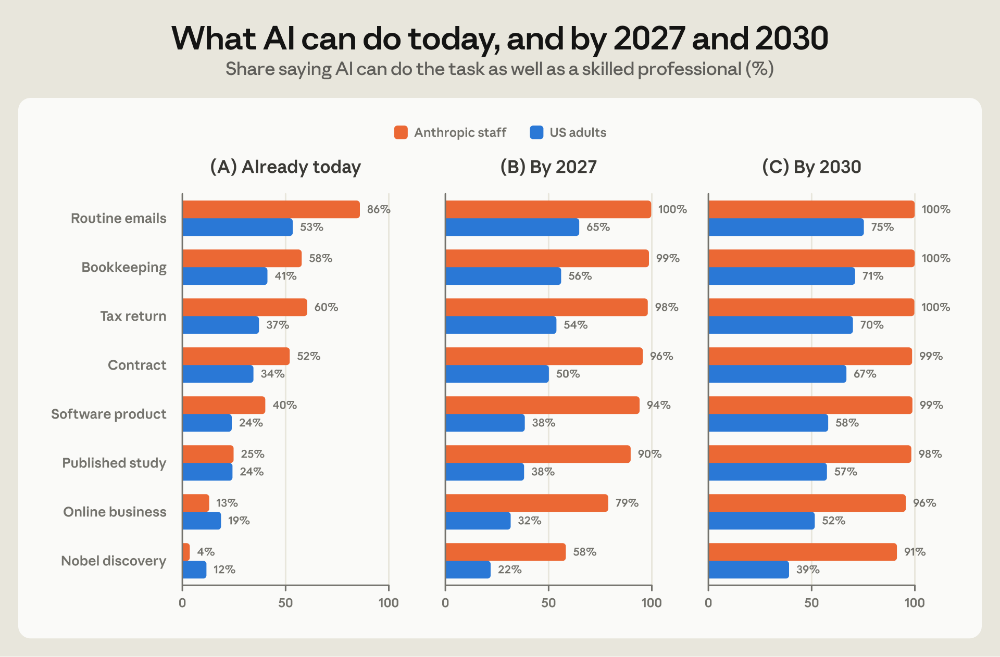
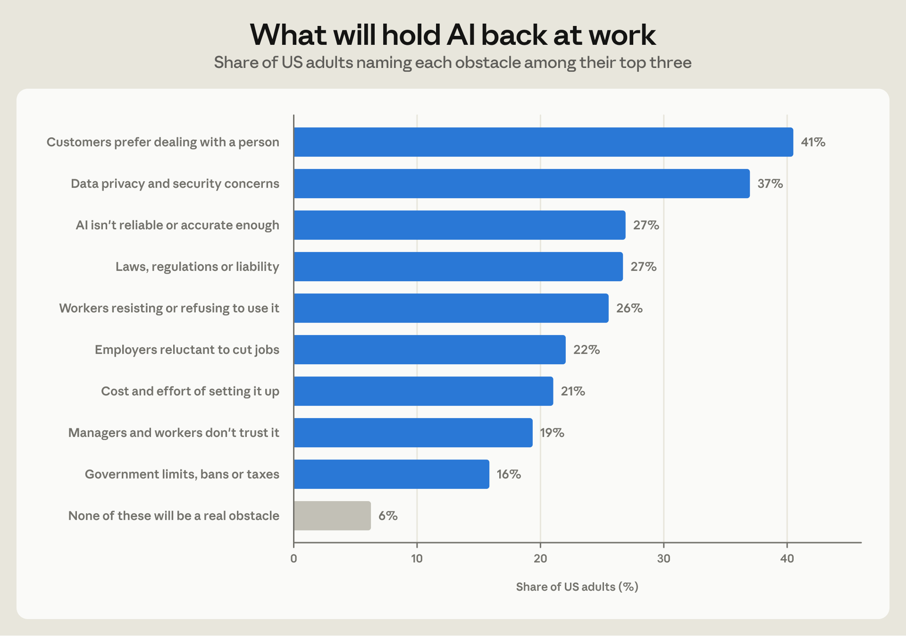
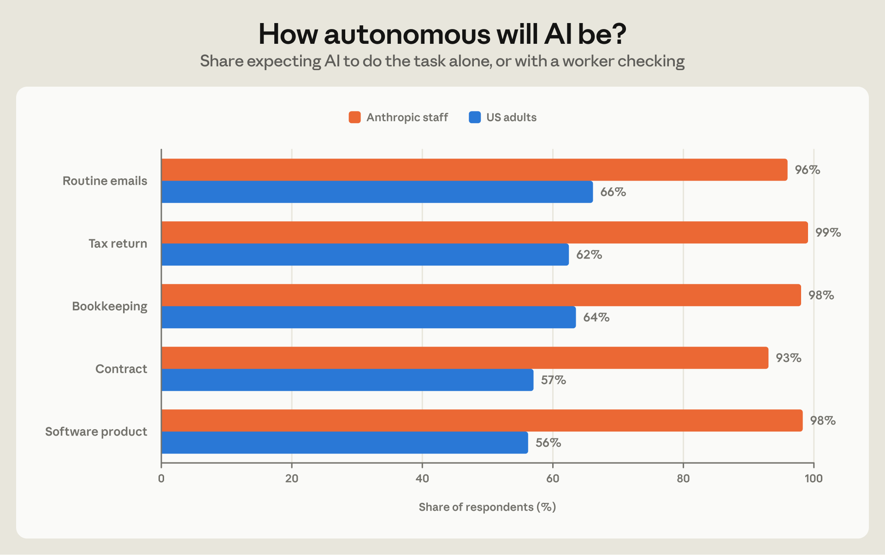
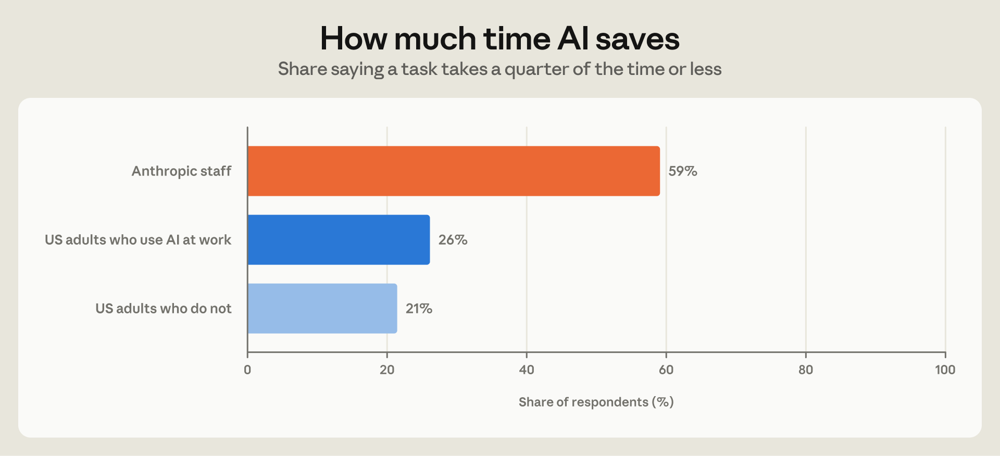
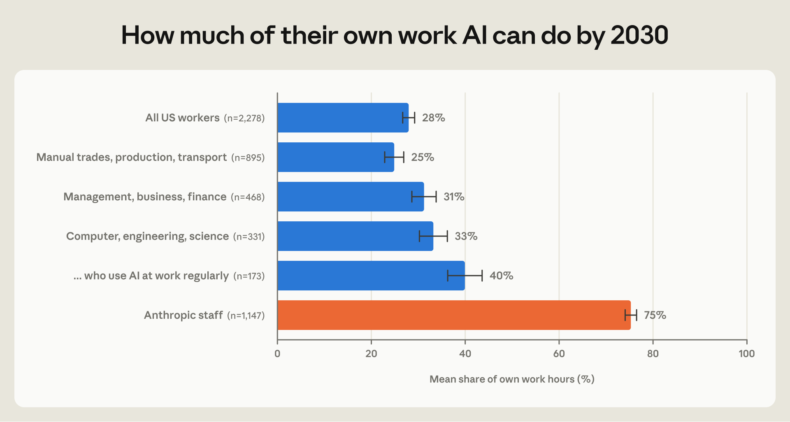
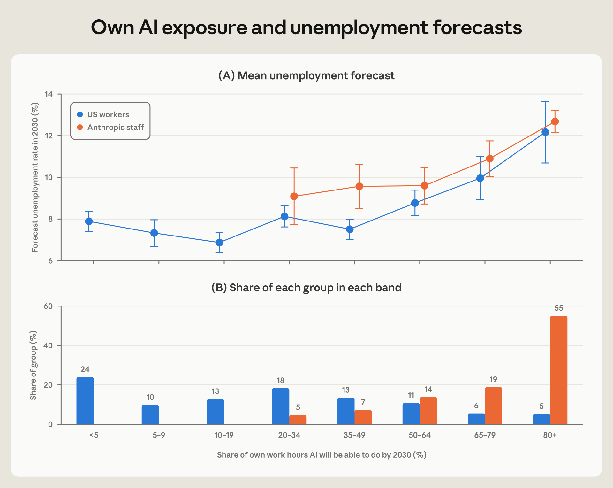
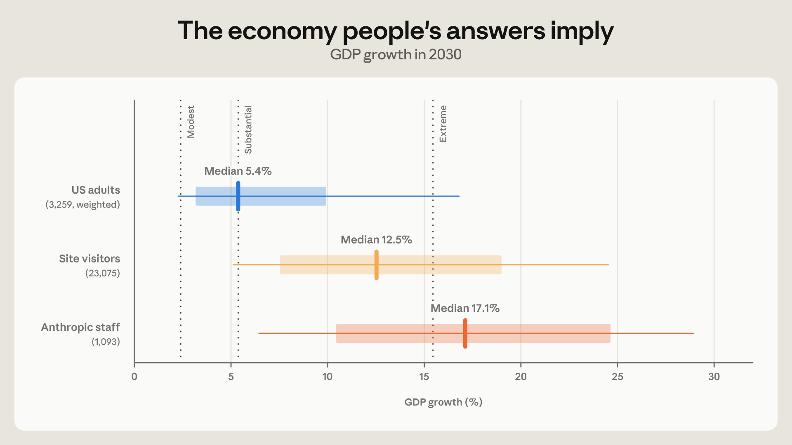
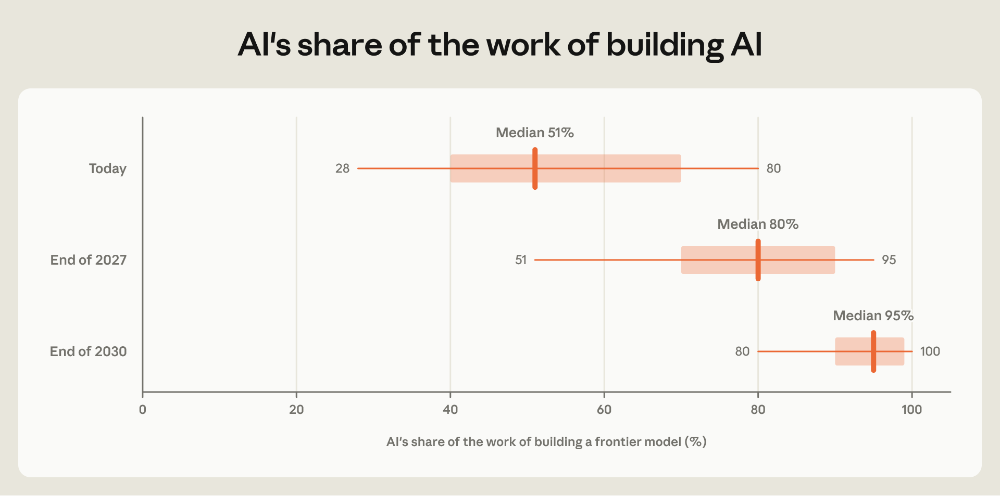

## Table of contents

Anthropic이 2026년 10월 16일 [고용 보고서](/employment-at-anthropic)와 함께 낸 두 번째 보고서가 [The AI expectations gap](https://www.anthropic.com/research/ai-expectations-gap)이다. 두 보고서를 묶은 소개 글의 제목이 [Working at the frontier shapes expectations for the future](https://www.anthropic.com/research/expectations-for-the-future)라서, 이 제목으로 인용되기도 한다. 저자는 Szymon Sacher, Tess Cotter, Charles I. Jones, Anton Korinek, Peter McCrory다.

고용 보고서가 "AI를 가장 깊게 쓰는 회사에서 일이 어떻게 바뀌었나"를 다뤘다면, 이 보고서는 그 경험이 미래에 대한 기대를 어떻게 바꾸는지 묻는다. AI를 매일 만들고 쓰는 사람들과 일반 대중에게 같은 질문을 던지고 답을 비교했다.

# 조사 방법

| | 미국 성인 | Anthropic 직원 |
| --- | --- | --- |
| 조사 시기 | 2026년 8월 11~23일 | 2026년 8월 9~12일 |
| 응답자 | 10,980명 | 1,334명 |
| 방식 | Morning Consult 온라인 패널, 성인 인구 기준 가중치 적용 | 사내 설문, 가중치 없음 |
| 미래 시점 | 절반은 2027년, 절반은 2030년으로 질문 | 전원 2030년으로 질문 |

질문은 AI가 할 수 있는 일, 얼마나 널리 쓰일지, 시간을 얼마나 줄여줄지, 얼마나 자율적으로 일할지, AI 때문에 일자리를 잃은 사람이 다른 직종에서 다시 일자리를 찾기까지 얼마나 걸릴지 등이다.

# 핵심 발견

1. **지금 AI가 할 수 있는 일에 대해서는 대체로 같은 생각이다. 갈리는 것은 앞으로의 속도다.** 2030년까지 AI가 노벨상급 발견을 할 수 있다고 본 비율은 미국 성인 39%, 직원 91%다.
2. **AI로 줄어드는 시간도 다르게 본다.** AI가 잘하는 일을 AI로 하면 원래의 4분의 1 이하 시간이면 된다고 답한 비율은 AI를 업무에 쓰는 미국 성인 26%, 직원 59%다.
3. **자기 일에 대해서는 차이가 가장 크다.** 2030년까지 AI가 현재 업무의 80% 이상을 할 수 있다고 본 비율은 미국 근로자 5%, 직원은 과반이다.
4. **노동시장을 생각하는 방식은 같다.** 두 집단 모두 AI가 자기 일을 더 많이 하리라고 볼수록 실업률을 높게 예측했다. 자기 일이 자동화될 거라고 보는 정도가 같으면, 예측한 실업률도 거의 같다.

# AI가 할 수 있는 일

두 집단에게 일상적인 이메일 작성부터 노벨상급 과학적 발견까지 여덟 가지 작업을 주고, AI가 숙련된 전문가만큼 해낼 수 있는 시점을 물었다.

_왼쪽부터 "이미 할 수 있다", "2027년까지", "2030년까지"라고 답한 비율. 주황이 Anthropic 직원, 파랑이 미국 성인이다. 지금 기준으로는 두 집단이 작업 난이도 순서를 거의 똑같이 매기고, 복잡한 작업일수록 차이가 작다. 2030년에는 직원 쪽이 모든 작업에서 91~100%다. 출처: Anthropic_

- 과학 연구를 설계하고 수행해 논문으로 내는 일은 지금 할 수 있다는 응답이 두 집단 모두 4분의 1 정도다. 그런데 내년까지 가능하다고 본 비율은 직원 10명 중 9명, 미국 성인 38%다.
- 미국 성인은 작업에 따라 19~40%가 "AI는 이 일을 절대 못 한다"고 답했다. 직원 중에는 많아야 2%다. 보고서는 이 차이를 가장 눈에 띄는 차이로 꼽았다.
- AI를 얼마나 자주 쓰는지에 따라서도 갈린다. 2030년까지 여덟 개 중 일곱 개 이상이 가능하다고 본 비율은 AI를 써 본 적 없는 사람 28%, 미국 성인 전체 41%, 업무에 AI를 꾸준히 쓰는 사람(응답자의 약 5분의 1) 56%, 직원 96%다.

# 도입을 막는 것

능력이 있다고 바로 쓰이지는 않는다. 2030년까지 AI가 할 수 있게 될 업무 중 실제로 AI로 처리될 비율을 미국 성인은 42%, 직원은 65%로 봤다.

미국 성인에게는 무엇이 도입을 막을지도 물었다(직원에게는 묻지 않았다). 기술적 한계보다 사람의 선호와 제도를 더 큰 장벽으로 봤다.

_장벽을 최대 세 개까지 고르게 해서 합이 100%를 넘는다. 고객이 사람 상대를 선호함(41%), 개인정보·보안 우려(37%), AI의 신뢰성 부족과 법·규제·책임 문제(각 27%) 순이다. 출처: Anthropic_

업무에 AI를 꾸준히 쓰는 미국 성인은 순서가 다르다. 개인정보·보안 우려를 1순위로 꼽고(42%, 나머지는 37%), 고객 선호는 조금 덜 중요하게 봤다(37%, 나머지는 42%).

# AI는 얼마나 혼자 일할까

AI가 혼자 일하면 사람을 대체하고, 사람을 도우면 사람의 생산성을 올린다. 그래서 2030년에 다섯 가지 작업을 누가 하게 될지 물었다.

_"AI가 혼자 한다" 또는 "AI가 대부분 하고 사람은 검토한다"를 고른 비율. 직원은 모든 작업에서 93~99%이고, 미국 성인은 56~66%다. 미국 성인 10명 중 4명은 사람이 대부분 하거나 AI의 도움을 조금 받을 거라고 봤다. 출처: Anthropic_

# AI로 줄어드는 시간

AI가 사람을 겨우 대체할 정도의 기술이면 일자리만 없애고 GDP는 별로 늘지 않는다. 반대로 같은 일을 훨씬 적은 시간에 끝내면 GDP가 의미 있게 오른다. 그래서 AI가 잘하는 일(문서 요약, 이메일 초안 등)을 AI로 하면 검토와 수정 시간까지 포함해 얼마나 걸리는지 물었다.

_원래 시간의 4분의 1 이하로 줄어든다고 답한 비율. 출처: Anthropic_

직원의 85%는 절반 이하 시간이면 된다고 했다. AI를 업무에 쓰는 미국 성인의 대표적인 답은 "절반"이었고, 29%는 시간이 그대로거나 오히려 더 걸린다고 답했다. 직원 중에는 이렇게 답한 사람이 5%뿐이다. 보고서는 직원들이 실제로 겪은 일을 답했을 가능성이 있다고 보고, 고용 보고서의 결과(코딩 에이전트 도입 다음 달 엔지니어가 추가한 코드량이 3배가 됨)를 근거로 든다.

# 내 일은 얼마나 AI가 하게 될까

차이가 가장 큰 질문이다.

_2030년까지 AI가 자기 업무 시간 중 얼마를 할 수 있을지에 대한 평균 응답. 미국 쪽은 일하는 사람만 집계했다. 컴퓨터·엔지니어링·과학 직군에서 AI를 꾸준히 쓰는 사람도 40%로, 직원(75%)보다는 미국 근로자 평균(28%)에 더 가깝다. 출처: Anthropic_

미국 근로자는 평균 28%, 직원은 평균 75%로 답했다. 미국 근로자 중 80% 이상이라고 답한 사람은 20명 중 1명이다. 직군별로는 육체노동·생산·운송직 25%, 컴퓨터·엔지니어링·과학 직군 33%다.

# 실업률 예측: 생각하는 방식은 같다

응답자에게 현재 미국 실업률이 약 4.2%라고 알려주고 2030년 실업률을 예측하게 했다. 그리고 "AI가 내 일을 얼마나 할 수 있을지"에 따라 응답자를 묶어 평균을 냈다.

_위: 구간별 2030년 실업률 예측 평균. 같은 구간에서는 두 집단의 예측이 거의 같다. 아래: 각 구간에 속한 응답자 비율. 직원의 55%가 80% 이상 구간에 몰려 있고, 미국 근로자는 5% 미만 구간이 24%로 가장 많다. 출처: Anthropic_

- 미국 근로자 중 AI가 자기 일의 절반 미만을 할 거라고 본 사람은 실업률을 7~8%로 예측했다.
- 절반을 넘으면 비율이 클수록 예측 실업률도 올라간다. 80% 이상이라고 본 사람은 평균 12.2%로, 글로벌 금융위기 때의 최고치보다 높다.
- 미국 근로자 전체로 보면 AI가 할 수 있는 업무 비율이 10%p 늘 때 예측 실업률이 0.4%p 올라간다.
- AI 전반에 대한 낙관은 이 차이를 설명하지 못한다. 자기 업무 노출 정도가 같으면, 여덟 가지 작업 중 AI가 몇 개를 해낼 거라고 보는지는 실업률 예측과 관계가 없다.

직원들에게서도 같은 기울기가 나온다. 보고서의 결론은 두 집단이 AI와 노동시장에 대해 다른 이론을 가진 것이 아니라는 것이다. AI가 무엇을 할 수 있는지를 서로 다르게 겪었고, 그래서 기대가 다르다.

# 채용과 재취업

직원들은 AI가 자기 일 대부분을 하게 될 거라고 보면서도, 회사는 계속 사람을 뽑을 거라고 봤다. 직원의 95%가 앞으로 12개월간 인원이 늘 거라고 답했다. 증가율의 중앙값은 66%였고, 27%는 두 배 이상을 예상했다. 회사의 계획이 아니라 개인 의견이다. 그래도 업무가 자동화되는 것과 일자리가 줄어드는 것은 다른 예측이라는 점은 보여준다.

AI 때문에 일자리를 잃은 사람이 다른 직종에서 일을 다시 찾는 데 걸리는 시간은 직원 쪽이 조금 더 비관적이었다. 직원 응답의 중앙값은 12개월, 미국 성인은 7~12개월 구간이다. 평소에는 실직 후 재취업까지 3개월 정도 걸린다고 알려주고 물었다.

# 이 기대대로라면 경제는 얼마나 성장할까

보고서는 응답을 앞서 Anthropic이 발표한 경제 모델(Economic Scenarios for Transformative AI)에 넣었다. AI 능력, 도입 속도, 자율성, 시간 절감, 재취업 마찰의 다섯 가지 답을 모두 한 응답자(미국 성인 3,259명, 직원 1,093명)를 대상으로, 각자의 답대로라면 2030년 GDP 성장률이 얼마가 되는지 계산했다.

_굵은 막대는 25~75분위, 가는 선은 10~90분위 구간이다. 점선은 모델의 세 시나리오로, 왼쪽부터 Modest(연 2.4%), Substantial(5.4%), Extreme(15.4%)이다. 출처: Anthropic_

- 미국 성인의 중앙값은 5.4%다. 평소 성장률의 두 배가 넘는다.
- 직원의 중앙값은 17.1%다. 이 속도면 GDP가 4년 반마다 두 배가 된다. 보고서는 역사상 전례가 없는 변화라고 표현했다.
- 9월 9일 공개한 온라인 [시나리오 탐색기](https://www.anthropic.com/institute/econ-scenarios)에서 48시간 동안 140여 개국의 23,075명이 같은 질문에 답했다. 중앙값은 12.5%로 두 집단 사이에 있다. 일부러 찾아와 퀴즈를 푼 사람들이라 일반인보다 AI에 관심이 많은 집단이다.

세 집단 모두 안에서도 편차가 커서 분포가 넓게 겹친다.

# 연구소 안에서 보는 AI의 AI 개발

직원이 더 낙관적인 이유 중 하나는 개발 과정을 가까이서 보기 때문일 수 있다. 그래서 직원들에게 2026년 초 수준의 최신 모델을 만드는 일 중 AI가 하는 몫이 얼마인지, 앞으로는 얼마가 될지 물었다.

_세로 눈금은 중앙값, 상자는 25~75분위, 선은 10~90분위다. 현재 추정은 28%에서 80%까지 넓게 퍼져 있다. 출처: Anthropic_

중앙값은 현재 51%, 2027년 말 80%, 2030년 말 95%다. 모델 개발에 가장 가까운 리서치팀은 현재 몫을 평균 60%로, 나머지 응답자(53%)보다 조금 높게 봤다. 다만 팀 사이의 차이보다 같은 팀 안의 차이가 훨씬 크다. 이 질문은 코드 작성 비율보다 넓다. 연구 방향 설정, 실험 설계와 평가까지 포함한다. 참고로 Anthropic 코드베이스에 머지되는 코드의 80% 이상은 이미 Claude가 쓴다.

# 읽을 때 주의할 점

- **직원 설문은 사내 설문이다.** 가중치를 적용하지 않았다. 채용 전망과 AI 개발 비율은 회사의 계획이나 측정이 아니라 직원 개인의 추정이다.
- **미국 성인 표본은 온라인 패널이다.** 인터넷을 쓰지 않는 성인은 빠지고, 인구 구성 가중치로 바로잡을 수 없는 차이가 있을 수 있다.
- **질문 시점이 다르다.** 미국 성인은 절반만 2030년을 기준으로 답했고, 직원은 전원 2030년 기준이다. 본문 수치는 2030년 응답 기준이다.
- **수치는 시기에 따라 움직인다.** 9월 17~24일에 미국 성인 7,613명에게 같은 질문을 다시 했더니, 노벨상급 발견 응답이 39%에서 44%로 올랐다. GDP 성장률 중앙값은 5.6%로 거의 그대로였다.
- **GDP 성장률은 예측이 아니다.** 응답을 모델에 넣어 계산한 값이다. 모델의 다른 변수는 Substantial 시나리오 값으로 고정했다.

보고서는 마지막에, 업무에 AI를 많이 쓰는 미국 근로자의 기대가 이미 직원 쪽에 가깝다고 짚는다. AI 사용이 퍼지면 대중의 기대도 바뀔 수 있다는 뜻이다. 얼마나 바뀔지는 다른 회사에서도 AI가 연구소에서만큼 많은 일을 하게 되는지에 달려 있다.

# 참고

- [The AI expectations gap](https://www.anthropic.com/research/ai-expectations-gap) (Anthropic, 2026-10-16)
- [Working at the frontier shapes expectations for the future](https://www.anthropic.com/research/expectations-for-the-future) (Anthropic, 2026-10-16): 고용 보고서와 이 보고서를 묶은 소개 글
- [How employment is changing at Anthropic](https://www.anthropic.com/research/employment-at-anthropic) (Anthropic, 2026-10-16): 같은 날 나온 고용 보고서. [요약 글](/employment-at-anthropic)
- [When AI Builds Itself](https://www.anthropic.com/institute/recursive-self-improvement) (The Anthropic Institute): AI가 스스로를 개선하는 과정(재귀적 자기 개선)에 대한 보고서
