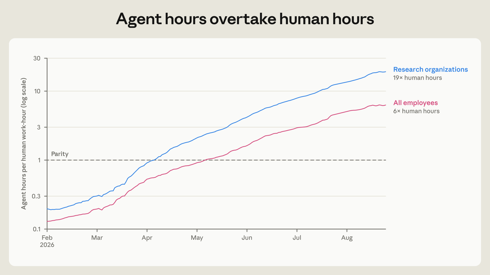
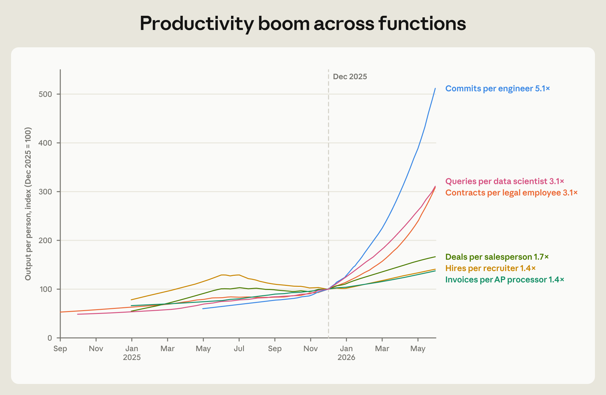
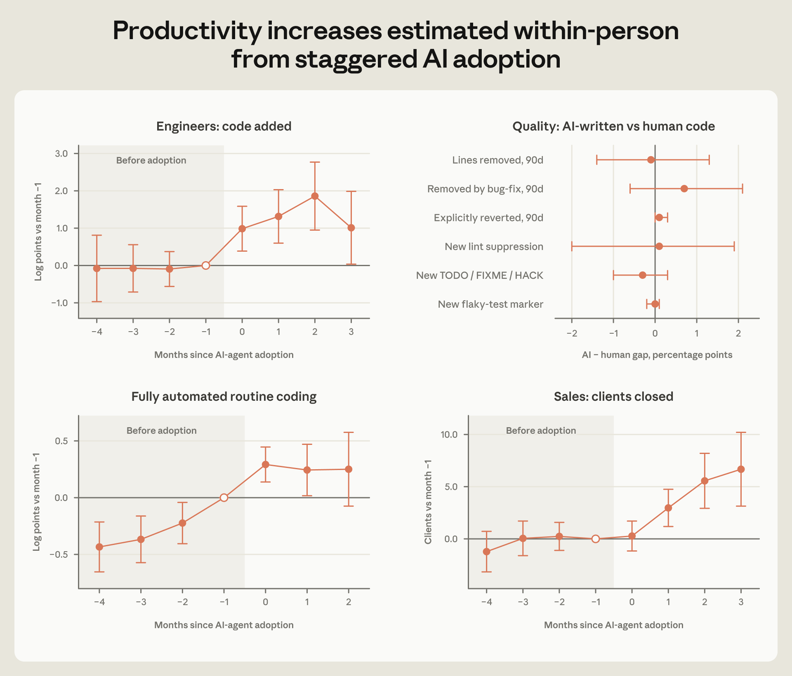
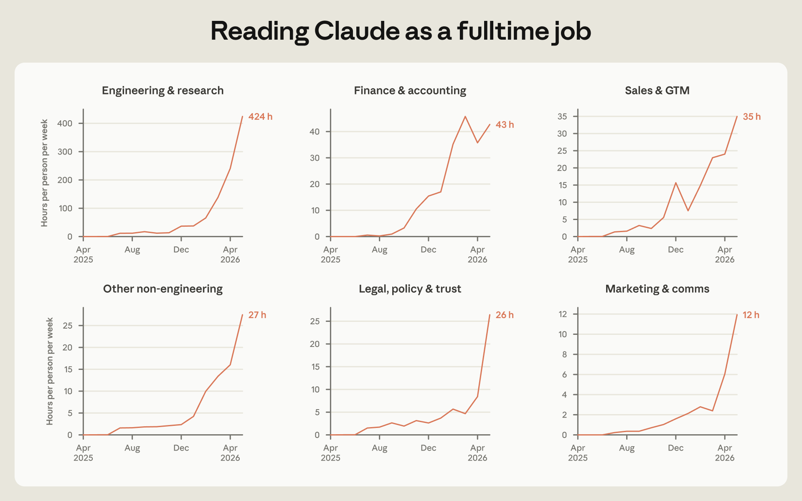
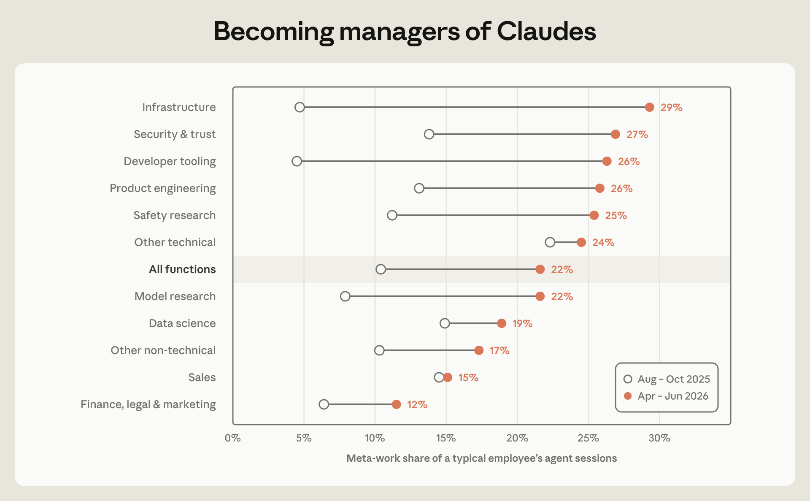

## Table of contents

Anthropic이 2026년 10월 16일 [How employment is changing at Anthropic](https://www.anthropic.com/research/employment-at-anthropic)이라는 보고서를 냈다. 경제팀 연구자 네 명(Nathan Wilmers, Regina Catipon, Maxim Massenkoff, Peter McCrory)이 썼다.

질문은 하나다. AI를 업무 흐름 전체에 깔아버린 회사에서 일과 고용은 어떻게 바뀌는가. Anthropic은 AI 도입의 최전선에 있으니, 여기서 일어나는 일이 다른 회사에 곧 닥칠 일의 선행 지표가 될 수 있다는 것이 보고서의 전제다.

근거로 쓴 데이터는 고용 기록, AI 사용량, 직무별 산출 지표, 직원 설문, Slack 소통 패턴, 캘린더, 채용 면접 평가표다. 여기에 직원 인터뷰 17건을 더했다.

# 핵심 발견 네 가지

보고서가 첫머리에 정리한 결론은 이렇다.

1. **주니어 기술직 채용 비중이 줄었다.** 같은 시기 AI 에이전트의 작업 시간은 빠르게 늘어, 8월에는 직원 작업 시간의 6배가 됐다.
2. **사람당 산출량이 늘었다.** 엔지니어는 코드를, 영업은 계약을, 법무는 검토 건수를 더 많이 처리했다. 같은 직원을 추적해 보면 새 AI 도구를 쓰기 시작한 뒤 산출이 올랐다.
3. **사람의 주의력이 병목이 됐다.** 비기술직조차 에이전트 출력을 다 읽으려면 근무 시간의 절반이 든다. 그래서 직원들은 에이전트를 관리하는 일(메타워크)에 시간을 쓴다.
4. **채용 기준이 바뀌었다.** 면접관은 기술 전문성과 실행력보다 자율성과 판단력을 더 본다.

# 채용: 주니어 기술직이 줄었다

Anthropic은 빠르게 커졌지만 매출에 비해 사람을 적게 뽑았다. 창업 5년 차 기준 직원 1인당 매출이 같은 연차의 Google, Meta보다 2~4배 많다. Anthropic은 2026년 4월까지 12개월, Google은 2003년, Meta는 2009년 10-K 수치를 2025년 달러로 환산해 비교했다.

줄어든 자리는 주니어 기술직이다.

| 지표 | 변화 |
| --- | --- |
| 기술 부서 내 주니어 비중 (2025년 초 이후) | 21% → 14% |
| 기술직 신규 채용 중 주니어 비중 | 27% → 9% |
| 전체 인원 중 기술 부서 비중 (최근 1년) | 61% → 56% |

_기술 부서(왼쪽)는 채용(파랑), 재직 인원(분홍), 채용 공고(주황) 모두 주니어 비중이 내려갔다. 비기술 부서(오른쪽)는 채용과 인원 비중이 25% 안팎을 유지한다. 출처: Anthropic_

2026년 1월부터 Claude를 가장 많이 쓰는 핵심 기술팀에서 "코드 작성과 버그 찾기는 Claude에게 넘길 수 있다"는 인식이 퍼졌고, 4월에는 엔지니어링과 리서치 조직이 하위 직급 채용을 줄였다. 같은 달 설문에서 관리자 다수가 AI 때문에 다른 역량을 뽑는다고 답했고, ML 관리자의 약 3분의 1, SWE 관리자의 약 5분의 1은 AI 때문에 덜 뽑는다고 답했다. 주니어 채용 공고는 2025년 12월 이후 특히 크게 줄었다.

기술 부서 비중이 줄었다고 기술직 채용이 줄어든 것은 아니다. 절대 인원은 계속 늘었고, 영업, 재무, 채용 조직이 더 빨리 늘었을 뿐이다. 비기술직이 직접 소프트웨어를 만들게 된 영향도 있다. 원래 코드를 커밋하지 않던 비기술직의 코딩 에이전트 세션은 2025년 8월 월 2건에서 2026년 5월 월 90건으로 늘었다.

기술 부서 안에서는 반대 방향의 변화가 있었다. 최근 30일간 커밋이 없는 직원의 비중이 1년 사이 절반 가까이 줄었다. 엔지니어 대 PM 비율은 약 17:1로 2025년보다 올랐고, 관리자의 커밋 수는 두 배가 됐다. 감독하고 조율하는 역할도 점점 코드를 직접 만들어 배포하는 일을 포함하게 된 셈이다.

행정직은 회사가 커져도 거의 늘지 않았다. 비서 에이전트, 자동 검토, 티켓 처리 외주를 조합해 대체했다. 한 임원 비서는 일정 관리와 메일 분류를 에이전트에 맡기고 "chief of staff"에 가까운 상위 업무로 옮겨 갔다.

사람의 재배치도 잦아졌다. 근속 1년 이상 직원이 매달 부서를 옮길 확률이 2025년보다 2026년에 50% 높다. 팀 단위 이동도 있었다. Claude.ai의 인사말 같은 제품 문구를 쓰던 디자인팀은 에이전트가 좋은 문구를 쓰도록 이끄는 컨텍스트 그래프를 만든 뒤, 모델 평가(eval)와 프롬프트를 쓰는 일로 옮겨 갔다.

# 생산성: 에이전트가 사람보다 오래 일한다

2026년 3월, 자율 에이전트와 대화형 에이전트의 작업 시간 합이 처음으로 사람의 근무 시간을 넘었다. 대규모 코드 마이그레이션이나 테스트 보강처럼 회사 차원에서 돌리는 에이전트를 빼고 직원 개인이 부리는 에이전트만 봐도, 8월에는 에이전트가 사람보다 6배 오래 일했다. 여기서 에이전트 작업 시간은 추론과 도구 실행 시간이고, 30분 넘는 대기는 뺐다. 사람은 주 40시간으로 계산했다.

_사람 근무 1시간당 에이전트 작업 시간(로그 축). 직원이 직접 부리는 대화형 에이전트만 셌다. 전체 직원(분홍)은 5월 무렵 1:1을 넘어 8월에 6배, 리서치 조직(파랑)은 19배가 됐다. 출처: Anthropic_

엔지니어 1인당 커밋 속도는 6개월 전의 5배다. 비기술직도 산출이 늘었다. 변호사는 계약서를, 매입 담당은 인보이스를, 영업은 계약을 더 많이 처리했다.

_2025년 12월을 100으로 둔 1인당 산출. 2026년 5월까지 엔지니어 커밋 5.1배, 데이터 사이언티스트 쿼리와 법무 계약서 3.1배, 영업 계약 1.7배, 채용 담당자당 채용과 매입 담당자당 인보이스 1.4배. 출처: Anthropic_

다만 같은 기간 회사 매출도 폭발적으로 늘었다. 좋은 모델을 팔면 계약을 따기도 쉽다. 그래서 보고서는 AI의 효과만 떼어 보려고, 같은 달 같은 회사에서 일하는 사람 중 코딩 에이전트를 도입한 엔지니어 192명과 도입하지 않은 74명을 비교했다.

- 도입한 뒤 몇 달 동안 엔지니어가 추가하는 코드량이 급격히 늘었다.
- **AI가 짠 코드는 품질이 낮지 않은지** 확인하려고, 같은 사람이 같은 달 같은 디렉터리에 커밋한 코드 중 직접 쓴 것과 에이전트가 쓴 것을 비교했다. 90일 안에 지워지거나 되돌려진 비율에 차이가 없었다.
- 완전 자율 에이전트를 처음 도입한 사람들은 도입 전부터 이미 산출이 가파르게 오르던 사람들이었다. 도입 효과와 원래 성향이 섞여 있다는 뜻이다.

_도입 직전 달(-1)을 기준으로 한 변화. 왼쪽 위는 엔지니어가 추가한 코드량, 오른쪽 위는 AI가 쓴 코드와 사람이 쓴 코드의 품질 지표 차이(0 근처면 차이 없음), 왼쪽 아래는 완전 자율 에이전트 도입, 오른쪽 아래는 영업 담당자의 계약 고객 수다. 왼쪽 아래만 도입 전부터 이미 오르고 있다. 출처: Anthropic_

영업도 에이전트를 도입한 뒤 더 많은 고객과 계약했다. 한 영업 담당자는 메일 초안과 CRM 연동을 자동화해 기존 업무의 약 20%를 덜어냈고, 다른 담당자는 그렇게 확보한 시간으로 이전보다 30% 많은 고객을 만났다고 했다.

직무 단위로 보면, Claude를 복잡한 작업에 많이 쓰는 직무일수록 2026년 1월에서 7월 사이 주니어 고용 증가가 더뎠다.

# 병목: 사람의 주의력

에이전트가 빨라질수록 사람이 따라가지 못한다.

- 대화형 Claude 세션 시간의 약 **80%는 사람 입력을 기다리는 시간**이다. 한 엔지니어는 이를 두고 사람이 에이전트의 병목이라고 표현했다.
- 대화형 세션의 출력 토큰을 사람이 읽는 데 걸리는 시간으로 환산하면(토큰당 0.75단어, 분당 250단어), 비기술 조직에서도 **주 근무 시간의 절반 이상**이 나온다.

_조직별로 에이전트 출력을 다 읽는 데 드는 1인당 주당 시간. 2026년 4월 기준 엔지니어링·리서치는 424시간으로 애초에 읽을 수 없는 양이고, 재무·회계 43시간, 영업 35시간, 법무 26시간이다. 출처: Anthropic_
- 새 모델이 나오면 직원들은 곧바로 더 어려운 일을 맡긴다. 이전 모델 기준 난이도 상위 10% 작업의 비중이 10%에서 13%로 약 30% 늘고, 그 뒤 몇 주간 유지된다. 쉬운 작업 쪽은 거의 그대로다.

이 병목을 풀려고 직원들은 일 자체보다 **에이전트가 일하게 만드는 일**에 시간을 쓴다.

- 에이전트용 상시 지침(standing instructions)은 2025년 7월 수백 건에서 1년 뒤 8,500건이 됐다.
- 대화형 Claude 세션 중 메타워크(스킬 작성, 다른 에이전트를 위한 계획과 리뷰, 파이프라인 모니터링 대시보드 등)의 비중은 2025년 가을 10%에서 2026년 봄 22%로 늘었다.

_조직별 메타워크 비중(2025년 8~10월 → 2026년 4~6월). 인프라가 5%에서 29%로 가장 크게 늘었고, 영업은 14%에서 15%로 거의 그대로다. 세션 요약 2,000건을 자동 분류해 추정했다. 출처: Anthropic_
- 2026년 4월 설문의 주관식 응답에서 20%는 자기 역할이 "일을 직접 하는 것"에서 "Claude를 관리하는 것"으로 바뀌었다고 썼다. 생산성이 올랐다고 쓴 응답은 27%였다.

그렇다고 사람끼리의 일이 줄지는 않았다. 캘린더 기준 중앙값 직원의 회의 시간은 1년 전보다 20% 늘었다. 회사 성장과 회의가 많은 비기술직 증가 영향도 있지만, 기술직 개인 기여자만 봐도 16% 늘었다. 버그를 쫓다 보면 결국 사람이 모여 결정해야 하는 조직적, 기술 부채 문제가 드러난다는 설명이다.

Slack에서도 같은 흐름이 보인다. 에이전트는 활성 공개 채널의 거의 절반에 등장하지만 사람 사이의 대화를 대체하지 않았다. 사람끼리 주고받는 응답 수는 그대로이고, 에이전트 응답이 그 위에 더해졌다. 에이전트는 여러 사람과 두루 연결되는 노드라기보다 한 직원에게 딸린 팀처럼 움직인다. 한 부서의 Slack 네트워크에 에이전트 스레드가 번져 가는 모습은 원문의 애니메이션(Figure 8)에서 볼 수 있다.

부작용도 있다. 에이전트는 기록된 것만 안다. 대면 회의에서 결정하고 기록을 남기지 않으면 에이전트는 낡은 맥락으로 일한다. 몇 달 전 굿즈 문서에 이름이 올라 있던 직원은 담당이 바뀐 뒤에도 에이전트로부터 티셔츠, 머그컵 요청을 계속 받았다고 한다. 그래서 비공개 회의나 DM에서 일하는 것을 꺼리고, 결정과 피드백을 공개된 곳에 남기라는 압박이 커진다.

# 채용 기준: 자율성과 판단력

2024년 이후 입사자 수천 명의 면접 평가표를 자동 분류해 보니 두 가지가 바뀌었다.

**AI 도구 활용을 본다.** 2024년에는 지원자의 AI 활용 이력을 언급한 평가가 기술직 약 5%, 비기술직 약 7%였다. 2026년에는 기술직에서 3배, 비기술직에서 4배가 됐다.

**전문성보다 판단을 본다.** 기술직 면접에서 가장 크게 늘어난 평가 항목은 자율성과 판단력이고, 특정 분야 전문성의 비중은 줄었다. 한 관리자는 모델의 능력이 분야마다 들쭉날쭉할 테니 팀원이 여러 분야를 오갈 수 있으면 좋겠다고 했다. 비기술직은 고객과 미션에 대한 지향이 늘고 실행 역량 평가가 줄었다.

# 고용주가 할 수 있는 일

보고서는 Anthropic의 관행 상당수가 다른 회사에 그대로 옮겨질 수 없다고 먼저 선을 긋고, 세 가지를 짚는다.

1. **지분 공유.** 직원이 주식을 넓게 보유하면 AI 도입의 성과를 함께 가져간다. 직원은 자기 전문성을 기계가 쓸 수 있게 정리해 넘기고, 업무 방식이 계속 흔들리는 것을 감수한다. 보고서는 그 대가가 있어야 한다고 보고, 1950년대 미국 노사 합의(경영진의 작업 재편 권한을 인정하는 대신 생산성에 연동한 임금 인상을 받은 구조)를 예로 든다.
2. **조기 경보 체계.** 직무별 수요와 생산성 지표를 AI 역량, 사용량과 함께 보며 전환 위험이 큰 직무를 미리 찾는다.
3. **내부 재배치 우선.** 위험한 직무의 직원을 기술이 맞으면서 덜 위험한 자리로 옮긴다. AI가 빨라질수록 새 일마다 외부에서 사람을 구하는 방식은 더 큰 병목이 된다는 논리다.

내부 재배치에는 대가도 있다. 기존 직원을 지키겠다는 약속은 신규 채용을 주저하게 만들 수 있고, 경쟁이 치열한 시기에는 비용이 크다. 반면 재배치를 우선하면 회사가 AI를 인건비 절감용 대체에만 쓰지 않고 새 제품과 새 시장을 만드는 데 쓰도록 압박하는 효과가 있다. 사람을 겨우 이길 만한 수준의 자동화로 사람을 바꾸면, 해고된 사람이 잃는 소득에 비해 생산성 이득은 미미하다는 지적이다.

마지막으로 보고서는 이 조치들이 주니어 채용 감소를 해결하지 못한다고 인정한다. 기존 직원 보호는 애초에 채용되지 못한 사람에게 도움이 되지 않는다. 그래서 기업의 노력과 함께 재교육, 소득 지원 같은 정부 정책이 필요하다고 맺는다.

# 읽을 때 주의할 점

- **인과관계가 아니다.** 도구 도입은 무작위가 아니다. 큰 프로젝트를 앞둔 사람이 먼저 도구를 갖추면 효과가 부풀려진다. 영업 성과도 회사 성장과 겹친다.
- **품질 지표는 대리 변수다.** 삭제, 되돌림, lint 억제 주석 같은 지표로 품질을 쟀고, 보고서도 AI의 오류가 사람의 오류보다 찾기 어려울 수 있다고 적었다.
- **설문 문항이 바뀌었다.** "업무 프로세스가 나를 최대한 생산적으로 만드는가"에 동의한 비율은 2024년 말 44%, 2025년 11월 58%였다. 2026년 4월에는 75%지만 "최대한(as possible)"을 빼고 물었다.
- **Anthropic은 일반적인 회사가 아니다.** 업무 흐름 전체를 AI에 맞춰 짠 회사다. 2026년 8월 기준 Anthropic 직원은 2030년까지 AI가 자기 업무의 75%를 할 수 있다고 봤지만, 미국인 평균은 28%였다. 기대치부터 다르다.

# 참고

- [How employment is changing at Anthropic](https://www.anthropic.com/research/employment-at-anthropic) (Anthropic, 2026-10-16)
- [The AI expectations gap](https://www.anthropic.com/research/ai-expectations-gap) (Anthropic, 2026-10-16): 같은 날 나온 직원과 일반인의 AI 기대 비교 보고서. [요약 글](/ai-expectations-gap)
- [How AI Is Transforming Work at Anthropic](https://www.anthropic.com/research/how-ai-is-transforming-work-at-anthropic) (Anthropic, 2025-12-02): 엔지니어 대상 설문 기반의 이전 보고서
- [An Evidence Review of Subsidized Job Training](https://www.anthropic.com/research/reviewing-the-evidence-on-worker-retraining-programs) (The Anthropic Institute): 보고서가 결론에서 언급한 재교육 정책 근거 검토
