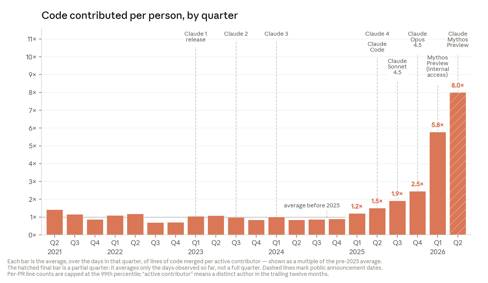
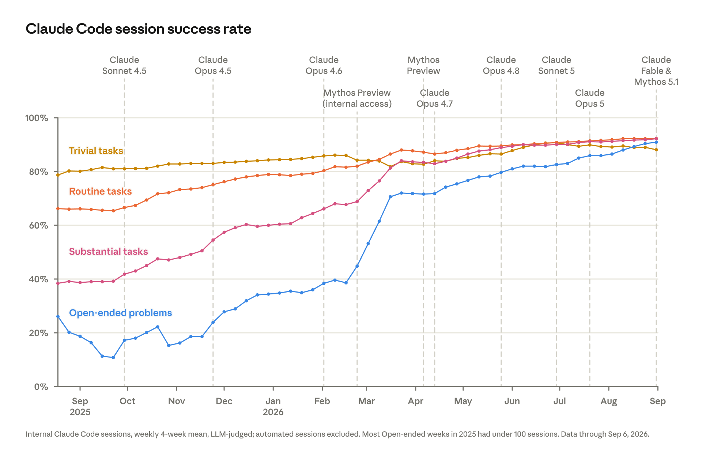
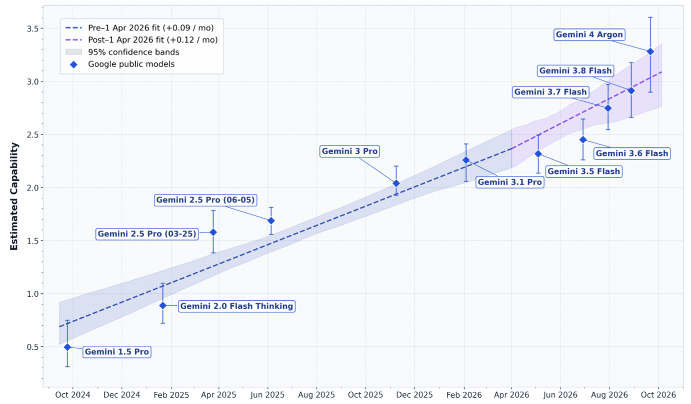
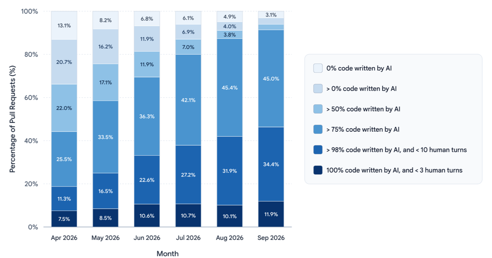
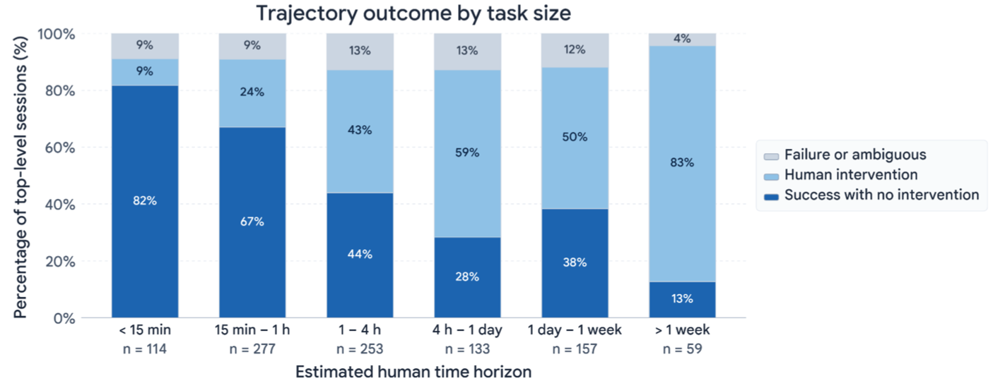

## Table of contents

AI가 AI를 만드는 일을 점점 더 많이 맡으면, 언젠가 AI가 자기 후속 모델을 사람 없이 설계하고 학습시키는 단계에 이를 수 있다. 이를 **재귀적 자기 개선**(recursive self-improvement, RSI)이라고 부른다. 그 단계가 오면 발전 속도는 사람이 아니라 연산 자원이 정하게 된다.

2026년 하반기, 두 프런티어 연구소가 자기 회사 안의 데이터로 이 질문을 들여다본 결과를 내놨다.

- **Anthropic [When AI builds itself](https://www.anthropic.com/institute/recursive-self-improvement):** The Anthropic Institute의 Marina Favaro와 Jack Clark가 썼다. 데이터는 2026년 5월 기준이고, 9월 18일에 그래프 하나를 갱신했다.
- **Google DeepMind [Gemini 4 Argon Safety & Security Report](https://storage.googleapis.com/deepmind-media/gemini/gemini_4_safety_report.pdf):** 2026년 10월에 낸 217쪽짜리 안전 보고서다. 그중 3.4.2절 "ML R&D 위험 종합 평가"(74~78쪽)가 같은 질문을 다룬다.

결론은 엇갈린다. Anthropic은 **AI가 이미 AI 개발을 가속하고 있다**고 했고, DeepMind는 **아직 처음부터 끝까지의 가속은 없다**고 했다. 그런데 자세히 보면 두 보고서가 잰 것이 다르고, 사실관계는 생각보다 많이 겹친다.

이 시리즈 앞 글들과도 이어진다. [고용 보고서](/employment-at-anthropic)는 Anthropic 직원 1인당 커밋이 6개월 사이 5배가 됐다고 했고, [AI 기대 격차 보고서](/ai-expectations-gap)에서 직원들은 모델 개발 업무의 51%를 이미 AI가 한다고 답했다.

# 한눈에 비교

| | Anthropic | Google DeepMind |
| --- | --- | --- |
| 문서 성격 | 연구소의 공개 분석 글. 정책 제언 포함 | 모델 출시용 안전 보고서의 한 절 |
| 핵심 질문 | AI가 AI 개발을 얼마나 가속하고 있나 | AI 주도의 AI 개발이 위험 기준선을 넘었나 |
| 주된 측정 | 1인당 코드량, 세션 성공률, 실험 최적화, 연구 판단력 | 모델 능력 지수(GCI)의 상승 속도 |
| AI가 쓰는 코드 비중 | 머지되는 코드의 80% 이상 (2026년 5월) | 대부분의 운영 코드에서 75% 이상 |
| 사람이 맡는 일 | 연구 방향과 판단. 이 격차도 좁혀지는 중 | 연구 방향, 새 실험 설계, 미묘한 학습 불안정 진단 |
| 결론 | 가속은 이미 일어나고 있고, 복리처럼 커질 가능성이 높다 | 처음부터 끝까지의 가속은 없고, 위험은 낮다 |

# Anthropic: 가속은 이미 일어나고 있다

Anthropic은 모델 개발 업무를 엔지니어링(코드 작성, 인프라, 학습 관리)과 연구(어떤 실험을 할지, 결과를 어떻게 해석할지, 다음에 무엇을 시도할지)로 나누고, 둘 다에서 같은 그림이 나온다고 본다. 사람이 목표만 주면 방법은 Claude가 찾는다. 다만 목표 자체를 고르는 판단력에서는 아직 차이가 크다.

## 엔지니어링: 코드량과 성공률

2026년 5월 기준, Anthropic 코드베이스에 머지되는 코드의 80% 이상을 Claude가 썼다. Claude Code가 나오기 전(2025년 2월)에는 한 자릿수였다. 리더들은 스크립트와 실험 코드까지 포함해 90% 이상이라고 말해 왔는데, 80%는 운영 코드에 머지된 줄만 센 보수적인 수치다.

_분기별 1인당 머지된 코드 줄 수를 2025년 이전 평균 대비 배수로 나타냈다. 2021~2024년은 거의 평평하다가, Claude가 코드를 직접 실행하기 시작한 2025년에 한 번, 장시간 자율 작업이 가능해진 2026년에 또 한 번 꺾여 올라간다. 2026년 2분기(빗금, 진행 중인 분기)는 8배다. 출처: Anthropic_

보고서도 코드 줄 수가 양만 재는 불완전한 지표이고, 8배는 실제 생산성 향상을 거의 확실히 부풀린 수치라고 인정한다. 그래서 두 가지를 덧붙인다.

- **체감 생산성:** 2026년 3월 연구팀 130명 설문에서 응답 중앙값은 "AI가 없을 때보다 4배"였다. Anthropic은 실제로는 이보다 낮을 거라고 본다.
- **품질:** 사람이 중간에 고치거나 방향을 바꾸거나 직접 넘겨받는 비율이 1년 내내 줄었다. 가장 열린 과제(무엇이 답인지 엔지니어도 모르는 문제)의 성공률은 2026년 5월 76%로, 6개월 사이 50%p 올랐다.

_사내 Claude Code 세션 중 사람이 고치지 않고 끝난 비율(4주 평균, Claude가 판정). 9월 갱신판으로, 열린 문제(파랑)는 2025년 가을 20% 안팎에서 2026년 9월 약 91%까지 올라 다른 난이도와 거의 만났다. 세로 점선은 모델 출시 시점이다. 출처: Anthropic_

코드의 "읽고 이어서 고치기 좋은 정도"는 2025년 말에는 사람보다 못했고, 지금은 비슷하며, 1년 안에 더 나아질 거라는 게 내부 시각이다(직원들 사이에 완전한 합의는 아니다). 과거 claude.ai 장애를 일으킨 버그를 되짚어 보니, 모든 변경을 Claude가 자동 리뷰했다면 약 3분의 1을 운영 배포 전에 잡았을 거라는 분석도 있다.

## 연구: 실험은 사람보다 낫고, 판단은 따라오는 중

**정해진 목표의 실험은 이미 사람을 넘었다.** 작은 모델을 학습시키는 코드를 주고, 정확성 검사를 통과하면서 최대한 빠르게 만들라는 과제를 모델 출시 때마다 돌린다. 2025년 5월 Claude Opus 4는 약 3배, 2026년 4월 Claude Mythos Preview는 약 52배 빠르게 만들었다. 숙련된 연구자는 4~8시간 걸려 4배 정도다. 보고서는 배수 자체보다 같은 조건에서 모델끼리, 모델과 사람을 비교할 수 있다는 점에 의미를 둔다.

**연구 과제 하나를 처음부터 끝까지 맡겨 보기도 했다.** "약한 모델이 강한 모델을 믿을 만하게 감독할 수 있나"라는 안전 연구 문제를 Claude 에이전트들에게 맡겼더니, 성능 하한과 상한 사이 격차의 97%를 메웠다(누적 800시간, 연산 비용 약 1만 8천 달러). 사람 연구자 둘은 일주일 동안 약 23%를 메웠다. 다만 결과가 실제 운영 규모 모델로 깔끔하게 옮겨지지는 않았고, 문제와 채점 기준은 사람이 정했다.

**다음 한 수를 고르는 판단력도 좋아지고 있다.** 2026년 1~3월 연구자와 Claude가 함께 한 실제 세션 중, 연구자가 엉뚱한 방향으로 갔다가 돌아온 순간 129개를 골랐다. 그 직전까지만 보여주고 모델에게 다음 수를 제안하게 한 뒤, 세션 결말을 아는 별도의 Claude가 사람과 모델 중 누구의 제안이 나은지 판정했다.

_모델 제안이 사람의 실제 선택보다 낫다고 판정된 비율(주황)과 비긴 비율(회색). 세션 전체를 아는 모델이 쓴 "이상적인" 답의 기준선이 90%다. 2025년 11월 Opus 4.5는 51%, 2026년 4월 Mythos Preview는 64%다. 출처: Anthropic_

일부러 사람의 선택이 아쉬웠던 순간만 골랐으니 사람과 모델을 공정하게 비교한 것은 아니다. 사람이 이미 좋은 수를 둔 127개 순간으로 같은 실험을 하면 모델이 이긴 비율은 약 20%로 떨어진다.

## Anthropic이 그리는 세 가지 미래

1. **추세가 멈춘다.** 지수 곡선이 S자 곡선으로 꺾이거나, 전력과 반도체 공급이 병목이 된다. 그래도 지금 수준의 AI가 퍼지는 것만으로 세상은 크게 바뀐다. Anthropic은 가능성이 낮다고 본다. 잴 수 있는 모든 능력이 아직 같은 곡선을 따르고 있기 때문이다.
2. **효율이 복리로 커진다.** 개발은 상당 부분 자동화되지만 연구 방향과 결과 판단은 사람이 한다. Anthropic은 지금 이쪽으로 가고 있다고 본다. 다만 한 부분이 빨라지면 병목은 다른 곳으로 옮겨 간다(암달의 법칙). Anthropic에서는 이미 사람의 코드 리뷰가 새 병목이 됐다.
3. **완전한 RSI.** AI가 후속 모델을 스스로 설계하고, 사람은 감독과 검증으로 물러난다. 정렬(alignment) 문제가 어떻게 될지 가장 불확실한 시나리오다.

그래서 Anthropic은 프런티어 개발을 늦추거나 잠시 멈출 수 있는 **선택지**가 있어야 한다고 주장한다. 이를 확인할 체계가 갖춰지고 다른 프런티어 개발사들도 검증 가능한 방식으로 멈춘다면, 자신들도 늦추거나 멈출 것이라고 밝혔다. 한 회사만 멈추면 선두가 바뀔 뿐이라 의미가 적고, 학습 실행은 미사일 기지보다 숨기기 쉬워서 검증 체계를 만드는 게 핵심 과제라고 본다.

# Google DeepMind: 끝에서 끝까지의 가속은 없다

DeepMind 보고서의 이 절은 성격이 다르다. 새 모델(Gemini 4 Argon)을 내기 전에 "AI 주도의 AI 개발"이 위험 임계 수준(CCL)에 이르렀는지 판정하는 안전 평가의 일부다. DeepMind가 우려하는 시나리오는, AI가 AI 개발을 가속해 위험한 능력을 가진 모델이 일찍 나오는데 안전, 거버넌스, 사회의 적응은 그만큼 빨라지지 않는 경우다.

결론은 두 가지다.

## 발견 1: 모델 능력의 상승 속도는 그대로다

DeepMind는 "처음부터 끝까지의 가속"을 **최신 Gemini 모델의 능력이 얼마나 빨리 오르는지**로 정의했다. 하위 작업 몇 개가 빨라져도 전체가 다른 곳에서 막히면 능력 상승 속도는 그대로일 것이기 때문이다.

능력은 내부 지수 GCI v1로 쟀다. 모델 123개의 벤치마크 92개 점수를 하나의 통계 모델로 묶어, 모델마다 "일반 능력" 값을 하나씩 추정한 것이다(외부의 Epoch Capabilities Index와 비슷한 방식이지만 값은 서로 비교할 수 없다).

_공개 Gemini 모델의 GCI 추정치와 출시 시점. 2026년 4월 1일 이전 추세는 월 +0.09, 이후는 월 +0.12다. 신뢰 구간이 겹쳐 차이가 통계적으로 유의하지 않다. 맨 위 Gemini 4 Argon은 추세선보다 높다. 출처: Google DeepMind, Gemini 4 Argon Safety & Security Report, Figure 3.14_

- 전체 기간의 능력 상승 속도는 월 약 0.1 GCI로 꾸준하다.
- 2026년 4월 1일을 기준으로 나누면 이전 0.091(95% 신뢰 구간 0.071~0.108), 이후 0.118(0.053~0.171)이다. 내부 모델까지 넣어도 0.097과 0.107로, 유의한 차이가 없다.
- Gemini 4 Argon은 추세보다 위에 있다. DeepMind는 이를 AI 덕분이 아니라 조직 차원의 투자와 학습 연산량이 늘어난 결과로 본다.

## 발견 2: 일부는 자동화됐지만 사람이 여전히 깊이 관여한다

모델 개발의 핵심 분야(소프트웨어 엔지니어링, 데이터 정제, 평가와 학습 환경 구축, 실험 실행과 분석, 커널 최적화, 데이터센터 운영, 칩 설계)를 이끄는 시니어 리더와 연구자 12명에게 물었다. 자동화는 잘 정의되고 검증 가능한 실행 작업에서 가장 많이, 열린 과학적 아이디어 발굴과 장기적인 연구 감각에서 가장 적게 일어났다.

**운영 코드:** 대부분의 운영 코드는 75% 이상을 AI가 쓴다. 그런데 AI에 완전히 맡긴 풀 리퀘스트는 4월 7.5%에서 9월 11.9%로 늘었을 뿐이고, 약 88%는 여전히 사람이 여러 번 방향을 잡아 주거나 직접 코드를 써야 했다. 실험 코드는 이 분석에서 빠졌고, DeepMind는 그쪽 추세가 더 가파를 거라고 본다.

_월별 풀 리퀘스트를 AI가 쓴 코드 비율로 나눴다. 맨 아래 가장 진한 칸(AI가 100% 쓰고 사람 개입 3회 미만)이 "완전 위임"으로, 7.5%에서 11.9%가 됐다. AI가 75% 넘게 쓴 PR(아래 세 칸)은 4월 약 44%에서 9월 약 91%로 늘었다. 출처: Google DeepMind, Figure 3.15_

**사내 에이전트 사용:** 사내에서 Argon이 수행한 작업 기록 1,389건을 무작위로 뽑아, Gemini Flash 3.8에게 과제가 무엇인지, 사람이 혼자 하면 얼마나 걸릴지, 에이전트가 혼자 성공했는지 판정하게 했다.

_사람이 혼자 할 때 걸릴 시간별로 나눈 결과. 진한 파랑이 개입 없이 성공, 연한 파랑이 사람 개입, 회색이 실패나 판단 불가다. 혼자 끝낸 비율은 15분 미만 과제 82%, 1~4시간 44%, 일주일 초과 13%다. 출처: Google DeepMind, Figure 3.16_

**쓸 수 있는데 안 쓰는 것은 아닌가:** 모델은 완전 자동화가 가능한데 사람들이 그렇게 쓰지 않을 뿐일 수도 있다("자동화 오버행"). DeepMind는 아니라고 본다. 일상적인 AI 개발 엔지니어링 과제로 만든 내부 평가(GRB)에서 Argon은 절반 정도만 풀었다. 완전 자동화라면 거의 만점이어야 한다.

그래서 DeepMind는 Argon이 ML R&D 관련 위험 임계 수준 두 개를 넘지 않았고, AI 주도 AI 개발의 위험은 **현재 낮다**고 결론 냈다. 개별 코딩 과제는 해내지만, 그것들을 사람 개입 없이 엮어 연구 흐름 전체를 이어 가지는 못한다는 판단이다.

# 왜 결론이 갈리나

## 잰 것이 다르다

- **Anthropic은 과정을 쟀다.** 사람 한 명이 내보내는 코드량, 세션 성공률, 정해진 실험에서의 속도, 다음 수 판단. 개발 공정의 각 단계가 얼마나 빨라졌는지를 본다.
- **DeepMind는 결과를 쟀다.** 최종적으로 나온 모델의 능력이 얼마나 빨리 오르는지를 본다. 공정 일부가 빨라져도 결과물의 개선 속도가 그대로면 "가속 없음"이다.

이 차이는 Anthropic 글이 직접 꺼낸 암달의 법칙으로 설명할 수 있다. 공정 일부가 몇 배 빨라져도 전체 속도는 빨라지지 않은 부분에 묶인다. 사람의 코드 리뷰, 연구 방향 결정, 연산 자원이 그런 부분이다. 두 보고서는 같은 현상을 다른 지점에서 보고 있을 수 있다.

DeepMind의 지표에도 한계는 있다. 4월 이후 기울기의 신뢰 구간(0.053~0.171)이 넓어서, 유의하지 않다는 것이 가속이 없다는 증거라기보다 아직 판별할 데이터가 부족하다는 뜻일 수도 있다. 4월 이후 출시 모델은 몇 개뿐이다.

## 사실관계는 많이 겹친다

- **코드 대부분은 AI가 쓴다.** Anthropic 80% 이상, DeepMind 75% 이상.
- **사람은 방향과 판단을 쥐고 있다.** Anthropic은 이것을 "연구 감각(research taste)"이라 부르고, DeepMind는 연구 방향 선택, 새 실험 설계, 미묘한 학습 불안정 진단이라고 적었다. 두 회사가 꼽은 사람의 역할이 거의 같다.
- **과제가 클수록 AI 혼자는 어렵다.** DeepMind는 과제 규모별로 이를 보여줬고, Anthropic도 목표를 고르는 판단력에서 격차가 남아 있다고 인정했다.

차이는 **추세를 어떻게 읽느냐**에 있다. Anthropic은 판단력마저 "한동안 못하다가 잘하게 되는 또 하나의 능력"일 수 있다고 보고, 사람이 방향만 정하더라도 한 사람이 조종하는 작업량이 커지니 가속은 복리로 쌓인다고 본다. DeepMind는 지금 관측되는 자동화 수준과 능력 평가 점수를 근거로 현재 위험을 판정한다.

## 문서의 목적이 다르다

Anthropic 글은 개발을 늦추거나 멈출 선택지를 만들자는 정책 제언으로 끝난다. 변화가 빠르다는 근거를 모으는 글이다. DeepMind 보고서는 모델을 출시해도 되는지 판단하는 안전 평가다. 위험 임계 수준을 넘었는지 아닌지를 가리는 것이 목적이고, "현재 위험은 낮다"는 그 판정이다. 같은 데이터라도 어떤 질문에 답하려는지에 따라 강조점이 달라진다.

# 읽을 때 주의할 점

- **둘 다 자기 회사 안의 데이터다.** 외부에서 검증할 수 없고, 측정 방식도 각자 정했다.
- **AI가 AI를 채점한다.** Anthropic의 세션 성공률과 다음 수 비교는 Claude가, DeepMind의 작업 기록 분석은 Gemini Flash 3.8이 판정했다.
- **코드 줄 수는 생산성이 아니다.** Anthropic이 직접 8배는 과장이라고 썼다. DeepMind의 AI 작성 비율도 실험 코드를 뺀 운영 코드만 셌다.
- **설문은 체감이다.** Anthropic의 "4배"는 직원 130명의 추정치이고, 보고서 스스로 개발자의 AI 생산성 추정이 부풀려질 수 있다는 METR 연구를 인용했다. DeepMind의 자동화 수준 판단은 12명의 응답에 기댄다.
- **비교 시점이 다르다.** Anthropic 본문은 2026년 5월 기준(성공률 그래프만 9월 갱신)이고, DeepMind는 2026년 9~10월 기준이다.

# 참고

- [When AI builds itself](https://www.anthropic.com/institute/recursive-self-improvement) (The Anthropic Institute, 2026-09-18 갱신)
- [Gemini 4 Argon Safety & Security Report](https://storage.googleapis.com/deepmind-media/gemini/gemini_4_safety_report.pdf) (Google DeepMind, 2026-10): 3.4.2절 Holistic Assessment of ML R&D Risks
- [Google Says AI Isn't Building Itself Yet—Even Though It Writes 75% of the Code](https://decrypt.co/381061/google-deepmind-ai-isnt-building-itself-writes-most-code) (Decrypt, 2026-10-15): DeepMind 보고서의 이 절을 다룬 기사
- [AI를 가장 깊게 쓰는 회사에서 일은 어떻게 바뀌었나](/employment-at-anthropic), [AI를 만드는 사람과 일반인은 미래를 얼마나 다르게 보나](/ai-expectations-gap): 이 시리즈의 앞 글
