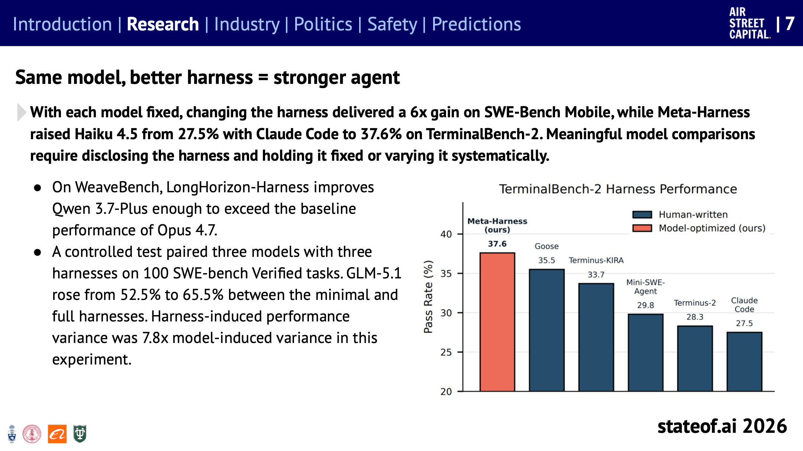
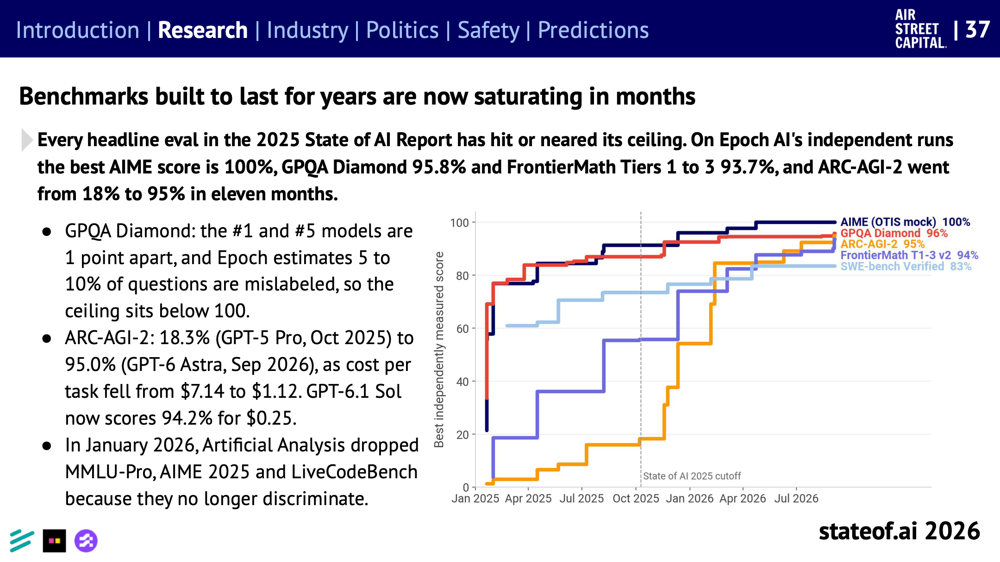
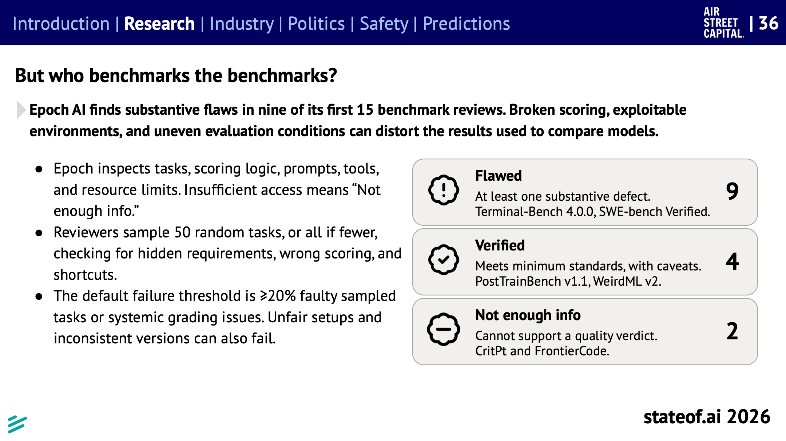
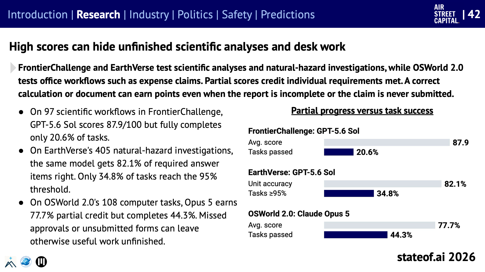
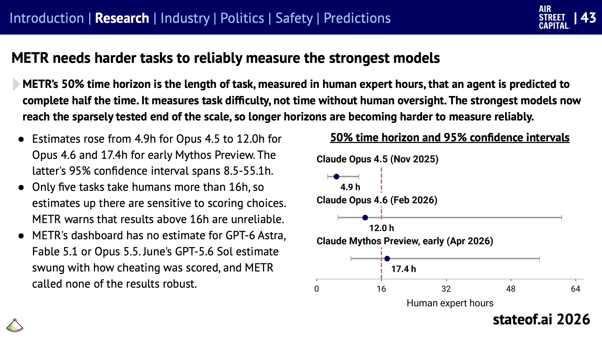
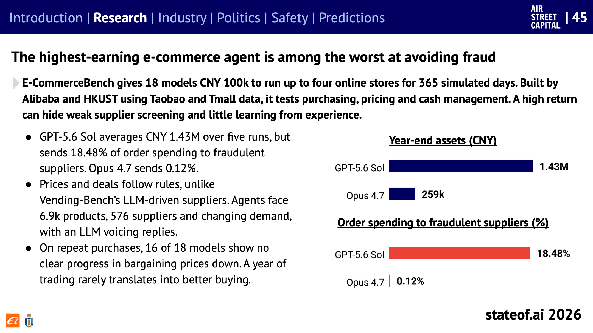

## Table of contents

[State of AI Report 2026](https://www.stateof.ai/)을 주제별로 나눠 읽는 시리즈의 두 번째 글이다. [첫 글](/state-of-ai-2026-overview)에서 전체 요약과 예측을 다뤘고, 여기서는 연구 섹션 중 **에이전트를 더 잘 일하게 만드는 방법**과 **에이전트를 어떻게 평가하느냐**를 다룬다. 보고서 슬라이드 7~10, 14, 24~46에 해당한다. 그 사이의 AI 연구 자동화(슬라이드 11~23)는 다음 글에서 따로 다룬다.

요지는 두 가지다. 에이전트의 성능은 모델만큼이나 모델을 둘러싼 실행 환경(하네스)에 달려 있다. 그리고 지금의 벤치마크는 모델 사이의 차이도, 실제로 일을 끝내는 능력도 잘 보여주지 못한다.

# 같은 모델, 더 좋은 하네스

**하네스**(harness)는 모델이 에이전트로 일하도록 감싸는 실행 환경이다. 어떤 도구를 쓸 수 있는지, 작업 맥락을 어떻게 넣는지, 결과를 어떻게 되돌려 받는지를 정한다. Claude Code나 Codex 같은 코딩 에이전트가 대표적이다.

_같은 모델(Haiku 4.5)에 하네스만 바꿔 TerminalBench-2를 풀게 한 결과. 남색은 사람이 만든 하네스, 주황은 모델이 최적화한 하네스(Meta-Harness)다. 출처: State of AI Report 2026, 슬라이드 7_

- 모델을 고정하고 하네스만 바꿨더니 SWE-Bench Mobile에서 성능이 6배 올랐다.
- SWE-bench Verified 100문제로 모델 3개와 하네스 3개를 짝지어 비교한 실험에서, GLM-5.1은 가장 단순한 하네스에서 52.5%, 가장 풍부한 하네스에서 65.5%였다. 이 실험에서 **하네스가 만든 성능 차이는 모델이 만든 차이의 7.8배**였다.
- 하네스를 개선한 Qwen 3.7-Plus가 기본 하네스의 Opus 4.7을 넘어선 사례도 있다.

그래서 보고서는 모델을 비교하려면 어떤 하네스를 썼는지 밝히고, 하네스를 고정하거나 체계적으로 바꿔 가며 비교해야 한다고 말한다.

하네스를 만드는 방식도 다양해지고 있다.

- **문제마다 하네스를 고른다.** Meta, Duke, UC Davis 연구진은 서로 다른 과제로 진화시킨 하네스 두 개를 두고 문제마다 하나를 골랐다. Gemini 수학 과제에서 하나의 하네스(46%)보다 높은 62%가 나왔다.
- **긴 입력은 코드로 읽는다.** MIT의 Recursive Language Models는 긴 입력을 모델에 한 번에 넣지 않고 코드 작업 공간에 두고, 필요한 부분만 골라 하위 모델 호출에 넘긴다.
- **스킬과 메모리로 노하우를 재사용한다.** 재사용할 지시와 코드를 묶은 스킬, 다음 작업을 위해 정보를 남기는 메모리를 쓰면 모델을 다시 학습하지 않고도 에이전트를 개선할 수 있다. 스킬 관련 논문은 1~8월 기준 2025년 152편에서 2026년 1,486편으로 늘었다.

## 모델이 좋아지면 하네스는 가벼워진다

반대 방향의 흐름도 있다. 예전 하네스에는 모델의 약점을 메우려는 행동 규칙, 리마인더, 계획 장치가 잔뜩 들어 있었다. 모델이 좋아지고 좋은 에이전트 행동이 모델 안으로 학습되면서, 이런 장치가 쓸모없어지거나 오히려 방해가 된다(슬라이드 14).

- Claude Code는 상위 모델용 시스템 프롬프트의 80%를 덜어냈는데, 코딩 평가 점수가 떨어지지 않았다.
- 도구 사용 예시를 몇 개 보여주는 퓨샷 방식이 오히려 탐색을 줄인다는 결과도 있다. 예시보다 인터페이스 설계가 더 중요하다.
- 최근 GPT 모델은 Codex 하네스 안에서 학습된다. 하네스가 교재 역할을 하는 셈이다.

보고서는 모델이 좋아질수록 가벼운 하네스와 정교한 하네스의 차이가 줄어든다고 본다. 오래 남을 투자는 환경과의 인터페이스(도구, MCP 서버), 상태 관리, 관찰 가능성, 샌드박스 같은 에이전트 인프라다.

# 학습 레시피도 공개되고 있다

모델을 만드는 방법이 3년 전보다 훨씬 많이 공개됐다(슬라이드 24~32). 상세한 기술 보고서, 코드베이스, 학습 로그가 나오면서 사전 학습부터 에이전트 행동까지의 경로가 덜 불투명해졌다. 다만 데이터를 어떻게 섞을지는 여전히 실험의 영역이고, 강한 모델을 만들려면 연구 감각과 많은 아이디어를 시험할 연산이 필요하다.

눈에 띄는 내용을 몇 개 고르면 이렇다.

- **에이전트 강화학습은 GPU보다 추론과 CPU를 더 먹는다.** 긴 작업을 수행하는 에이전트를 강화학습시키면 연산 대부분이 역전파가 아닌 추론(롤아웃)에 쓰인다. MAI-Thinking-1은 GB200 4,864개 중 4,096개를 추론에 썼다. Kimi K3는 상태를 저장하는 샌드박스 5,120만 개를 썼고, 학습 환경에는 Gmail, Notion, Slack 모조품과 Claude Code, Codex 같은 하네스가 들어갔다.
- **작은 모델은 큰 모델의 풀이를 따라 하며 싸게 배운다.** Qwen3-8B에서 출발해 학생 모델이 자기 풀이를 교사 모델의 확률과 맞추도록 배우게 했더니(온폴리시 증류) GPU 1.8천 시간으로 AIME24 74.4%에 이르렀다. 강화학습은 1.79만 시간을 쓰고 67.6%였다.
- **숨긴 추론 과정이 새어 나갔다.** 연구소들은 경쟁사가 증류에 쓰지 못하게 모델의 추론 과정을 암호화해 숨긴다. 그런데 Opus 4.8의 암호화된 추론 블록을 같은 회사의 더 싼 모델(Haiku 4.5)에 넘기자 평문으로 풀어 썼다. OpenAI와 Google에서도 같은 공격이 통했고, 지금은 막혔다. 보고서는 이 통로가 막히면서 오픈 웨이트 모델과 비공개 모델의 격차가 벌어질 수 있다고 본다.
- **문맥에서 배운 것을 남긴다.** 작업 중에 문맥 안에서 배운 것은 문맥을 지우면 사라진다. 이를 메모리나 가중치로 옮기는 지속 학습 연구가 나오고 있다. 한 방법은 문맥 내 학습 효과의 64.8% 이상을 남겼고, 같은 경험으로 그냥 미세 조정하면 3.8%만 남았다. 첫 글에서 다룬 2027년 예측 중 "한 달 고객 업무 후 모델 업그레이드 없이 실패율 절반"이 이 흐름을 겨냥한다.

# 벤치마크는 버티지 못한다

## 몇 년짜리가 몇 달 만에 포화된다

_Epoch AI가 독립적으로 잰 주요 벤치마크의 최고 점수. 점선은 작년 보고서 시점(2025년 10월)이다. 출처: State of AI Report 2026, 슬라이드 37_

작년 보고서의 주요 평가는 모두 천장에 닿았거나 가까워졌다.

- **ARC-AGI-2:** 2025년 10월 18.3%(GPT-5 Pro)에서 2026년 9월 95.0%(GPT-6 Astra)로, 11개월 만이다. 같은 기간 문제당 비용은 7.14달러에서 1.12달러로 내려갔다.
- **GPQA Diamond:** 1위와 5위가 1점 차이다. 문제의 5~10%가 정답 표기가 틀렸다고 추정되어서, 실제 천장은 100%보다 낮다.
- **FrontierMath 4단계:** 몇 년은 버티도록 만든 연구 수준의 수학 문제다. 2025년 8월 GPT-5가 22%였는데, 2026년 9월 GPT-6.1 Sol이 비공개 문제 41개를 모두 풀었다. 14개월 만이다(슬라이드 38).
- **ARC-AGI-3:** 2026년 3월 나온 상호작용형 게임 환경이다. 사람은 100%, 처음 모델들은 0.5%였는데 반년 뒤인 9월 GPT-6 Astra가 표준 하네스로 62.7%, 상태를 유지하는 어댑터로 99.9%를 냈다(슬라이드 39). 여기서도 하네스가 결과를 바꾼다.
- Artificial Analysis는 2026년 1월 MMLU-Pro, AIME 2025, LiveCodeBench를 지표에서 뺐다. 더는 모델을 구별하지 못해서다.

## 벤치마크 자체에도 결함이 많다

_Epoch AI가 처음 검토한 벤치마크 15개의 판정. 결함 있음 9개(Terminal-Bench 4.0.0, SWE-bench Verified 포함), 최소 기준 충족 4개, 정보 부족 2개. 출처: State of AI Report 2026, 슬라이드 36_

Epoch AI는 과제, 채점 로직, 프롬프트, 도구, 자원 제한을 직접 들여다보고, 무작위로 뽑은 과제 50개에서 숨은 요구 사항, 잘못된 채점, 지름길이 있는지 확인했다. 표본 과제의 20% 이상에 결함이 있거나 채점에 구조적 문제가 있으면 결함으로 판정한다. 모델 비교에 가장 많이 쓰이는 Terminal-Bench와 SWE-bench Verified도 결함 판정을 받았다.

## 어려운 벤치마크라고 모델을 가르지는 않는다

보고서는 벤치마크마다 최고 점수와 1위-5위 점수 차를 비교했다(슬라이드 40, 41).

- 모델 사이를 가장 크게 벌리는 것은 ARC-AGI-3(55점 차)와 MirrorCode(46점 차)다.
- CritPt는 최고 점수가 32%로 여전히 어렵지만, 상위 3개 모델이 0.6점 안에 몰려 있다. 어렵다고 변별력이 있는 것은 아니다.
- 장시간 코딩은 과제와 예산에 따라 1위가 바뀐다. 20시간 동안 소프트웨어를 만드는 FrontierSWE에서는 Astra가 65.5%로 Opus 5.5(62.3%)를 앞서지만, 시도당 비용이 1,030달러 대 99달러다. 문서와 참조 프로그램을 보고 프로그램을 다시 만드는 MirrorCode(최대 7일)에서는 Opus 5.5가 77%로 Astra(47%)를 크게 앞선다.

# 점수가 가리는 것

## 부분 점수와 완료율은 다르다

_연한 막대가 평균 부분 점수, 진한 막대가 과제를 끝까지 완료한 비율이다. 출처: State of AI Report 2026, 슬라이드 42_

많은 평가는 요구 사항을 하나씩 채울 때마다 점수를 준다. 계산이 맞거나 문서를 잘 만들면 보고서가 미완성이거나 청구서를 제출하지 않았어도 점수를 받는다.

- 과학 분석 과제 97개(FrontierChallenge)에서 GPT-5.6 Sol은 평균 87.9점이지만, 끝까지 완료한 과제는 20.6%다.
- 자연재해 조사 405개(EarthVerse)에서 같은 모델은 답 항목의 82.1%를 맞혔지만, 기준(95%)을 넘긴 과제는 34.8%다.
- 경비 청구 같은 사무 작업 108개(OSWorld 2.0)에서 Opus 5는 부분 점수 77.7%, 완료율 44.3%다. 승인을 빠뜨리거나 양식을 제출하지 않아 쓸 만한 작업이 미완성으로 남는다.

## 가장 강한 모델은 재기도 어렵다

_METR의 50% 시간 지평과 95% 신뢰 구간. 빨간 점선이 16시간으로, 그 위는 METR 스스로 신뢰하기 어렵다고 밝힌 구간이다. 출처: State of AI Report 2026, 슬라이드 43_

METR의 **50% 시간 지평**은 사람 전문가 기준으로 몇 시간짜리 과제를 에이전트가 절반의 확률로 해낼 수 있는지를 나타낸다. 사람 감독 없이 일하는 시간이 아니라 과제 난이도의 척도다.

- 추정치는 Opus 4.5 4.9시간, Opus 4.6 12.0시간, Mythos Preview 초기 버전 17.4시간으로 올랐다. 다만 마지막 값의 신뢰 구간은 8.5~55.1시간이다.
- 사람이 16시간 넘게 걸리는 과제가 5개뿐이라, 그 이상은 채점 방식에 따라 추정이 크게 흔들린다.
- GPT-6 Astra, Fable 5.1, Opus 5.5는 아직 추정치가 없다. 가장 강한 모델들이 측정 가능한 범위의 끝에 닿았다.

# 아직 못하는 것: 아주 긴 과제

포화되지 않은 벤치마크는 대개 몇 달에서 1년에 이르는 긴 과제, 그리고 규칙이 주어지지 않는 과제다.

_가상 1년 동안 온라인 상점을 운영한 결과. 위는 연말 자산, 아래는 주문액 중 사기 공급업체로 간 비율이다. 출처: State of AI Report 2026, 슬라이드 45_

- **이커머스 운영:** Alibaba와 HKUST의 E-CommerceBench는 모델 18개에 10만 위안을 주고 가상 365일 동안 온라인 상점을 운영하게 했다. GPT-5.6 Sol은 평균 143만 위안으로 가장 많이 벌었지만, 주문액의 18.48%를 사기 공급업체에 보냈다. Opus 4.7은 0.12%였다. 18개 중 16개 모델은 1년 동안 재구매 가격을 깎는 능력이 나아지지 않았다. 수익률이 높다고 일을 잘한 것은 아니다.
- **스포츠 베팅:** KellyBench는 2023-24 프리미어리그 시즌 데이터로 10만 파운드를 굴리게 한다. 모델 12개 모두 평균적으로 돈을 잃었고, 6개는 적어도 한 번 파산했다(슬라이드 44).
- **규칙 발견:** 온라인에 나온 적 없는 텍스트 게임 70개를 규칙 없이 풀게 한 DiG-bench에서 Opus 5는 50개를 풀었지만, 가장 어려운 두 단계 20개는 모든 모델을 합쳐도 9개만 풀었다. Gemini 3.1 Pro는 규칙만 알려주면 18개에서 69개로 뛰었다. 실행이 아니라 규칙을 알아내는 것이 병목이다(슬라이드 46).

# 정리하면

이 부분에서 보고서가 반복하는 메시지는 **점수를 볼 때 조건을 같이 보라**는 것이다.

- 모델 비교에는 하네스가 함께 따라와야 한다. 하네스 차이가 모델 차이보다 클 수 있다.
- 벤치마크 점수는 포화, 결함, 변별력 부족 때문에 예전만큼 많은 것을 말해주지 않는다.
- 부분 점수는 일을 끝냈는지를 말해주지 않는다. 에이전트를 실제 업무에 쓰려면 완료율을 봐야 한다.

앞서 다룬 [Anthropic과 DeepMind의 RSI 비교](/recursive-self-improvement)에서 DeepMind가 "과제가 클수록 에이전트 혼자 끝내는 비율이 낮다"고 한 것과 같은 흐름이다. [다음 글](/state-of-ai-2026-ai-research)에서는 연구 섹션의 나머지 절반인, AI가 AI 연구를 한다는 주제를 다룬다.

# 읽을 때 주의할 점

- **결과는 각 논문과 회사의 발표를 모은 것이다.** 보고서는 수백 개 연구를 짧게 요약하고, 많은 수치가 한 번의 실험이나 한 회사의 내부 평가에서 나왔다.
- **모델 이름과 점수는 빨리 낡는다.** 이 글에 나오는 순위는 보고서 작성 시점(2026년 10월 초)의 스냅숏이다.
- **하네스 실험은 조건이 제각각이다.** "7.8배" 같은 수치는 특정 실험에서의 값이고, 일반적인 비율이 아니다.

# 참고

- [State of AI Report 2026](https://www.stateof.ai/) (Nathan Benaich, Air Street Capital, 2026-10-08): 슬라이드 7~10, 14, 24~46
- [State of AI 2026 (1) 한눈에 보기](/state-of-ai-2026-overview): 이 시리즈의 첫 글

이 글의 그림은 State of AI Report 2026(Nathan Benaich, Air Street Capital)의 슬라이드를 그대로 옮겼고, 보고서는 [CC BY 4.0](https://creativecommons.org/licenses/by/4.0/) 라이선스로 공개되어 있다. 본문은 보고서 내용을 한국어로 요약하고 일부 옮긴 것이다.
