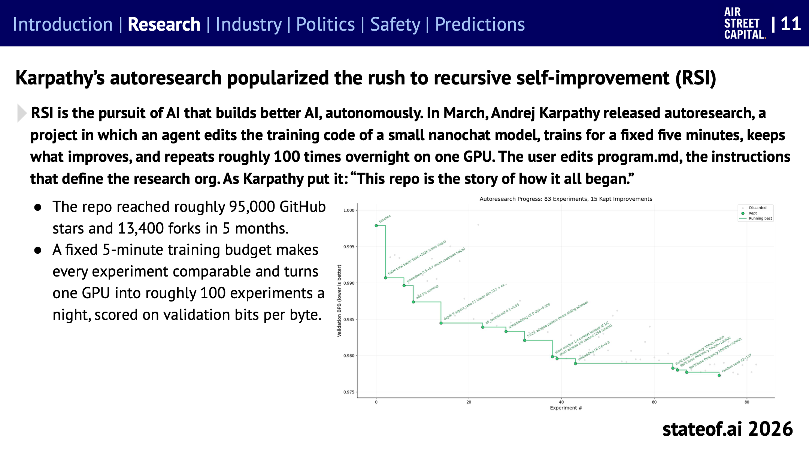
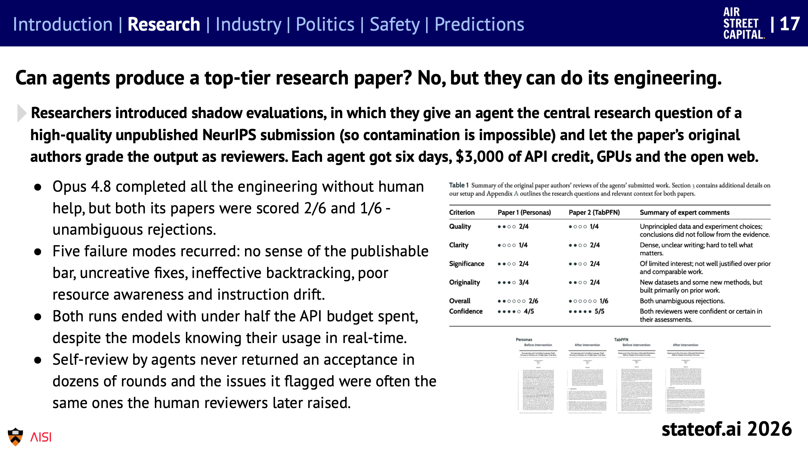
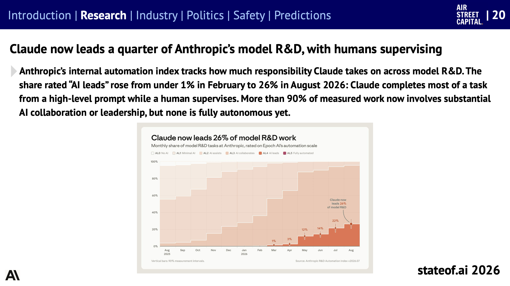
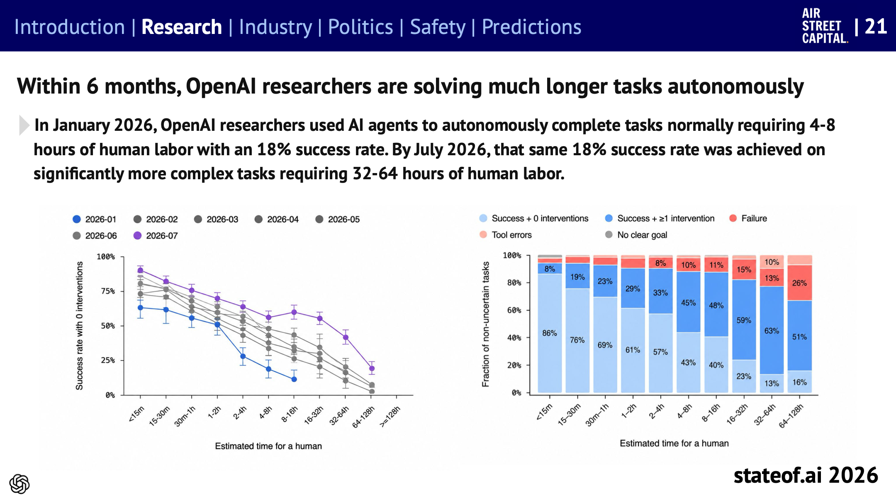
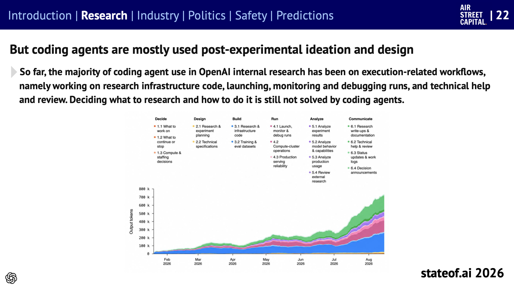
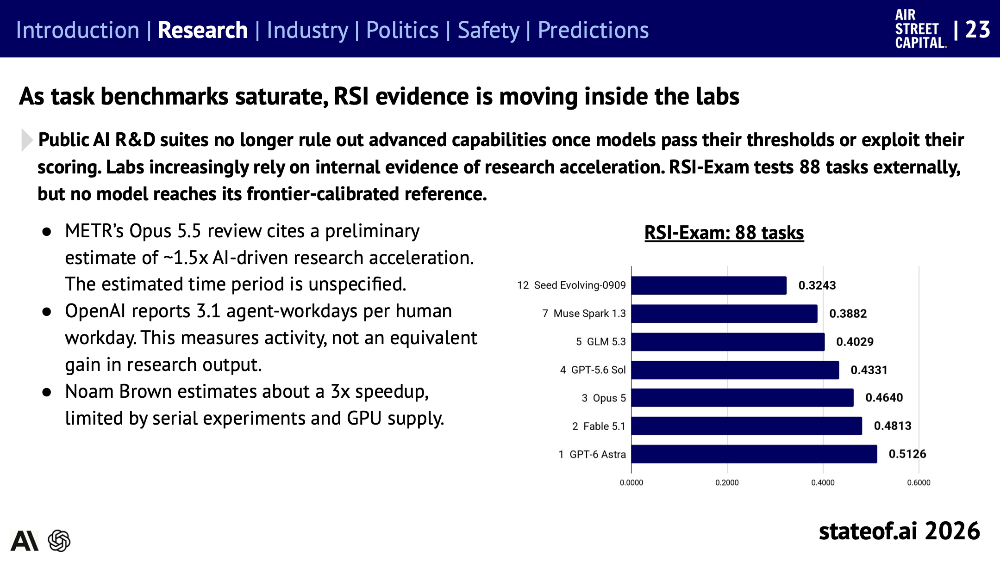

## Table of contents

[State of AI Report 2026](https://www.stateof.ai/)을 주제별로 나눠 읽는 시리즈의 세 번째 글이다. [2편](/state-of-ai-2026-agents)에서 에이전트와 벤치마크를 다뤘고, 여기서는 그 에이전트가 **AI 연구 자체를 얼마나 맡고 있는지**를 다룬다. 보고서 슬라이드 11~23에 해당한다.

이 주제는 다른 시리즈의 [Anthropic과 DeepMind의 RSI 비교](/recursive-self-improvement)에서 한 번 다뤘다. 그 글에 나온 Anthropic의 코드량 8배, 다음 수 판단 64% 같은 수치는 이 보고서에도 그대로 실려 있다(슬라이드 18, 19). 그래서 이 글에서는 그 글에 없던 내용, 즉 공개 연구의 흐름, OpenAI 내부 데이터, 에이전트가 쓴 논문의 심사 결과를 중심으로 정리한다.

보고서의 결론은 이 한 문장으로 줄일 수 있다. **실행은 빠르게 AI에게 넘어가고 있지만, 무엇을 연구할지 정하는 일은 아직 사람이 한다.**

# 공개 연구: autoresearch와 자기 개선 논문

## 한 GPU로 하룻밤에 실험 100번

**재귀적 자기 개선**(recursive self-improvement, RSI)은 AI가 스스로 더 나은 AI를 만드는 것을 말한다. 2026년 3월 Andrej Karpathy가 공개한 autoresearch가 이 흐름을 대중화했다.

_autoresearch로 83번 실험하고 그중 개선된 15번을 채택한 기록. 세로축은 검증 손실(낮을수록 좋다)이고, 초록 계단이 지금까지의 최고 기록이다. 출처: State of AI Report 2026, 슬라이드 11_

구조는 단순하다. 에이전트가 작은 언어 모델(nanochat)의 학습 코드를 고치고, 정확히 5분 동안 학습시키고, 결과가 나아졌으면 남기고 아니면 버린다. 이걸 GPU 한 장으로 하룻밤에 100번쯤 반복한다. 사람이 고치는 것은 연구 조직의 지침에 해당하는 `program.md` 파일 하나다.

- 학습 시간을 5분으로 고정해서 모든 실험을 같은 조건으로 비교할 수 있다.
- 저장소는 5개월 만에 GitHub 스타 약 9만 5천 개, 포크 1만 3,400개를 받았다.

## 자기 개선 연구가 늘고 있다

2026년 1~8월 논문을 전년 같은 기간과 비교하면, 검증 가능한 보상(verifiable rewards)을 다루는 논문은 10.4배, RSI를 직접 다루는 논문은 2.7배 늘었다(슬라이드 12). 보고서는 당장의 기회가 채점이 확실한 실험을 자동화하는 데 있고, 가치 있는 연구 질문을 고르는 것은 별개의 (그리고 아주 가치 있는) 문제라고 본다.

에이전트가 자기 자신을 고치는 연구도 있다(슬라이드 13).

- **Darwin Gödel Machine** 계열은 고정된 모델을 둘러싼 프롬프트, 도구, 작업 흐름(스캐폴드)을 에이전트가 스스로 다시 쓴다. Hyperagents는 그 수정 절차까지 고친다.
- 다만 **더 나은 에이전트가 더 나은 에이전트를 만드는 데도 더 낫다는 증거는 아직 없다.** Weco는 100번의 시도로 사람이 다듬은 에이전트를 이겼지만, 그 새 에이전트로 다음 에이전트를 개선하게 했을 때는 효율이 유의하게 오르지 않았다.

## 연구 과제를 통째로 맡기면

에이전트에게 연구를 처음부터 끝까지 맡긴 실험도 여럿 소개된다.

- **사후 학습 자동화(PostTrainBench):** H100 한 장과 10시간을 주고 작은 기반 모델을 특정 벤치마크에 맞춰 사후 학습시키게 했다. Fable 5.1이 44.6%, Opus 5.5가 43.8%, GPT-6 Astra가 41.9%로, 공식 instruct 모델(48.4%)에 가까워졌다. 단, 벤치마크 하나에 맞춘 조정이지 전반적으로 좋아진 모델을 만든 것은 아니다(슬라이드 15).
- **학습 속도 경쟁(nanoGPT speedrun):** 1억 2,400만 파라미터 GPT를 목표 손실까지 더 적은 스텝으로 학습시키는 과제다. Fable 5의 가장 긴 시도는 8.7일 동안 이어졌고, 기준 3,290스텝에서 2,726스텝까지 줄여 사람 기록(2,600스텝)과의 격차를 81.7% 메웠다. 다만 새로운 아이디어는 많지 않았다(슬라이드 16).

## 에이전트가 쓴 논문은 심사를 통과할까

_아직 공개되지 않은 NeurIPS 투고 논문의 연구 질문을 에이전트에게 주고, 결과물을 그 논문의 원저자들이 심사했다. 품질, 명확성, 중요성, 독창성 항목별 점수와 종합 점수(2/6, 1/6)다. 출처: State of AI Report 2026, 슬라이드 17_

"섀도 평가"라는 방식이 흥미롭다. 아직 공개되지 않은 좋은 NeurIPS 투고 논문의 핵심 연구 질문을 에이전트에게 주고(그래서 학습 데이터에 섞였을 수가 없다), 결과물을 그 논문의 원저자들이 심사위원으로 채점한다. 에이전트에게는 6일, API 크레딧 3천 달러, GPU, 인터넷이 주어졌다.

- Opus 4.8은 엔지니어링을 사람 도움 없이 모두 해냈다. 하지만 논문 두 편은 6점 만점에 2점과 1점, 명백한 탈락이었다.
- 실패 패턴 다섯 가지가 반복됐다. 어느 수준이어야 출판할 만한지 모름, 창의성 없는 해결책, 잘못된 길에서 제대로 돌아오지 못함, 자원을 제대로 쓰지 못함, 지시에서 점점 벗어남.
- 두 시도 모두 API 예산의 절반도 쓰지 않고 끝났다. 사용량을 실시간으로 알 수 있었는데도 그랬다.
- 에이전트가 스스로 심사하게 했을 때는 수십 번을 돌려도 한 번도 "채택"을 주지 않았고, 지적한 문제도 나중에 사람 심사위원이 지적한 것과 같은 경우가 많았다. 스스로의 부족함은 알아보지만 고치지는 못한 셈이다.

제목 그대로다. 최상위 학회 논문을 쓸 수 있느냐는 아니다. 하지만 그 논문의 엔지니어링은 할 수 있다.

# 연구소 안: 실제로 얼마나 맡기고 있나

공개 벤치마크가 포화되면서, 보고서는 RSI의 근거가 연구소 내부로 옮겨 가고 있다고 본다.

## Anthropic: 모델 R&D의 26%를 Claude가 주도

_Anthropic의 모델 R&D 작업을 Epoch AI의 자동화 척도(AL0 AI 없음 ~ AL5 완전 자동화)로 매긴 월별 비중. 가장 진한 칸(AL4, AI가 주도)이 3월 1%, 5월 12%, 7월 22%, 8월 26%로 늘었다. 출처: State of AI Report 2026, 슬라이드 20 (원자료: Anthropic R&D Automation Index)_

Anthropic은 내부 자동화 지수로 모델 R&D에서 Claude가 맡는 책임의 크기를 추적한다.

- "AI가 주도"로 분류된 작업이 2월 1% 미만에서 8월 26%로 늘었다. 사람이 큰 방향만 주면 Claude가 작업 대부분을 끝내고, 사람은 감독한다는 뜻이다.
- 측정된 작업의 90% 이상이 AI가 상당히 협업하거나 주도하는 작업이다.
- **완전 자동화(AL5)는 아직 0%다.**

[AI 기대 격차 보고서](/ai-expectations-gap)에서 Anthropic 직원들은 모델 개발 업무 중 AI가 하는 몫을 중앙값 51%로 답했다. 측정 방식이 달라서 직접 비교할 수는 없지만, "AI가 관여한다"와 "AI가 주도한다" 사이에 아직 거리가 있다는 점은 두 수치가 함께 보여준다.

## OpenAI: 같은 성공률로 8배 긴 과제

_왼쪽: 사람이 하면 걸릴 시간별로 본, 사람 개입 없이 성공한 비율. 파랑이 2026년 1월, 보라가 7월이다. 오른쪽: 과제 길이별 결과 분포로, 연한 파랑이 개입 없이 성공, 진한 파랑이 한 번 이상 개입 후 성공, 빨강이 실패다. 출처: State of AI Report 2026, 슬라이드 21_

- 2026년 1월, OpenAI 연구자들이 쓴 에이전트는 사람이 4~8시간 걸리는 과제를 18% 확률로 혼자 끝냈다.
- 7월에는 같은 18%를 사람이 32~64시간 걸리는 과제에서 냈다. 6개월 사이 같은 성공률로 감당하는 과제 길이가 약 8배가 됐다. 다만 왼쪽 그래프에서 7월의 20% 안팎 지점은 64~128시간 구간에 찍혀 있어, 보고서 본문 설명과 그래프가 정확히 맞지는 않는다. 어느 쪽으로 읽어도 8배 이상이다.
- 그래도 과제가 길수록 혼자 끝내는 비율은 뚝 떨어진다. 오른쪽 그래프에서 15분 미만 과제는 86%를 혼자 끝냈지만, 32~64시간 과제는 13%였다.

## 그런데 무엇에 쓰고 있나

_OpenAI 내부 연구에서 코딩 에이전트가 낸 출력 토큰을 연구 단계(결정, 설계, 구축, 실행, 분석, 소통)별로 나눴다. 파랑(연구 인프라 코드와 데이터셋 구축)과 분홍(실행과 디버깅), 초록(기술 지원과 리뷰 등 소통)이 대부분이고, 맨 아래 주황(무엇을 연구할지 결정, 실험 설계)은 거의 보이지 않는다. 출처: State of AI Report 2026, 슬라이드 22_

OpenAI 내부 연구에서 코딩 에이전트는 대부분 **실행** 쪽에 쓰인다. 연구 인프라 코드 작성, 학습 실행의 시작, 감시, 디버깅, 기술 지원과 리뷰다. 무엇을 연구할지, 어떻게 할지 정하는 일은 아직 코딩 에이전트가 풀지 못했다.

DeepMind가 Gemini 4 Argon 보고서에서 "자동화는 잘 정의되고 검증 가능한 실행 작업에서 가장 많고, 열린 아이디어 발굴과 연구 감각에서 가장 적다"고 한 것과 같은 그림이다.

# 그래서 연구는 얼마나 빨라졌나

_왼쪽: 연구소와 연구자들이 밝힌 가속 추정치. 오른쪽: 외부 평가인 RSI-Exam 88개 과제의 모델별 점수로, 어느 모델도 프런티어 기준점에 이르지 못했다. 출처: State of AI Report 2026, 슬라이드 23_

추정치는 1.5배에서 3배 사이로 흩어져 있고, 각자 재는 것이 다르다.

| 출처 | 추정 | 무엇을 쟀나 |
| --- | --- | --- |
| METR (Opus 5.5 검토) | AI로 인한 연구 가속 약 1.5배 | 예비 추정. 어느 기간 기준인지는 밝히지 않음 |
| OpenAI | 사람 1근무일당 에이전트 3.1근무일 | 활동량. 그만큼 연구 성과가 늘었다는 뜻은 아님 |
| Noam Brown (OpenAI) | 약 3배 | 순서대로 해야 하는 실험과 GPU 공급이 상한을 정함 |

외부에서 잴 방법도 마땅치 않다. 공개 AI R&D 평가는 모델이 기준을 넘거나 채점의 허점을 이용하면 더는 고급 능력을 가려내지 못한다. 외부 평가인 RSI-Exam(88개 과제)에서는 어느 모델도 프런티어 기준점에 닿지 못했다.

# 정리하면

- **실행은 넘어가고 있다.** 코드 작성, 실험 실행과 감시, 디버깅, 정해진 목표의 최적화는 이미 상당 부분 AI가 한다. Anthropic에서는 AI가 주도하는 R&D 작업이 반년 사이 1% 미만에서 26%가 됐고, OpenAI에서는 같은 성공률로 감당하는 과제 길이가 8배가 됐다.
- **방향은 아직 사람이 정한다.** 무엇을 연구할지 고르는 일, 출판할 만한 수준을 아는 일, 막혔을 때 다른 길을 찾는 일에서 에이전트는 아직 약하다. 논문 심사 실험과 OpenAI의 사용 분포가 같은 결론을 가리킨다.
- **가속의 크기는 합의가 없다.** 1.5배부터 3배까지 추정이 나뉘고, 활동량과 연구 성과는 다르다.

[첫 글](/state-of-ai-2026-overview)에서 다룬 2027년 예측 중 "자율 AI 팀이 같은 시간과 연산 자원으로, 스스로 연구 과제를 정해서 사람이 이끄는 모델 연구를 이긴다"가 바로 이 빈자리, 방향을 정하는 능력을 겨냥한다. 저자는 사이트 서문에서 다음으로 보고 싶은 것이 에이전트의 **과학적 감각**이라고 썼다. 어떤 실험을 할지 고르고, 유망한 방향을 알아보고, 익숙한 방법을 언제 버려야 할지 아는 능력이다.

# 읽을 때 주의할 점

- **내부 지표는 각 연구소의 발표다.** Anthropic의 자동화 지수, OpenAI의 과제 길이와 사용 분포 모두 외부에서 검증할 수 없다. 측정 방식도 연구소마다 다르다.
- **"AI가 주도"는 완전 자동화가 아니다.** Anthropic의 26%는 사람이 큰 방향을 주고 감독하는 작업이다.
- **가속 추정은 정의가 제각각이다.** 활동량(에이전트 근무일), 연구 속도, 체감이 섞여 있다.
- **실험 대부분은 한두 번의 시도다.** 섀도 평가는 논문 두 편, speedrun은 특정 과제 하나의 결과다. 보고서도 "새로운 아이디어가 적었다는 것이 AI 연구의 일반적인 한계를 뜻하지는 않는다"고 단서를 달았다.

# 참고

- [State of AI Report 2026](https://www.stateof.ai/) (Nathan Benaich, Air Street Capital, 2026-10-08): 슬라이드 11~23
- [State of AI 2026 (1) 한눈에 보기](/state-of-ai-2026-overview), [State of AI 2026 (2) 에이전트와 벤치마크](/state-of-ai-2026-agents): 이 시리즈의 앞 글
- [AI는 스스로를 만들고 있나: Anthropic과 Google DeepMind의 상반된 내부 분석](/recursive-self-improvement): 같은 주제를 두 연구소의 원문으로 비교한 글

이 글의 그림은 State of AI Report 2026(Nathan Benaich, Air Street Capital)의 슬라이드를 그대로 옮겼고, 보고서는 [CC BY 4.0](https://creativecommons.org/licenses/by/4.0/) 라이선스로 공개되어 있다. 본문은 보고서 내용을 한국어로 요약하고 일부 옮긴 것이다.
