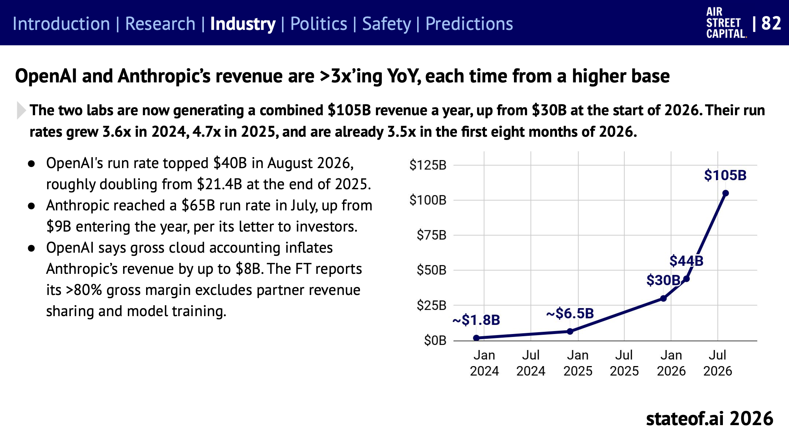
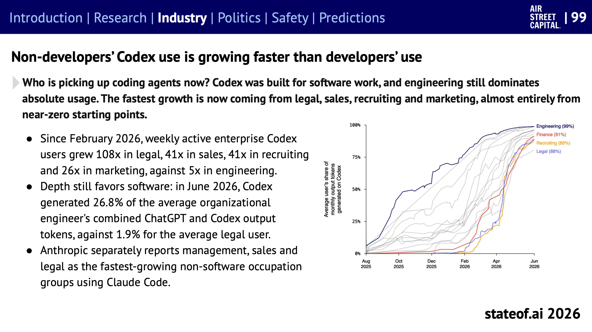
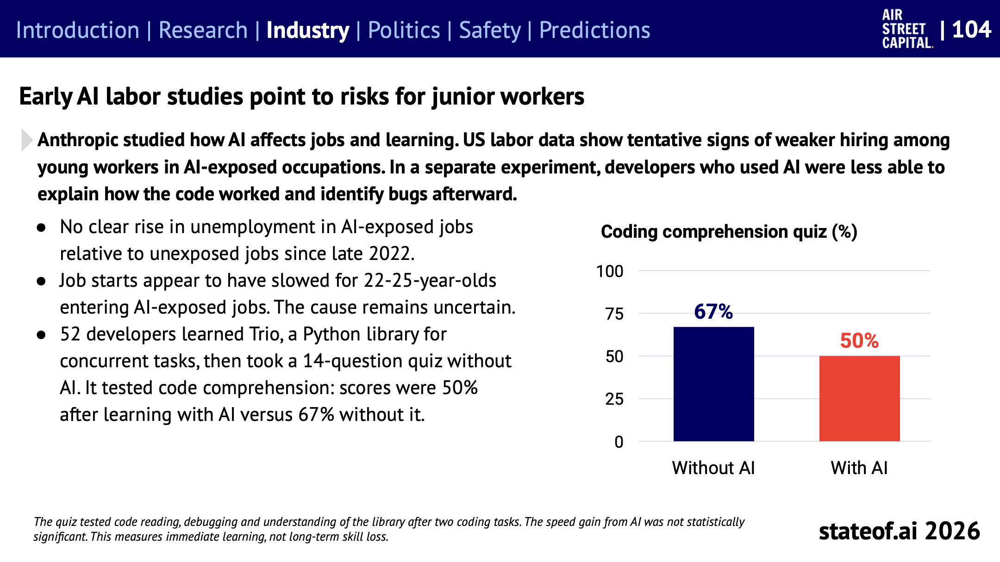
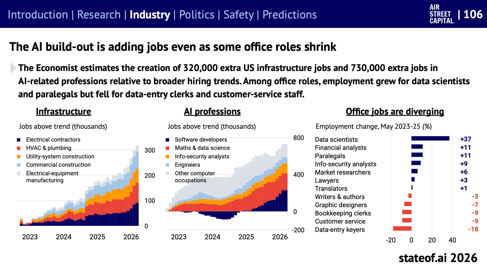
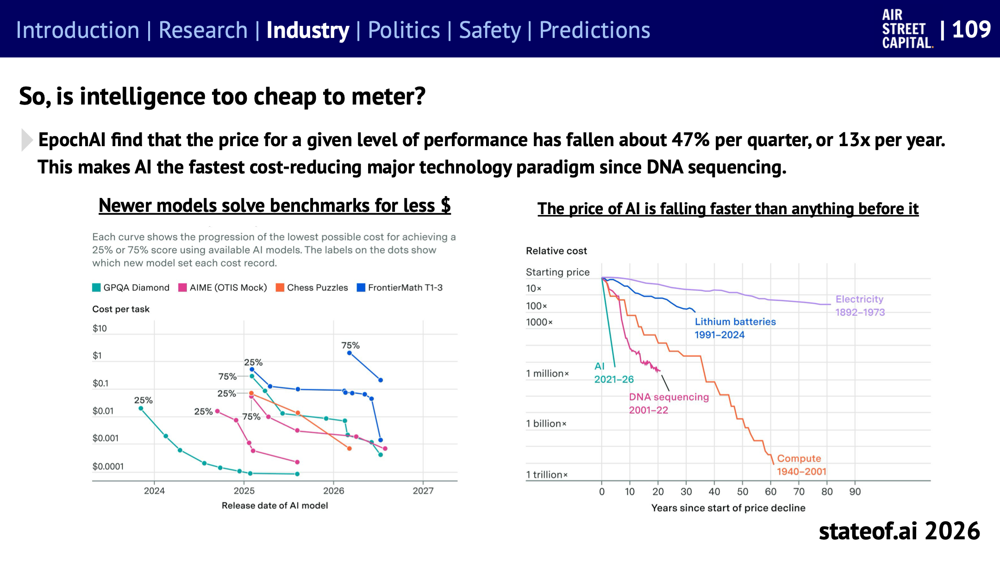
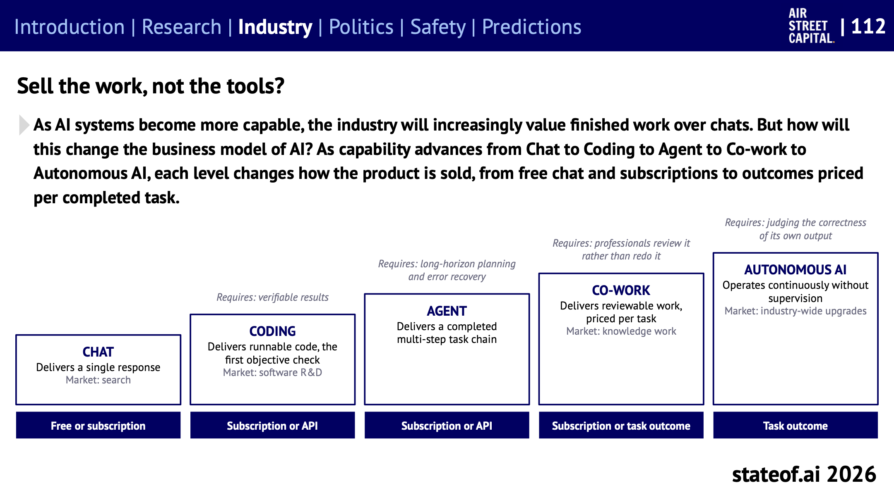
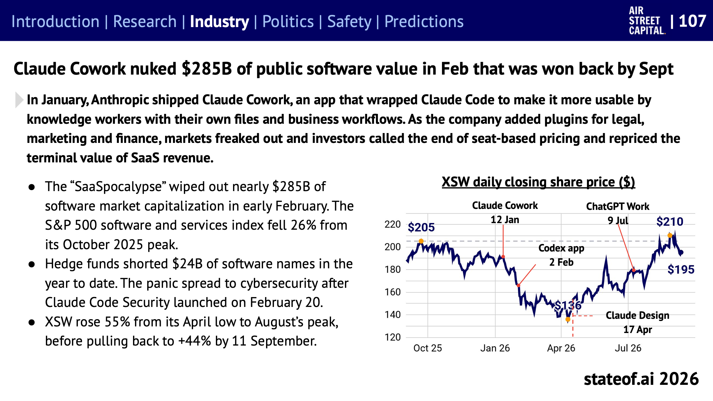

## Table of contents

[State of AI Report 2026](https://www.stateof.ai/)을 주제별로 나눠 읽는 시리즈의 여섯 번째 글이다. [5편](/state-of-ai-2026-science)까지 연구 섹션을 다뤘고, 이번부터 산업 섹션으로 넘어간다. 여기서는 **누가 AI로 돈을 벌고, 누가 쓰고, 일자리는 어떻게 바뀌는지**를 다룬다. 슬라이드 82~117, 119~120에 해당한다. 인프라와 투자 쪽 슬라이드(121~162)는 다음 글에서 다룬다.

# 매출: 1년 사이 3.5배

_OpenAI와 Anthropic의 합산 연 매출 런레이트(그 시점 매출을 1년으로 환산한 값). 출처: State of AI Report 2026, 슬라이드 82_

두 연구소의 합산 런레이트는 2026년 초 300억 달러에서 8월 1,050억 달러가 됐다. 성장 배수는 2024년 3.6배, 2025년 4.7배, 2026년 첫 8개월 3.5배다. 매년 더 큰 기준에서 3배 넘게 크고 있다.

- **OpenAI:** 8월 런레이트 400억 달러 돌파. 2025년 말 214억 달러에서 약 두 배다.
- **Anthropic:** 7월 런레이트 650억 달러. 연초 90억 달러에서 7배 넘게 늘었다.
- **회계 논쟁:** OpenAI는 Anthropic의 매출이 클라우드 판매분을 총액으로 잡는 방식 때문에 최대 80억 달러 부풀려졌다고 주장한다. FT는 Anthropic의 80% 넘는 매출총이익률에 파트너와의 수익 배분과 모델 학습 비용이 빠져 있다고 보도했다.

보고서는 이 1,050억 달러를 AI가 바꾸려는 산업과 비교한다. 인도 IT 서비스 양대 기업(TCS, Infosys) 합산의 2.1배, 4대 회계법인 매출의 절반 가까이, 영국 법률 서비스 시장의 1.6배다(슬라이드 83). AI 전체 매출은 집계 범위에 따라 약 1,500억~2,290억 달러로 추정된다.

## 시장 점유: 어디서 재느냐에 따라 다르다

- **기업 API 지출(Ramp):** 9월 말 Anthropic이 지출 1위를 되찾았다. 10월 3일까지 Anthropic 52.4%, OpenAI 43.3%, 나머지 전부 4.2%다. 두 회사가 96%를 가져간다(슬라이드 85).
- **요청 수와 토큰(OpenRouter, Vercel):** OpenRouter에서는 OpenAI와 Anthropic이 텍스트 요청의 20.7%에 그친다. Vercel에서는 오픈 웨이트 모델이 토큰의 62.7%를 처리하지만 지출에서는 26.9%다. 싼 모델에 많은 요청이 몰리고, 돈은 비싼 모델로 간다(슬라이드 86).
- **순위 유지:** 지난 1년 52주 중 Anthropic은 51주 동안 Arena 상위 5위 안에 모델이 있었다. 두 리더보드 모두에서 1년의 3분의 1 이상 상위 5위를 지킨 곳은 Anthropic과 Google DeepMind뿐이다(슬라이드 87).

OpenAI는 올해만 제품 10개를 접거나 종료 일정을 발표했다. 보고서는 "곁가지 때문에 이 순간을 놓칠 수 없다"는 OpenAI의 말을 인용하며, Anthropic은 처음부터 그런 전선을 열지 않았다고 대비한다(슬라이드 88).

# 사용: 개발자 밖으로 퍼진다

## 코딩 에이전트를 비개발자가 쓴다

OpenAI Codex 사용자는 2월 초 주간 160만 명에서 8월 말 2,500만 명으로 7개월 사이 15배가 됐다. Anthropic에 연 100만 달러 넘게 쓰는 고객은 1,000곳을 넘어, 3개월 만에 두 배가 됐다(슬라이드 84).

_직군별 평균 사용자의 월간 출력 토큰 중 Codex가 만든 비율. 엔지니어링(남색)이 먼저 올랐고, 2026년 2월 이후 재무, 채용, 법무가 뒤따랐다. 출처: State of AI Report 2026, 슬라이드 99_

- 2026년 2월 이후 기업 Codex 주간 사용자는 법무 108배, 영업 41배, 채용 41배, 마케팅 26배로 늘었다. 엔지니어링은 5배다. 대부분 거의 0에서 시작했다.
- 다만 쓰는 깊이는 여전히 소프트웨어 쪽이 크다. 6월 기준 엔지니어의 ChatGPT와 Codex 출력 토큰 중 Codex 몫은 26.8%, 법무 사용자는 1.9%다.
- Anthropic도 Claude Code를 쓰는 비소프트웨어 직군 중 관리, 영업, 법무가 가장 빨리 늘고 있다고 밝혔다.

이 흐름은 [Anthropic 고용 보고서 요약](/employment-at-anthropic)에서 다룬 "비기술직 직원의 코딩 에이전트 세션이 월 2건에서 90건으로" 늘어난 것과 같은 방향이다.

## 연구소 안과 밖의 격차

- **OpenAI 내부와 외부:** 최근 28일 동안 Codex를 쓴 비율이 OpenAI 직원은 97.9%, 조직 사용자는 17.3%, 개인 사용자는 0.7%다(슬라이드 97).
- **상위 1%가 몰아서 쓴다:** Ramp 기준 상위 1% 기업의 중앙값은 직원 1인당 월 7,205달러를 AI에 쓴다. 전체 중앙값 기업은 12.5달러다. 약 580배 차이다. OpenAI와 Anthropic 지출의 약 80%를 고객 1%가 낸다(슬라이드 95).
- **스타트업이 앞서간다:** 2023년 9월에는 VC 투자를 받은 기업과 다른 기업의 직원당 AI 지출이 3.40달러와 2.13달러로 비슷했다. 2026년 8월에는 81.20달러와 8.33달러로 10배 가까이 벌어졌다(슬라이드 100).
- **S&P 500 기업:** AI를 실제 도입했다고 밝힌 곳은 69%지만, 시간에 따른 성과 지표를 공개한 곳은 2%다.

## 사람들은 Claude를 어디에 쓰나

Stanford SALT 연구소가 2026년 봄 2주 동안의 Claude.ai 대화 24만 9,834건을 Anthropic의 개인정보 보호 분석 도구로 분석했다(채팅만, Claude Code와 Cowork 제외). 중요도를 매길 수 있는 대화의 56%가 결과가 중요하거나 위험이 큰 일이었고, 12%는 위험이 아주 큰 일이었다. 72%는 사람이 일을 이끌고 AI가 돕는 형태였다. 위험이 큰 일일수록 AI 출력을 그대로 쓰는 비율이 21%에서 13%로 떨어졌다(슬라이드 96).

# 성과: 많이 쓰는 회사가 더 빨리 큰다

- **AI 네이티브 기업:** AI가 제품인 회사와 기존 소프트웨어에 AI를 더한 회사를 비교하면, 상위 4분위 매출 성장률이 연 매출 100만~2,000만 달러 구간에서 256% 대 90%, 2,000만 달러 이상 구간에서 172% 대 53%다(슬라이드 93). 1억 달러를 넘긴 뒤에도 성장이 이어진다. Cursor는 40억 달러를 넘겼다는 보도가 있다(슬라이드 92).
- **토큰을 많이 쓰는 회사:** BCG가 연 매출 5억 달러 이상 공개 기술 기업 107곳을 Cursor 토큰 사용량으로 나눠 보니, 많이 쓰는 쪽이 1년 매출 성장률이 3배 높았다(슬라이드 102).
- **일의 종류에 따라 편차가 크다:** Claude Opus 5는 정형화된 회계 과제 4종에서 20번 모두 만점을 받았지만, 은행 업무 시뮬레이션 100건(ATLAS-Finance)에서는 올바른 파일을 만들어 제대로 제출하기까지 해낸 비율이 12.3%였다. 한 과제에서는 자기가 세운 틀린 가정에 맞춰 검증해서, 자체 점검 13개를 모두 통과하고도 틀렸다(슬라이드 101).

보고서도 단서를 단다. AI를 많이 쓰는 회사가 빨리 크는 것은 사실이지만, AI를 써서 빨리 큰 것인지, 빨리 크는 회사가 AI를 많이 쓰는 것인지는 이 데이터로 가를 수 없다. 저자는 "그렇다고 의심한다"고 적었다.

# 일자리: 첫 연구들이 보내는 신호

## 주니어와 학습

_개발자 52명이 파이썬 비동기 라이브러리 Trio를 배운 뒤 AI 없이 본 14문항 퀴즈 점수. 코드 읽기, 디버깅, 라이브러리 이해를 묻는다. 출처: State of AI Report 2026, 슬라이드 104_

Anthropic이 AI가 일자리와 학습에 미치는 영향을 연구한 결과를 보고서가 묶어 소개한다.

- **실업:** 2022년 말 이후 AI에 노출된 직업에서 노출되지 않은 직업보다 실업이 뚜렷하게 늘지는 않았다.
- **주니어 채용:** AI에 노출된 직업에 들어가는 22~25세의 신규 취업이 둔화된 것으로 보인다. 원인은 아직 불확실하다.
- **학습:** 개발자 52명에게 새 라이브러리를 배우게 하고 AI 없이 퀴즈를 보게 했더니, AI와 함께 배운 쪽이 50%, AI 없이 배운 쪽이 67%였다. AI를 쓴 쪽이 더 빨리 끝낸 것도 통계적으로 유의하지 않았다. 다만 장기적인 실력 저하가 아니라 직후의 학습을 잰 것이다.

교육에서는 다른 결과도 있다. 시에라리온의 학교 12곳, 학생 1,763명을 무작위로 나눠 교사가 이끄는 Gemini 활동을 8주 했더니 수학 점수가 0.258 표준편차 올랐다. 보고서는 "좋은 튜터는 친절한 조수가 아니다"라고 정리한다. 답을 주는 것과 가르치는 것은 다르다는 뜻이다(슬라이드 105).

이 결과들은 [Anthropic 고용 보고서](/employment-at-anthropic)에서 본 "주니어 기술직 채용 비중 27%에서 9%로"와 겹친다. 한 회사의 사정이 아니라 노동시장 전체에서도 같은 신호가 보이기 시작했다는 것이다. 다만 아직 "보이기 시작했다" 수준이다.

## 늘어나는 일, 줄어드는 일

_왼쪽: 추세 대비 추가로 생긴 미국 인프라 일자리(전기, 냉난방, 건설 등). 가운데: 추세 대비 추가로 생긴 AI 관련 직군 일자리. 오른쪽: 2023년 5월~2025년 5월 사무직 직종별 고용 변화. 출처: State of AI Report 2026, 슬라이드 106 (원자료: The Economist)_

- The Economist는 AI 구축으로 미국에서 인프라 일자리 32만 개, AI 관련 직군 일자리 73만 개가 추세보다 더 생겼다고 추정했다.
- 사무직은 갈렸다. 2023년 5월에서 2025년 5월 사이 데이터 사이언티스트는 37%, 재무 분석가와 법률 보조원은 11% 늘었고, 데이터 입력원은 18%, 고객 서비스와 경리는 9% 줄었다.
- Ramp의 미국 기업 2만 1,559곳 분석에서는 AI 지출 상위 3분의 1 기업이 2년 동안 인원을 10.2%, 신입을 12% 늘렸다. 다만 거의 모두 기술 기업에서 나온 증가다(슬라이드 103).

# 가격과 사업 모델

## AI 가격은 분기마다 반값이 된다

_왼쪽: 벤치마크별로 특정 점수를 내는 최저 비용이 새 모델이 나올 때마다 내려간 기록. 오른쪽: 가격 하락이 시작된 뒤 경과 연수별 상대 비용. AI(2021~2026)가 DNA 시퀀싱보다 가파르다. 출처: State of AI Report 2026, 슬라이드 109 (원자료: Epoch AI)_

Epoch AI에 따르면 같은 성능을 내는 가격은 분기마다 약 47%, 1년에 약 13분의 1로 떨어진다. DNA 시퀀싱 이후 가장 빠른 가격 하락이다. 그래서 더 많은 일을 AI에 맡기는 것이 경제적으로 맞게 된다.

그런데 보고서는 **토큰 가격이 답 하나의 비용을 말해주지 않는다**고 짚는다(슬라이드 110, 111). 추론 모델은 답을 내기까지 토큰을 많이 쓴다. Artificial Analysis가 과제 하나를 끝내는 데 든 비용으로 재면 Anthropic의 프런티어 모델이 가장 비싸다. 과제 1달러당 얻는 지수 점수는 회사별 최고 모델 사이에서 6.9배 차이가 난다.

## 도구가 아니라 일을 판다

_능력 단계별로 무엇을 넘겨주고 어떻게 파는지. 각 단계 위에 그 단계로 가려면 필요한 조건이 적혀 있다. 출처: State of AI Report 2026, 슬라이드 112_

| 단계 | 넘겨주는 것 | 파는 방식 | 다음 단계로 가려면 |
| --- | --- | --- | --- |
| 채팅 | 답 하나 | 무료, 구독 | 검증 가능한 결과 |
| 코딩 | 돌아가는 코드 | 구독, API | 긴 계획과 오류 회복 |
| 에이전트 | 여러 단계 작업 완료 | 구독, API | 전문가가 다시 하지 않고 검토만 하면 되는 품질 |
| 코워크 | 검토 가능한 결과물 | 구독, 과제당 | 스스로 출력의 정확성 판단 |
| 자율 AI | 감독 없이 계속 운영 | 과제 결과당 | |

보고서는 AI가 좋아질수록 산업이 대화보다 **끝낸 일**에 값을 매기게 될 것이라고 본다. 이를 뒷받침하는 사례도 여럿이다.

- **특정 분야 회사는 오픈 모델을 다듬는다.** 법률 AI Harvey는 중국 오픈 모델 GLM-5.2를 사후 학습시켜, Sonnet 5보다 54.8% 싸게 운영하면서 자체 법률 문서 검토 품질 점수는 Fable 5보다 높았다(0.903 대 0.867). 보고서는 특정 분야에 집중한 회사가 그 분야의 채점 환경과 전문가 데이터를 가장 잘 만들 수 있다고 본다(슬라이드 113).
- **에이전트가 에이전트를 고친다.** 고객 상담 에이전트는 예전에 공급사의 엔지니어가 만들고 대화 기록을 읽으며 고쳤다. 이제는 고객사 직원이 평이한 말로 바꿀 점을 설명하면 에이전트가 고치고 테스트까지 한 뒤 사람이 승인한다. PolyAI는 고객이 배포한 변경의 87%가 이 방식이었다고 밝혔다(슬라이드 115).
- **일하는 과정이 데이터가 된다.** 연구소는 완성된 답보다 일이 어떻게 진행됐는지에 대한 기록을 원한다. 전문가가 고친 세무 에이전트의 작업 기록을 재사용하자 정확도 75% 이상으로 제출된 문서가 6주 만에 25%에서 86%로 늘었다. 기업의 업무 절차와 기록을 라이선스해 주면 10만 달러에서 1천만 달러 이상을 주겠다는 중개사도 생겼다(슬라이드 116). 학습 데이터와 평가 환경을 파는 회사들은 연 매출이 수억~20억 달러에 이른다(슬라이드 117).

# 시장이 흔들렸다: SaaSpocalypse

_소프트웨어 ETF(XSW) 일별 종가와 주요 제품 출시 시점. 출처: State of AI Report 2026, 슬라이드 107_

1월 Anthropic이 Claude Code를 지식 노동자용으로 감싼 앱 Claude Cowork를 내놨다. 법무, 마케팅, 재무용 플러그인이 붙자, 투자자들은 사람 수에 따라 받는 소프트웨어 구독 모델이 끝났다고 보고 SaaS 매출의 장기 가치를 다시 매겼다.

- 2월 초 소프트웨어 시가총액 약 2,850억 달러가 증발했다. S&P 500 소프트웨어·서비스 지수는 2025년 10월 고점 대비 26% 떨어졌다.
- 헤지펀드는 올해 소프트웨어 종목에 240억 달러어치 공매도를 걸었다. 2월 20일 Claude Code Security가 나오자 공포가 보안 업종으로 번졌다.
- 그런데 9월에는 대부분 회복했다. XSW는 4월 저점 대비 8월 고점까지 55% 올랐다.

저자는 사이트 서문에서 보안 회사들이 쓸모없어질 거라는 공포는 "어리석은 생각"이었다고 썼다. 공격 능력이 커지면 방어 수요도 커지기 때문이다. 투자자가 판단해야 할 것은 에이전트가 기존 회사의 가격 결정력을 깎을지, 시장을 키울지, 경쟁자를 키울지다.

연구소들도 직접 서비스 사업에 나섰다. 5월 Anthropic과 OpenAI는 사모펀드의 돈을 받아 기업 도입을 돕는 컨설팅 회사를 각각 세웠다. 출자한 사모펀드의 포트폴리오 기업이 곧 고객이다. OpenAI 쪽은 투자자에게 연 17.5% 최소 수익을 보장한다는 보도가 있어, 보고서는 지분보다 채권에 가까운 구조라고 봤다(슬라이드 108).

## 그 밖의 장면들

- **Meta의 Muse:** 저커버그의 "모두를 위한 개인 초지능"이 제품으로 나왔다. 사용자마다 앱을 넘나들며 일하는 클라우드 컴퓨터를 준다. 2주 만에 280만 다운로드, 미국 앱 차트 1위를 기록했고, Stripe, Shopify, Walmart, PayPal과 결제를 연결했다(슬라이드 119).
- **AI 쇼핑 유입:** AI 어시스턴트를 통한 쇼핑몰 방문은 1년 사이 203% 늘었지만, 아직 전체 방문의 0.4%다. 대신 전환율이 높다. Shopify에서 AI로 들어온 방문자는 검색으로 들어온 방문자보다 약 80% 더 자주 구매했다(슬라이드 120).
- **인재 이동:** OpenAI 이직이 더 많이 주목받지만, 경쟁사로 간 사람은 DeepMind 출신이 훨씬 많다(슬라이드 90).

# 정리하면

- **돈은 두 곳에 몰린다.** OpenAI와 Anthropic의 매출은 매년 3배 넘게 크고, 기업 API 지출의 96%를 가져간다. 다만 요청 수로 보면 싼 오픈 모델도 많이 쓰인다.
- **사용은 퍼지지만 고르지 않다.** 비개발자의 코딩 에이전트 사용이 가장 빨리 늘지만, 상위 1% 기업과 중앙값 기업의 지출 차이는 580배이고, 연구소 안과 밖의 격차도 크다.
- **가격은 떨어지지만, 과제당 비용은 다르다.** 같은 성능의 가격은 1년에 13분의 1이 되지만, 추론을 많이 하는 모델은 과제 하나에 많은 토큰을 쓴다.
- **일자리는 갈린다.** 인프라와 AI 직군은 늘고, 일부 사무직은 줄었다. 주니어 신규 취업 둔화와 AI로 배울 때의 이해도 저하는 아직 첫 신호이지만, 같은 방향을 가리킨다.

# 읽을 때 주의할 점

- **매출은 회사 발표와 보도다.** 런레이트는 특정 시점 매출을 연간으로 늘린 값이고, OpenAI와 Anthropic이 서로의 회계 방식을 문제 삼을 만큼 기준이 다르다.
- **지출 데이터는 표본이 한정돼 있다.** Ramp, OpenRouter, Vercel은 각자의 고객 기반에서 본 숫자다. 보고서도 이를 하나의 시장 점유율로 읽지 말라고 적었다.
- **상관이지 인과가 아니다.** AI를 많이 쓰는 회사가 빨리 크고 사람을 더 뽑는다는 결과는, 원래 잘되는 회사가 AI를 많이 쓰는 것일 수 있다.
- **일자리 연구는 초기 단계다.** 주니어 취업 둔화는 "보이는 것 같다", 학습 실험은 52명의 직후 결과다.

# 참고

- [State of AI Report 2026](https://www.stateof.ai/) (Nathan Benaich, Air Street Capital, 2026-10-08): 슬라이드 82~117, 119~120
- [AI를 가장 깊게 쓰는 회사에서 일은 어떻게 바뀌었나: Anthropic 고용 보고서 요약](/employment-at-anthropic): 주니어 채용과 비개발자의 에이전트 사용을 한 회사 안에서 본 글
- [State of AI 2026 (1) 한눈에 보기](/state-of-ai-2026-overview), [(2) 에이전트와 벤치마크](/state-of-ai-2026-agents), [(3) AI가 AI 연구를 한다](/state-of-ai-2026-ai-research), [(4) 피지컬 AI](/state-of-ai-2026-physical-ai), [(5) 과학 AI](/state-of-ai-2026-science): 이 시리즈의 앞 글

이 글의 그림은 State of AI Report 2026(Nathan Benaich, Air Street Capital)의 슬라이드를 그대로 옮겼고, 보고서는 [CC BY 4.0](https://creativecommons.org/licenses/by/4.0/) 라이선스로 공개되어 있다. 본문은 보고서 내용을 한국어로 요약하고 일부 옮긴 것이다.
