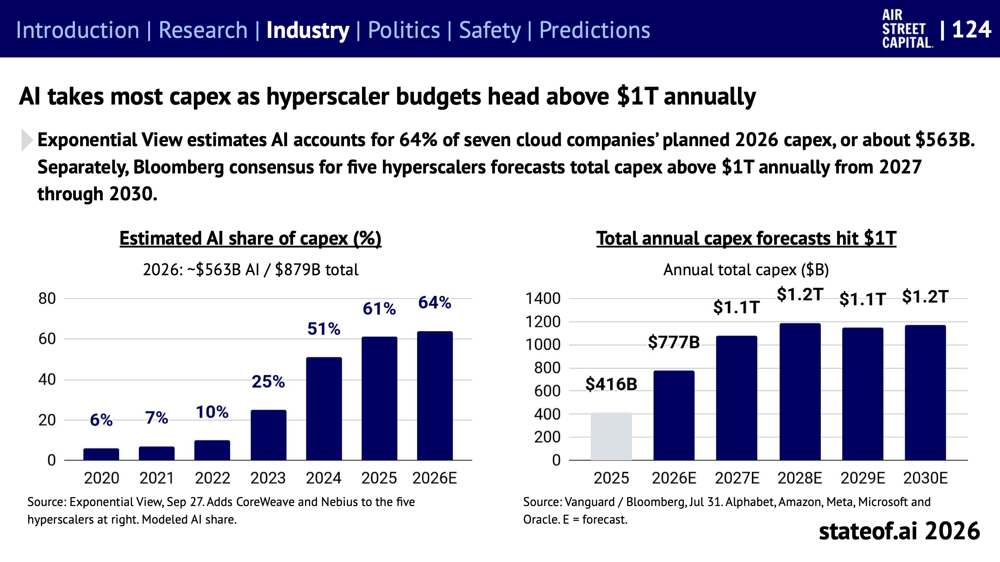
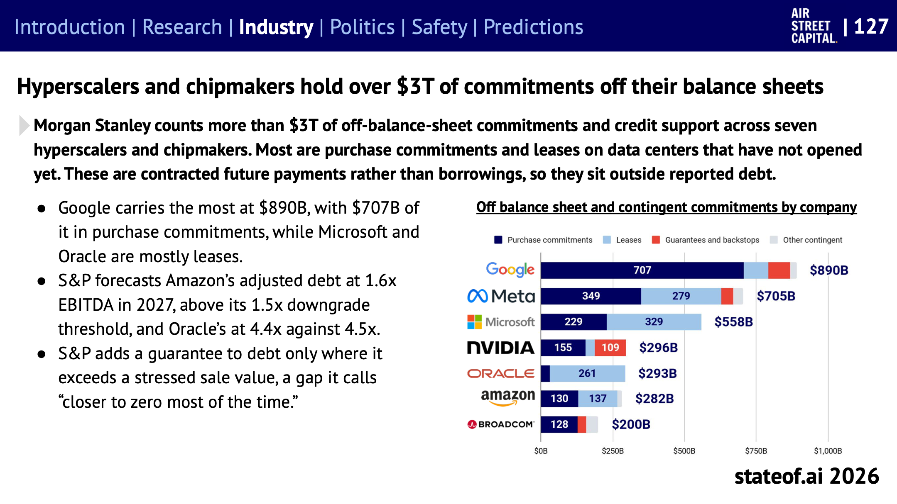
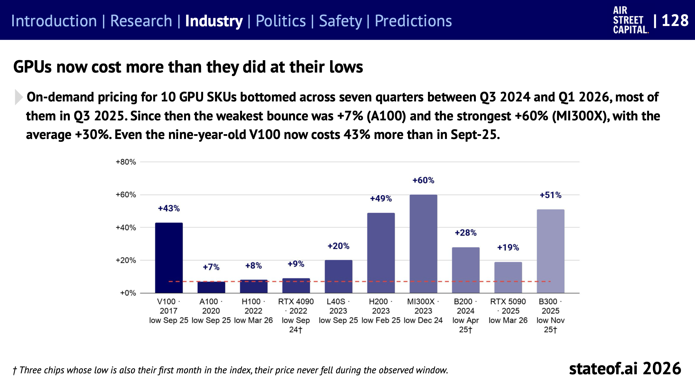
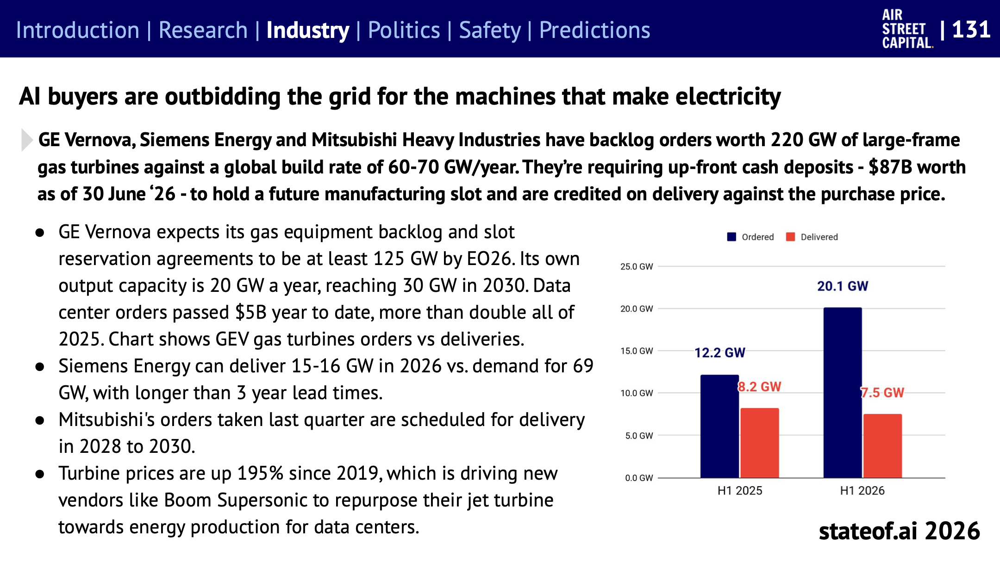
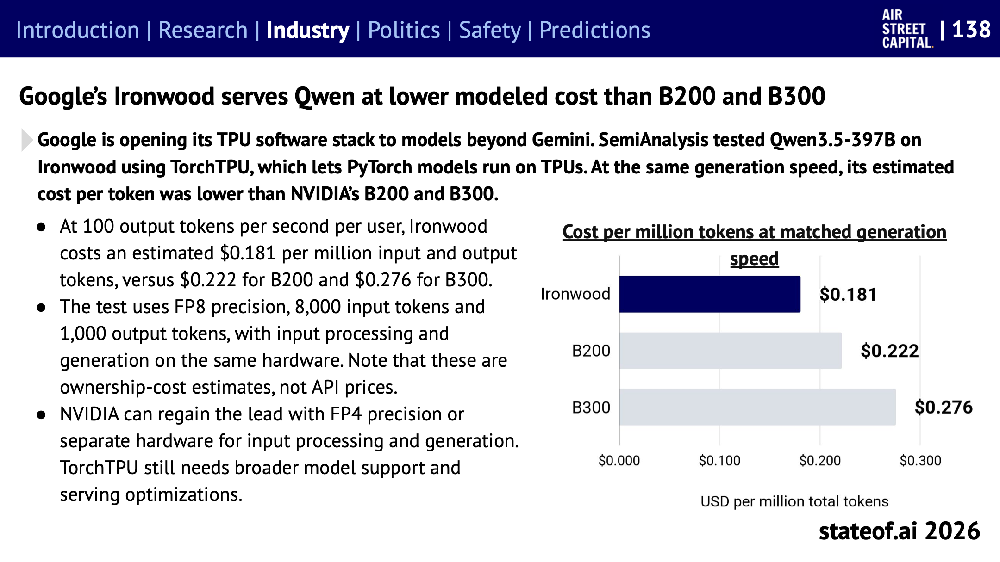
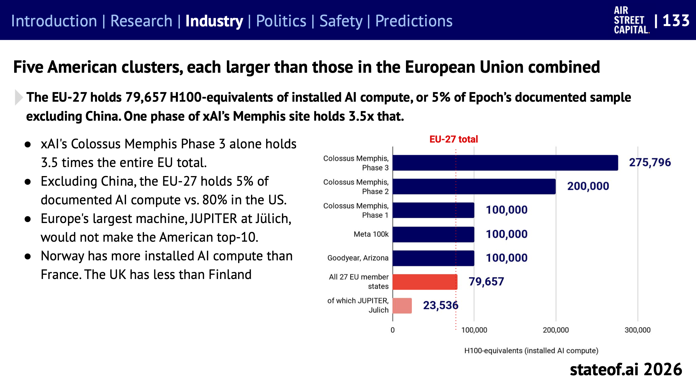
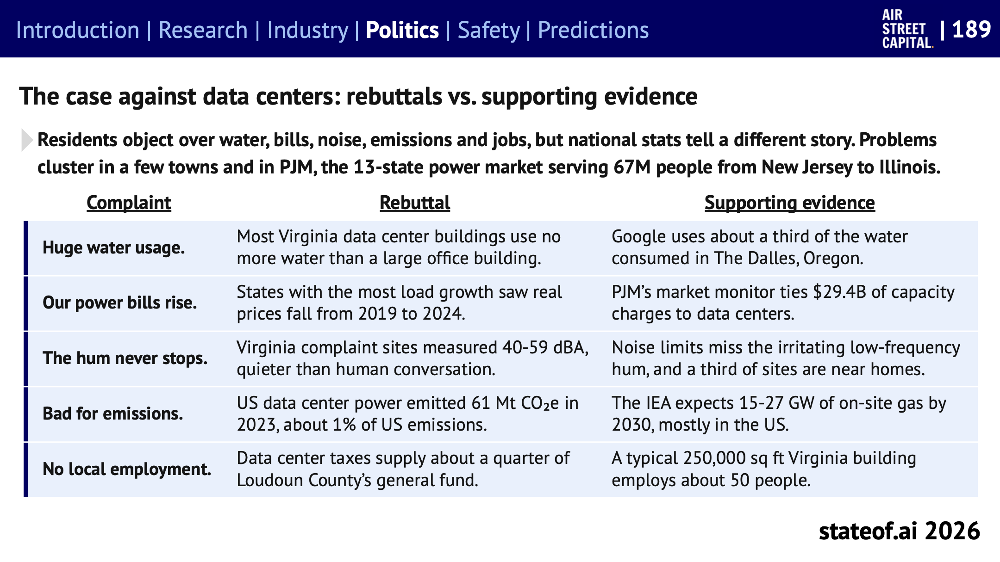
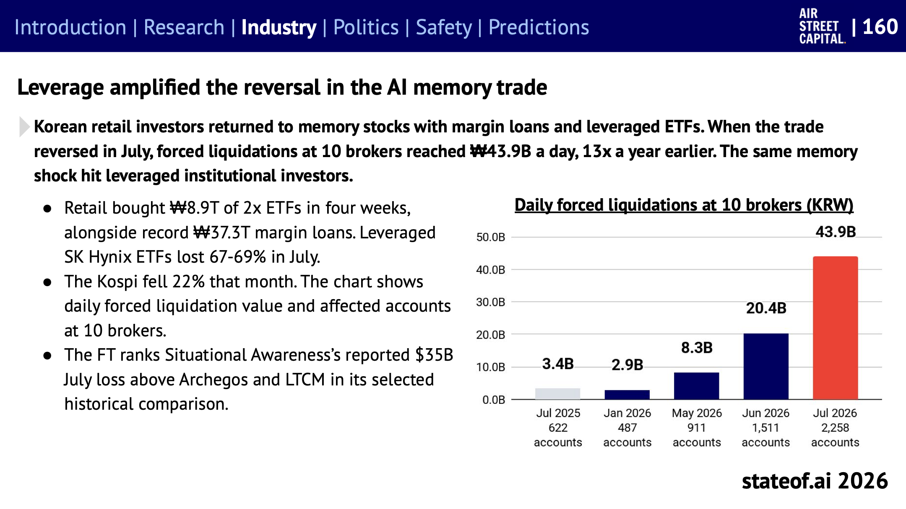

## Table of contents

[State of AI Report 2026](https://www.stateof.ai/)을 주제별로 나눠 읽는 시리즈의 일곱 번째 글이다. [6편](/state-of-ai-2026-business)에서 AI로 버는 돈과 쓰는 사람을 다뤘다면, 이번에는 **그 수요를 받치는 쪽**, 즉 데이터센터와 칩, 전력, 그리고 거기에 들어가는 돈을 다룬다. 산업 섹션의 슬라이드 121~144, 151~162와, 정치 섹션 중 데이터센터 반대를 다룬 슬라이드 188~191에 해당한다.

보고서 서문의 표현을 빌리면, AI가 더 많아지려면 **자금 조달, 건설, 그리고 지역 주민의 동의**가 필요하다. 올해는 셋 다 병목이 됐다.

# 돈의 규모: 연 1조 달러

_왼쪽: 클라우드 기업 7곳의 설비 투자 중 AI 비중 추정(Exponential View). 오른쪽: 하이퍼스케일러 5곳(Alphabet, Amazon, Meta, Microsoft, Oracle)의 연간 설비 투자 전망(Bloomberg 컨센서스). 출처: State of AI Report 2026, 슬라이드 124_

- **AI가 설비 투자의 대부분이다.** 클라우드 기업 7곳의 2026년 설비 투자 계획 8,790억 달러 중 약 64%, 5,630억 달러가 AI다. 2020년에는 6%였다.
- **2027년부터 연 1조 달러.** Bloomberg 컨센서스는 하이퍼스케일러 5곳의 설비 투자가 2027년부터 2030년까지 매년 1조 달러를 넘을 것으로 본다.
- **4대 하이퍼스케일러만 7,330억 달러.** Amazon, Alphabet, Microsoft, Meta의 2026년 설비 투자 가이던스는 2025년 4,100억 달러에서 79% 늘어난 7,330억 달러다. Alphabet은 119%, Meta는 90% 늘렸다(슬라이드 154).
- **연구소도 그만큼 모은다.** OpenAI와 Anthropic은 올해 각각 1,220억 달러와 950억 달러의 투자 유치를 발표했다. 연구소의 자금 조달이 하이퍼스케일러 설비 투자와 같은 규모가 됐다.
- **이미 계약된 미래 매출:** 대형 클라우드의 수주 잔고는 6월 기준 1조 6,900억 달러다(AI 외 사업 포함, 슬라이드 121).

## 장부 밖으로 나간 위험

_회사별 장부 밖 약정과 우발 채무(Morgan Stanley 집계). 남색이 구매 약정, 하늘색이 리스, 빨강이 보증과 지급 보장이다. 출처: State of AI Report 2026, 슬라이드 127_

이 투자의 상당 부분은 재무제표의 부채로 잡히지 않는 방식으로 조달된다.

- **장부 밖 약정 3조 달러:** Morgan Stanley는 하이퍼스케일러와 칩 회사 7곳의 장부 밖 약정과 신용 보강을 3조 달러 넘게 집계했다. 대부분 아직 문을 열지 않은 데이터센터에 대한 구매 약정과 리스다. 빌린 돈이 아니라 계약된 미래 지급이어서 보고된 부채에 들어가지 않는다. Google이 8,900억 달러로 가장 크다.
- **잔존 가치 보증이 퍼진다:** 데이터센터나 칩의 최소 재판매 가치를 대출자에게 보장해 주는 구조다. 부채는 자산을 소유한 별도 회사(SPV)에 두어 보증인의 장부 밖에 있다. Meta의 Hyperion 캠퍼스에서 시작해 1년 안에 4건, 총 1,750억 달러로 늘었다(Meta 410억, Broadcom 290억, NVIDIA 1,050억 달러). 이렇게 보증받은 부채는 보증인 자체 채권보다 금리가 1~1.5%p 높은 수준에서 팔려, Hyperion은 270억 달러를 모았다(슬라이드 126).
- **칩 회사가 고객의 빚을 보증한다:** NVIDIA는 OpenAI와 SB Energy의 리스, 전력 지급에 대해 최대 1,050억 달러를 보증했다. 고객이 갚지 못하면 칩 회사는 매출과 보증 지급을 함께 잃는다. NVIDIA는 독립적인 심사와 하드웨어 재사용으로 위험이 줄어든다고 주장한다(슬라이드 125).
- **신용 등급 경계선:** S&P는 Amazon의 2027년 조정 부채가 EBITDA의 1.6배로 등급 하향 기준(1.5배)을 넘고, Oracle은 4.4배로 기준(4.5배)에 바짝 다가갈 것으로 본다.

# 컴퓨팅 시장: 계약은 했는데 켜지 못한다

- **네오클라우드 계약 15GW 이상:** CoreWeave 같은 AI 전용 클라우드는 15GW 넘게 계약했다. 그런데 CoreWeave는 2분기 말 기준 계약 4.2GW 중 가동 중인 것이 1.5GW다. 부지를 찾고, 허가를 받고, 짓고, 전기를 넣고, 장비를 설치하기까지 시간이 걸린다. 당장 쓸 수 있는 용량은 MW당 4,000만~5,000만 달러로, 다년 계약(2,000만~2,500만 달러)의 두 배다(슬라이드 122).
- **비트코인 채굴 업체의 변신:** 채굴 업체들은 이미 가진 전력망 연결과 땅을 AI용으로 돌리고 있다. 5.6GW를 계약했지만 가동 중인 것은 900MW다(슬라이드 123).

## GPU 가격이 다시 올랐다

_GPU 종류별로 최저점 이후 온디맨드 가격이 오른 비율. 아래에 출시 연도와 최저점 시점이 적혀 있다. 출처: State of AI Report 2026, 슬라이드 128_

- GPU 10종의 온디맨드 가격은 2024년 3분기에서 2026년 1분기 사이에 바닥을 찍었고, 대부분 2025년 3분기였다. 그 뒤로 평균 30% 올랐다. 가장 적게 오른 A100이 7%, 가장 많이 오른 MI300X가 60%다.
- 출시 9년 된 V100도 2025년 9월보다 43% 비싸다.
- **오래된 GPU도 돈을 번다.** 9월 기준 A100은 시간당 1.76달러, V100은 0.95달러에 임대된다. 2020년에 나온 A100은 지금도 오픈소스 AI 논문에서 가장 많이 언급되는 NVIDIA 칩이다(슬라이드 129, 130).

이는 감가상각 논쟁과 이어진다. GPU를 몇 년에 걸쳐 상각해야 하느냐는 데이터센터 투자의 수익성을 좌우한다. 보고서는 임대 가격만으로는 수익성이나 적정 회계 수명을 정할 수 없고, 실제 가동률과 운영 비용을 봐야 한다고 단서를 단다.

# 전력: 발전기를 사려고 줄을 선다

_GE Vernova의 가스 터빈 반기별 수주(남색)와 인도(빨강). 수주는 늘었는데 인도는 오히려 줄었다. 출처: State of AI Report 2026, 슬라이드 131_

- **가스 터빈 주문 잔고 220GW:** GE Vernova, Siemens Energy, 미쓰비시중공업의 대형 가스 터빈 주문 잔고는 220GW다. 전 세계 생산 능력은 연 60~70GW다. 세 회사는 미래 생산 자리를 잡아 두려면 선금을 내라고 요구하고, 6월 말 기준 선금만 870억 달러다.
- Siemens Energy는 2026년 15~16GW를 인도할 수 있는데 수요는 69GW이고, 납기는 3년이 넘는다. 미쓰비시가 지난 분기에 받은 주문은 2028~2030년 인도 예정이다.
- 터빈 가격은 2019년 이후 195% 올랐다. 초음속 여객기를 만드는 Boom Supersonic이 제트 엔진을 데이터센터용 발전기로 돌리는 일까지 생겼다.
- **석탄 발전소 부지가 가스 캠퍼스로:** 미국은 2025년 말까지 석탄 발전 8.5GW를 폐쇄할 계획이었지만, 실제로 폐쇄한 것은 2.6GW다. 개발사들이 기존 발전소의 전력망 연결, 변전소, 용수, 허가를 사들여 몇 년씩 걸리는 신규 연결 대기를 건너뛰기 때문이다. 펜실베이니아의 2GW 석탄 발전소 부지는 100억 달러를 들여 4.4GW 가스 발전 단지로 다시 개발되고 있다(슬라이드 132).

# 칩: NVIDIA와 도전자들

## 연구소는 칩을 분산한다

프런티어 연구소들은 NVIDIA, AMD, TPU, Trainium, 자체 칩에 컴퓨팅을 나눠 맡긴다(슬라이드 136).

- OpenAI는 Trainium 2GW, Cerebras 0.75GW를 약정했고, Broadcom과는 10GW 로드맵을 짜고 있다.
- Anthropic은 Google TPU 5GW, AWS 최대 5GW에 더해 Azure와 SpaceX를 통한 NVIDIA 용량을 쓴다. 9월에는 Akamai와 7년 116억 달러 CPU 계약까지 맺었다.

## TPU가 추론 비용에서 앞섰지만

_Qwen3.5-397B를 사용자당 초당 100토큰 속도로 돌릴 때 100만 토큰당 비용 추정(SemiAnalysis). API 가격이 아니라 소유 비용 추정이다. 출처: State of AI Report 2026, 슬라이드 138_

- Google이 TPU 소프트웨어를 Gemini 밖의 모델에도 열었다. PyTorch 모델을 TPU에서 돌리는 TorchTPU로 Qwen 모델을 Ironwood에서 돌리자, 같은 속도에서 토큰당 비용이 NVIDIA B200, B300보다 낮았다.
- **그런데 NVIDIA가 골대를 옮겼다.** 차세대 Rubin의 초기 테스트에서는 에이전트가 모델을 쓰는 방식을 재현한 작업에서 MW당 처리량이 가장 강한 GB300 구성의 2.1배였다. 보고서는 NVIDIA를 이기려면 그 다음 세대와 경쟁하면서 소프트웨어도 개선해야 한다고 본다(슬라이드 139).
- **화웨이는 메모리가 발목이다.** 화웨이 Ascend는 DeepSeek V4를 출시 당일 지원할 만큼 소프트웨어를 다듬었지만, 메모리 공급이 부족해 DeepSeek의 대량 주문을 채우는 데 1년이 넘게 걸릴 수 있다는 보도가 있다(슬라이드 140).
- **논문 속 점유율은 그대로다.** 오픈소스 AI 논문의 가속기 언급 중 NVIDIA가 약 90%로 작년과 같다. AMD(62%)와 Ascend(52%)가 가장 빨리 늘었고, TPU 언급은 2년째 줄었다(슬라이드 141).

ASML이 2025년에 판 EUV 장비는 48대로 2021년보다 6대 많을 뿐인데, 대당 평균 매출은 약 1억 5천만 유로에서 2억 4,200만 유로로 61% 올랐다(슬라이드 135).

## NVIDIA는 생태계를 산다

- **오픈 웨이트 옹호:** 중국 오픈 모델 Kimi K3가 LMArena 한 부문 1위에 오르고, 백악관이 중국 모델을 쓰는 미국 기업에 조건을 걸 것을 검토한다는 보도가 나온 직후, 젠슨 황이 오픈 웨이트 모델을 옹호하는 공개서한을 냈다. 서명자는 235곳으로 늘었고 OpenAI, Google, Meta, Microsoft, AMD가 포함됐다. Anthropic은 빠졌다(슬라이드 142).
- **2주 만에 약 200억 달러:** NVIDIA는 Hugging Face를 129억 3천만 달러에 인수하기로 하고, Poolside와 70억 달러(라이선스 60억, 지분 10억) 계약을 맺었다. 오픈 모델의 유통 플랫폼과 모델을 만드는 팀을 한꺼번에 확보한 셈이다(슬라이드 143).
- **투자로 수요를 만든다:** NVIDIA는 올해 AI 투자 라운드 84건에 참여했다. 2024년의 약 두 배다. 자사 칩 수요를 만드는 투자이기도 하다(슬라이드 144).

# 미국과 유럽의 격차

_미국 주요 클러스터와 EU 27개국 전체의 AI 컴퓨팅 설치량(H100 환산, Epoch AI 집계). 빨간 점선이 EU 전체다. 출처: State of AI Report 2026, 슬라이드 133_

- 미국 클러스터 다섯 곳이 각각 EU 27개국 전체보다 크다. xAI의 멤피스 3단계 하나가 EU 전체의 3.5배다.
- 중국을 뺀 집계에서 EU는 AI 컴퓨팅의 5%, 미국은 80%를 가진다. 유럽 최대 슈퍼컴퓨터 JUPITER는 미국 상위 10위에도 들지 못한다.
- 노르웨이가 프랑스보다 AI 컴퓨팅이 많고, 영국은 핀란드보다 적다.
- 돈의 차이도 크다. 미국 4대 하이퍼스케일러의 올해 설비 투자 **증가분**(3,490억 달러)만 해도 EU AI 기가팩토리 초기 출자(10억 유로)의 10배가 넘는다(슬라이드 134). 다만 EU 금액은 초기 출자분이고, 유럽 전체 투자를 뜻하지는 않는다.

# 동네가 거부한다: 데이터센터 반대

작년 보고서는 "미국에서 데이터센터 님비(NIMBY)가 휩쓸 것"이라고 예측했고, [1편](/state-of-ai-2026-overview)의 채점에서 부분 적중을 받았다.

- 갤럽 조사에서 미국인의 71%가 동네에 AI 데이터센터가 들어서는 것에 반대했다. 원자력 발전소 반대(53%)보다 높다.
- Data Center Watch에 따르면 2분기에만 최소 45개 프로젝트, 약 680억 달러 규모가 지역 반대로 막히거나 늦어졌다.
- 그래도 CBRE는 2026년 상반기 8대 시장에서 사상 최대 건설을 보고했다(슬라이드 188).

_주민들이 내세우는 반대 이유마다 반박 근거(가운데)와 뒷받침 근거(오른쪽)를 나란히 놓았다. 출처: State of AI Report 2026, 슬라이드 189_

보고서는 반대 논거를 하나씩 따졌다. 전국 통계로는 반박되는 경우가 많지만, 문제는 일부 지역과 PJM(뉴저지에서 일리노이까지 13개 주, 6,700만 명에게 전기를 공급하는 전력 시장)에 몰려 있다.

| 반대 이유 | 반박 | 뒷받침 |
| --- | --- | --- |
| 물을 많이 쓴다 | 버지니아 데이터센터 대부분은 큰 사무실 건물보다 물을 더 쓰지 않는다 | Google이 오리건주 더댈러스 물 소비의 약 3분의 1을 쓴다 |
| 전기 요금이 오른다 | 부하가 가장 많이 늘어난 주에서 2019~2024년 실질 전기 요금이 내려갔다 | PJM 시장 감시 기관은 용량 요금 294억 달러를 데이터센터 탓으로 본다 |
| 소음이 멈추지 않는다 | 민원 지역 측정치는 40~59dBA로 사람 대화보다 조용하다 | 소음 기준이 거슬리는 저주파음을 놓치고, 3분의 1은 주택가 근처다 |
| 배출이 많다 | 2023년 미국 데이터센터 전력 배출은 미국 전체의 약 1% | IEA는 2030년까지 15~27GW의 현장 가스 발전을 예상한다 |
| 지역 일자리가 없다 | 라우던 카운티 일반 예산의 약 4분의 1이 데이터센터 세금 | 일반적인 버지니아 데이터센터 건물 하나의 고용은 약 50명 |

주 정부는 조건을 강화하고 있다. 텍사스는 전력과 용수 감사가 끝날 때까지 환경 허가를 멈췄고, 전력망 운영자 ERCOT는 다른 절차를 통과한 대형 프로젝트 17곳의 전원 연결을 보류했다. 펜실베이니아는 지역 승인을 주 환경 허가의 조건으로 만들고 데이터센터를 신속 허가 대상에서 뺐다(슬라이드 190). 백악관은 개발사가 늘어나는 전력 공급과 송전망 비용을 스스로 내도록 하는 자발적 서약을 내놨고, 주지사 23명을 포함해 300곳 넘게 지지했다(슬라이드 191).

# 투자: 몰리고, 커지고, 흔들린다

- **AI에만, 미국에만:** 올해 대형 투자 라운드에서 생성형 AI가 6달러 중 5달러를 가져갔다. AI 투자의 약 4분의 3이 미국 기업으로 갔다(슬라이드 151).
- **초대형 라운드가 전부다:** 2026년 투자금의 94%가 2억 5천만 달러 이상 라운드에서 나왔다. 2022년에는 10%였다(슬라이드 156). 중동 투자자가 참여한 라운드가 AI 투자금의 절반을 차지한다(슬라이드 155).
- **기업 가치는 몇 달마다 두 배:** 주요 AI 기업의 기업 가치가 두 배가 되는 데 걸린 시간은 3.5~13.3개월이다. 매출 대비 기업 가치는 Anthropic 15배, OpenAI 21배에서 xAI 250배까지 넓게 퍼져 있다(슬라이드 152, 153).
- **NVIDIA에 투자하는 게 나았나:** 서구의 NVIDIA 도전자 8곳에 들어간 173억 달러는 3.6배가 됐다. 같은 날 같은 돈으로 NVIDIA 주식을 샀다면 4.7배였다. 중국에서는 반대로, 도전자 6곳에 들어간 124억 달러가 8.8배가 돼 NVIDIA(7.4배)보다 나았다(슬라이드 158, 159).
- **중국 AI 상장 붐:** 중국 AI 관련 기업 5곳이 상장 이후 기업 가치를 약 5,480억 달러 늘렸고, 그중 87%가 D램 회사 CXMT에서 나왔다(슬라이드 157).

## 한국 개인 투자자의 메모리 주식 레버리지

_증권사 10곳의 일평균 반대매매(강제 청산) 금액과 해당 계좌 수. 출처: State of AI Report 2026, 슬라이드 160_

한국 독자에게는 이 슬라이드가 눈에 띈다. 한국 개인 투자자들은 신용 융자와 레버리지 ETF로 메모리 주식에 다시 들어갔다.

- 4주 동안 2배 레버리지 ETF를 8조 9천억 원어치 샀고, 신용 융자 잔고는 사상 최대인 37조 3천억 원이었다.
- 7월에 흐름이 뒤집히자 증권사 10곳의 반대매매가 하루 439억 원으로 1년 전의 13배가 됐다. 대상 계좌는 2,258개였다.
- SK하이닉스 레버리지 ETF는 7월 한 달에 67~69% 떨어졌고, 코스피는 그달 22% 하락했다.
- 같은 충격이 레버리지를 쓴 기관 투자자도 덮쳤다. FT는 Situational Awareness 펀드의 7월 손실(약 350억 달러)을 아케고스, LTCM보다 큰 사례로 꼽았다.

# 정리하면

- **돈은 충분하고, 원자가 부족하다.** 하이퍼스케일러 설비 투자는 연 1조 달러로 가고 연구소도 그만큼 모은다. 병목은 부지, 허가, 전력, 터빈, 메모리 같은 물리적인 것들이다. CoreWeave는 계약한 용량의 3분의 1 남짓, 채굴 업체들은 6분의 1 정도만 켜 놓았다.
- **위험이 장부 밖에 쌓인다.** 3조 달러가 넘는 약정과 보증이 재무제표 부채에 잡히지 않는다. 칩 회사가 고객의 빚을 보증하는 구조도 퍼졌다.
- **NVIDIA는 여전히 기본값이다.** TPU 같은 대안이 특정 작업에서 앞서도, 다음 세대 칩과 생태계 투자로 다시 앞서간다.
- **동의가 새로운 병목이다.** 미국인 다수가 동네 데이터센터에 반대하고, 주 정부는 허가 조건을 강화하고 있다.

# 읽을 때 주의할 점

- **추정과 전망이 섞여 있다.** 1조 달러 설비 투자는 컨센서스 전망이고, AI 비중 64%는 모델 추정이다. 4대 하이퍼스케일러의 7,330억 달러는 AI만이 아닌 전체 설비 투자다.
- **계약 용량은 합산할 수 없다.** 연구소들이 발표한 GW는 계획과 계약이 섞여 있고 서로 겹친다. 보고서도 더해서 읽지 말라고 적었다.
- **투자 수익률은 모델 계산이다.** NVIDIA 대비 수익률 비교는 일부 라운드를 모형화한 것이고, 비상장 기업 가치는 최근 투자 라운드 기준이다.
- **저자는 이 분야 투자자다.** 저자는 데이터센터 기업 Crusoe를 포함한 여러 기업에 투자하고 있다고 밝혔다.

# 참고

- [State of AI Report 2026](https://www.stateof.ai/) (Nathan Benaich, Air Street Capital, 2026-10-08): 슬라이드 121~144, 151~162, 188~191
- [State of AI 2026 (1) 한눈에 보기](/state-of-ai-2026-overview), [(6) AI 비즈니스와 일자리](/state-of-ai-2026-business): 이 시리즈의 앞 글

이 글의 그림은 State of AI Report 2026(Nathan Benaich, Air Street Capital)의 슬라이드를 그대로 옮겼고, 보고서는 [CC BY 4.0](https://creativecommons.org/licenses/by/4.0/) 라이선스로 공개되어 있다. 본문은 보고서 내용을 한국어로 요약하고 일부 옮긴 것이다.
