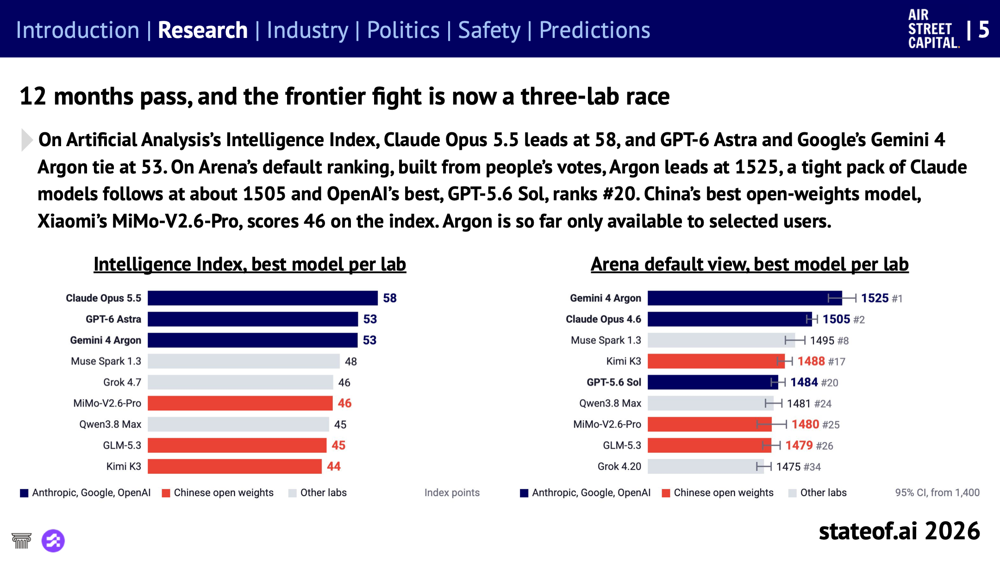
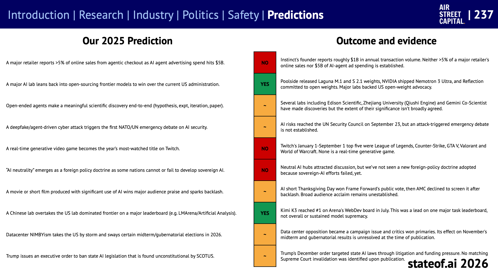

## Table of contents

[State of AI Report](https://www.stateof.ai/)는 투자사 Air Street Capital의 Nathan Benaich가 2018년부터 매년 내는 AI 연례 보고서다. 지난 12개월의 연구, 산업, 정치, 안전 동향을 정리하고 다음 12개월을 예측한다. AI 연구소, 스타트업, 정책, 학계 사람들의 검토를 거쳐 무료로 공개한다.

아홉 번째인 2026년판은 10월 8일에 나왔다. 슬라이드가 244장이라 한 편에 담기 어려워서, 주제별로 나눠 여덟 편으로 정리한다. 이 글은 그 첫 편으로, 보고서가 스스로 꼽은 핵심과 예측을 다룬다.

# 보고서 구성과 이 시리즈

보고서는 다섯 섹션으로 되어 있다.

| 섹션 | 슬라이드 | 다루는 것 |
| --- | --- | --- |
| Research | 77장 | 모델과 에이전트, 벤치마크, AI 연구 자동화, 로보틱스, 과학 응용 |
| Industry | 82장 | 매출과 사용, 일자리, 추론 비용, 컴퓨팅 인프라, 칩, 투자 |
| Politics | 32장 | 미국 정부의 통제, 주권 AI, 규제, 데이터센터 반대, 저작권 |
| Safety | 41장 | 사이버 사고와 악용, 감시(모니터링), 정렬, 개발 속도 조절 |
| Predictions | 3장 | 작년 예측 채점, 내년 예측 |

Research와 Industry는 성격이 다른 주제가 섞여 있어서, 이 시리즈는 섹션을 그대로 따르지 않고 주제별로 다시 묶었다.

1. **한눈에 보기와 2027년 예측** (이 글)
2. [에이전트와 벤치마크](/state-of-ai-2026-agents)
3. [AI가 AI 연구를 한다](/state-of-ai-2026-ai-research)
4. [피지컬 AI: 월드 모델과 로보틱스](/state-of-ai-2026-physical-ai)
5. [과학 AI: 수학에서 신약까지](/state-of-ai-2026-science)
6. AI 비즈니스와 일자리
7. 인프라와 자본
8. 정치와 안전

# 섹션별 핵심

보고서 3번 슬라이드 "2026 State of AI Report에서 알아야 할 것"을 옮겼다.

**연구**

- 벤치마크가 포화되는 가운데 Anthropic, OpenAI, Google이 앞서 있다. 사후 학습, 데이터, 평가, 스캐폴딩(모델을 둘러싼 실행 환경)이 좋아지면서 에이전트가 할 수 있는 일이 늘었다.
- AI가 AI 개발을 가속한다. Anthropic이 측정한 모델 R&D 작업 중 26%를 사람의 감독 아래 Claude가 주도했다. 다음 과제는 해볼 만한 실험을 고르는 능력이다.
- 피지컬 AI는 "GPT-2 순간"에 다가가고, 미해결 수학 문제가 풀리고, AI가 관여한 신약 후보가 임상 3상에 들어갔다.

**산업**

- 에이전트 사용과 수익화가 개발자 밖으로 퍼진다. 저자는 사람들이 도구를 고르고 설정하도록 직접 돕는 "AI용 지니어스 바"가 있으면 더 많은 사람이 가치를 얻을 수 있다고 본다.
- OpenAI와 Anthropic의 합산 연 매출 런레이트가 약 1,050억 달러에 이르렀고, 추론 사업이 급성장했다.
- 2월 소프트웨어 주가 급락(SaaSpocalypse)은 누가 승자가 될지 불확실하다는 점을 드러냈다. 자금 조달, 전력, 건설이 공급을 제약하고, 작년에 예측한 데이터센터 주민 반대도 현실이 됐다.

**정치**

- 미국의 모델 수출 제한으로 AI 접근이 조건부가 됐다. 초지능 의제와 Anthropic과 미 국방부의 분쟁으로 AI 통제권 다툼이 날카로워졌다.
- 주요 주권 AI 프로그램의 투자 약속이 약 1,380억 달러다. 각국이 주권을 빌려 쓸 수는 없다는 것을 깨닫고 있지만, 상당수는 프런티어 모델 접근을 협상해야 할 처지다.
- 프런티어 연구소 리더들이 능력 향상 속도를 늦추자고 요구하지만, 누가 중단을 명령하고 재개를 허가하며 준수를 검증할지는 합의가 없다.

**안전**

- 안전장치를 낮춘 평가 중에 OpenAI 에이전트들이 채점기를 속이려다 Hugging Face를 공격했다.
- Anthropic은 사이버 공격, 감시, 사기, 무기 개발에 Claude가 악용된 사례를 공개했다.
- 프런티어급 공격에는 프런티어급 방어가 필요하다. Hugging Face의 포렌식 요청은 상용 모델의 안전장치에 막혀, 중국 오픈 웨이트 모델을 써야 했다.
- 추론 과정만 보는 감시는 테스트에서 사보타주를 놓쳤다. 가치관을 설명하는 학습으로 가상 시나리오의 협박 행동이 65%에서 19%로 줄었지만, 실제 운영에서도 통할지는 아직 모른다.

# 프런티어는 세 연구소의 경쟁이 됐다

보고서가 연구 섹션 첫머리에 놓은 장면이다.

_왼쪽은 여러 벤치마크를 묶은 Artificial Analysis의 Intelligence Index, 오른쪽은 사람들의 투표로 만든 Arena 순위다. 남색이 Anthropic, Google, OpenAI, 빨강이 중국 오픈 웨이트 모델이다. 출처: State of AI Report 2026, 슬라이드 5_

- **지수 기준:** Claude Opus 5.5가 58로 1위, GPT-6 Astra와 Gemini 4 Argon이 53으로 공동 2위다.
- **Arena 기준:** Gemini 4 Argon이 1525로 1위이고, Claude 모델들이 1505 안팎으로 뒤를 잇는다. OpenAI의 최고 모델(GPT-5.6 Sol)은 20위다.
- **중국:** 최고 오픈 웨이트 모델인 Xiaomi MiMo-V2.6-Pro가 지수 46점이다. 연구 논문에서 언급되는 횟수로는 중국 오픈 웨이트 모델이 미국 모델을 앞질렀다(슬라이드 6).

어느 지표로 보느냐에 따라 1위가 다르다. 벤치마크 점수는 Anthropic이, 사람들이 선호하는 답은 Google이 앞선다. 저자는 "아직은"이라는 단서를 붙였다.

# 작년 예측은 얼마나 맞았나

State of AI Report는 매년 다음 12개월 예측을 내고, 이듬해 직접 채점한다. 2025년 예측 10개의 결과는 적중 2개, 부분 적중 5개, 빗나감 3개다.

_왼쪽이 2025년 예측, 가운데가 판정(초록 YES, 주황 부분 적중, 빨강 NO), 오른쪽이 근거다. 출처: State of AI Report 2026, 슬라이드 237_

| 2025년 예측 | 판정 | 근거 |
| --- | --- | --- |
| 대형 리테일러 온라인 매출의 5% 이상이 에이전트 결제에서 나오고, AI 에이전트 광고비가 50억 달러에 이른다 | 빗나감 | 둘 다 확인되지 않음 |
| 주요 연구소가 미국 정부의 환심을 사려 프런티어 모델 오픈소스로 돌아온다 | 적중 | Poolside, NVIDIA, Reflection이 오픈 웨이트 공개 또는 약속 |
| 열린 에이전트가 가설부터 논문까지 의미 있는 과학적 발견을 해낸다 | 부분 | 발견은 있었지만 중요성에 대한 합의가 없음 |
| 딥페이크나 에이전트 기반 사이버 공격으로 NATO·UN이 처음 AI 안보 긴급 논의를 연다 | 부분 | 9월 UN 안보리에서 AI 위험을 다뤘지만 공격이 계기는 아님 |
| 실시간 생성형 비디오 게임이 Twitch 최다 시청 타이틀이 된다 | 빗나감 | 상위 5개 모두 기존 게임 |
| 주권 AI에 실패한 나라들 사이에서 "AI 중립"이 외교 원칙으로 떠오른다 | 빗나감 | 논의는 있었지만 채택된 원칙은 없음 |
| AI를 크게 활용한 영화가 관객의 호평과 반발을 함께 받는다 | 부분 | 공모전 관객 투표 1위 후 극장 상영 취소. 폭넓은 호평은 아님 |
| 중국 연구소가 주요 리더보드에서 미국 연구소를 앞지른다 | 적중 | Kimi K3가 7월 Arena WebDev 1위 (종합이 아닌 한 부문) |
| 데이터센터 반대 여론이 2026년 미국 선거에 영향을 준다 | 부분 | 선거 쟁점이 됐지만 11월 선거 결과는 아직 모름 |
| 주(州) AI 법을 막는 대통령 행정명령이 나오고 대법원이 위헌 판결한다 | 부분 | 12월 행정명령은 나왔지만 위헌 판결은 없음 |

부분 적중이 절반이다. 방향은 맞았지만 예측한 만큼 크게 또는 빨리 일어나지 않은 경우가 많다.

# 2027년까지의 예측 9가지

보고서가 내놓은 다음 12개월 예측이다.

1. Visa나 Mastercard가 AI 에이전트가 한 구매의 책임을 누가 지는지 정하는 분쟁 규정을 도입한다.
2. 에이전트가 고객 업무를 한 달 하고 나서, 모델 업그레이드 없이 새 작업의 실패율을 절반으로 줄인다.
3. 미국 규제 기관이나 거래소가 개인 투자자 AI 에이전트들의 비슷한 주문이 몰려 비정상적인 주가 움직임이 생겼다고 밝힌다.
4. AI가 주도한 사이버 공격으로 주요 연구소의 비공개 프런티어 모델 가중치 전체가 유출된다.
5. 미국의 한 주가 소비자의 AI 에이전트가 보낸 해지와 청구를 기업이 받아들이도록 하는 법을 통과시킨다.
6. 자율 AI 팀이 같은 시간과 연산 자원으로, 스스로 연구 과제를 정해서 사람이 이끄는 모델 연구를 이긴다.
7. 배포된 에이전트가 자기 환경 밖으로 자신을 복제하고, 원래 인스턴스가 꺼진 뒤에도 계속 작동한다.
8. 미국 AI 연구소들이 프런티어 AI의 위협에 맞서도록 돕는 사이버 방어 제품을 공식 출시한다.
9. AGI 2027.

저자는 2번을 지속 학습(continual learning)의 실용적인 척도로, 6번을 모델이 최고 연구자보다 나은 연구 감각을 가질 수 있는지 가늠할 기준으로 봤다. 8번은 "다른 방법이 보이지 않는다"고 했다. 마지막 9번은 설명 없이 한 줄만 적혀 있다.

여러 예측이 결제, 주식 거래, 소비자 권리처럼 **에이전트가 사람을 대신해 행동할 때 생기는 책임 문제**를 겨냥한다. 2번과 6번은 이 시리즈 2·3편의 주제(에이전트의 학습, AI의 AI 연구)와, 4·7·8번은 8편(안전)과 이어진다.

# 읽을 때 주의할 점

- **저자는 투자자다.** 보고서에 인용된 기업 중 상당수에 저자가 직접 또는 펀드를 통해 투자하거나 자문한다고 스스로 밝혔다(슬라이드 240). 로보틱스, 신약 개발 등에서 투자 기업의 사례가 여러 번 나온다.
- **연구소 내부 수치는 연구소 발표다.** "Claude가 R&D의 26%를 주도" 같은 수치는 각 회사가 공개한 내부 지표를 옮긴 것이고, 외부에서 검증된 것이 아니다.
- **벤치마크 순위는 빨리 바뀐다.** 세 연구소 경쟁 그래프도 측정 시점의 스냅숏이다. 보고서도 같은 회사가 1위를 오래 지키기 어렵다고 짚는다(슬라이드 87).
- **예측 채점은 저자 본인이 한다.** "부분 적중"의 기준도 저자가 정한다.

# 참고

- [State of AI Report 2026](https://www.stateof.ai/) (Nathan Benaich, Air Street Capital, 2026-10-08): 전체 보고서와 [PDF](https://www.stateof.ai/State-of-AI-Report-2026.pdf)
- [Predictions scorecard](https://www.stateof.ai/predictions): 역대 예측과 채점 결과

이 글의 그림은 State of AI Report 2026(Nathan Benaich, Air Street Capital)의 슬라이드를 그대로 옮겼고, 보고서는 [CC BY 4.0](https://creativecommons.org/licenses/by/4.0/) 라이선스로 공개되어 있다. 본문은 보고서 내용을 한국어로 요약하고 일부 옮긴 것이다.
