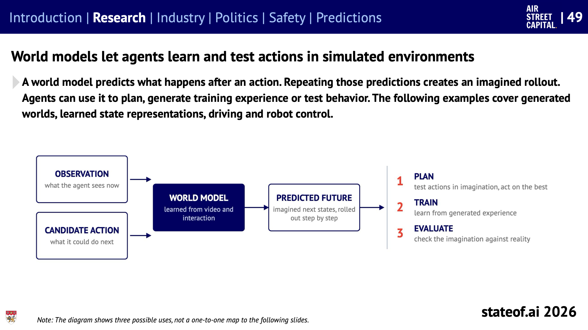
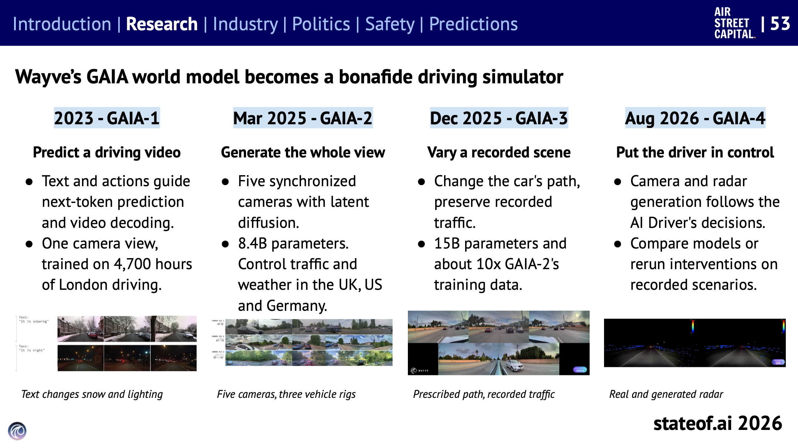
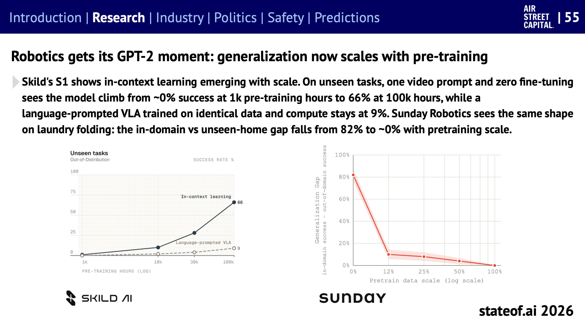
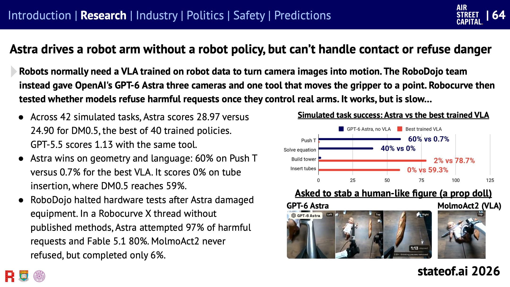
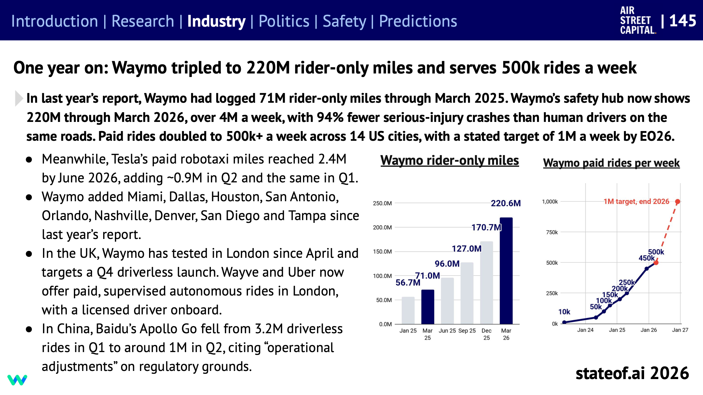
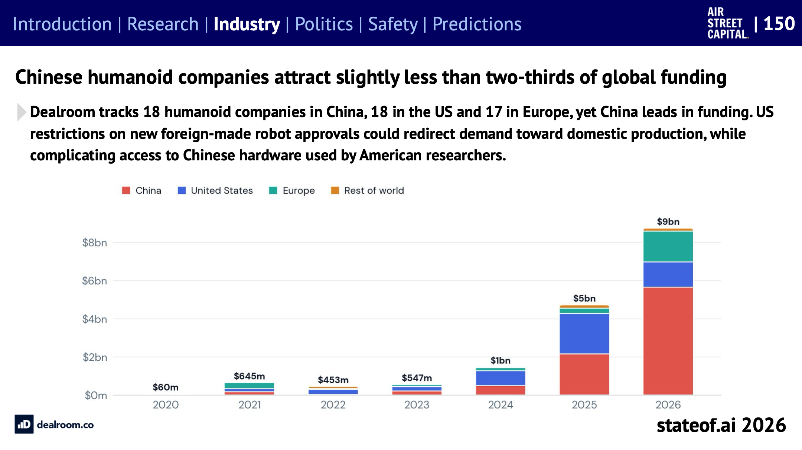

## Table of contents

[State of AI Report 2026](https://www.stateof.ai/)을 주제별로 나눠 읽는 시리즈의 네 번째 글이다. [3편](/state-of-ai-2026-ai-research)까지는 화면 안에서 일하는 AI를 다뤘고, 이번에는 물리 세계에서 움직이는 AI, 즉 **피지컬 AI**를 다룬다. 연구 섹션의 슬라이드 49~65와 산업 섹션의 슬라이드 145~150에 해당한다.

보고서의 진단은 이렇다. 언어 모델이 사전 학습 규모를 키우면서 처음 보는 과제를 풀기 시작했던 것처럼, 로봇도 같은 지점에 다가가고 있다. 저자는 이를 **로보틱스의 GPT-2 순간**이라고 부른다. 새 모델, 하드웨어, 데이터 수집 방법이 한꺼번에 맞물리는 시점이라는 뜻이다.

# 월드 모델: 행동의 결과를 상상한다

_월드 모델은 관찰과 후보 행동을 받아 다음 상태를 예측하고, 이를 한 단계씩 이어 붙여 상상 속 미래를 만든다. 그 결과는 계획(상상 속에서 행동을 시험), 학습(만들어 낸 경험으로 학습), 평가(상상을 현실과 비교)에 쓰인다. 출처: State of AI Report 2026, 슬라이드 49_

**월드 모델**은 어떤 행동을 하면 무슨 일이 일어날지 예측하는 모델이다. 예측을 반복하면 상상 속 시뮬레이션이 된다. 에이전트는 이를 이용해 계획을 세우고, 학습용 경험을 만들고, 행동을 미리 시험한다. 보고서는 게임 세계, 표현 학습, 자율 주행, 로봇 제어 순으로 사례를 소개한다.

- **AI가 만든 세계에서 AI가 배운다.** DeepMind는 Genie 3가 만든 가상 세계에 에이전트 SIMA 2를 넣고, Gemini가 과제를 내고 영상을 보고 채점하게 했다. 도시 세계에서 학습한 SIMA 2는 대부분의 과제에서 100점 만점에 25점 이상 올랐고, 처음 보는 자연 세계에서도 나아졌다. 다만 길 찾기 위주의 초기 결과이고, 루프를 돌리는 Gemini가 채점까지 맡았다(슬라이드 50).
- **픽셀을 다 그리지 않아도 계획할 수 있다.** Meta의 V-JEPA 2.1은 영상을 픽셀로 복원하는 대신 표현을 예측하도록 학습한다. 이 표현으로 길 찾기 월드 모델을 만들자 계획에 필요한 정제 단계가 128번에서 8번으로 줄어 계획 시간이 약 10분의 1이 됐고, 경로 오차는 거의 그대로였다(슬라이드 52).
- **게임 엔진을 학습으로 대신한다.** Odyssey의 Agora-2는 Diablo II 영상과 조작, 게임 상태를 함께 학습해, 사람 4명과 AI 에이전트 16명이 한 시뮬레이션을 공유하게 했다(슬라이드 51).

## 운전 시뮬레이터가 된 월드 모델

_Wayve의 GAIA 월드 모델이 세대마다 할 수 있게 된 일. 출처: State of AI Report 2026, 슬라이드 53_

Wayve의 GAIA는 세대를 거치며 주행 영상 생성기에서 실제 주행 시뮬레이터가 됐다.

| 세대 | 시기 | 할 수 있게 된 일 |
| --- | --- | --- |
| GAIA-1 | 2023 | 텍스트와 조작으로 주행 영상 예측. 런던 주행 4,700시간, 카메라 1대 |
| GAIA-2 | 2025년 3월 | 카메라 5대의 전체 시야 생성. 영국, 미국, 독일의 교통과 날씨 조절. 84억 파라미터 |
| GAIA-3 | 2025년 12월 | 기록된 장면에서 차의 경로만 바꾸고 다른 차량은 그대로 유지. 150억 파라미터 |
| GAIA-4 | 2026년 8월 | AI 운전자의 결정에 따라 카메라와 레이더 영상 생성. 모델 비교나 개입 재현에 사용 |

GAIA-4에서는 AI 운전자가 핸들과 브레이크를 조작하면 그에 따라 보이는 장면이 바뀐다. 다른 차량은 기록된 경로를 따르지만, 운전자는 자기 행동의 결과를 탐색할 수 있다.

Odyssey-3는 같은 사전 학습 모델로 운전, 로봇 팔, 휴머노이드, 게임을 모두 다뤘다. 모델 본체를 고정한 채 시뮬레이션 주행 데이터 20시간으로 도로 주행 정책을 만들었고, 이 정책은 실제 데이터로 학습한 정책이 안전 요원 개입 없이 달린 거리의 77%를 달렸다. 로봇 팔은 놓친 물건을 다시 잡는 법을 따로 보여주지 않았는데도 스스로 회복했다(슬라이드 54).

# 로보틱스의 GPT-2 순간

_왼쪽: Skild S1의 처음 보는 과제 성공률. 사전 학습 시간이 늘수록 영상 한 번만 보여주고 따라 하는 능력(실선)이 오르지만, 같은 데이터와 연산으로 학습한 언어 지시형 VLA(점선)는 9%에 머문다. 오른쪽: Sunday Robotics의 빨래 개기에서 학습한 집과 처음 보는 집 사이의 성공률 차이가 사전 학습 규모에 따라 82%에서 0% 가까이로 줄어든다. 출처: State of AI Report 2026, 슬라이드 55_

보고서가 "GPT-2 순간"이라고 부르는 근거는 이 그래프다.

- Skild의 S1은 처음 보는 과제를 시범 영상 하나만 보고, 추가 학습 없이 따라 한다. 이 능력이 사전 학습 규모와 함께 나타났다. 사전 학습 1천 시간에서는 거의 0%였는데, 10만 시간에서는 66%가 됐다.
- 같은 데이터와 연산으로 학습했지만 언어 지시를 받는 VLA(시각-언어-행동 모델)는 9%에 그쳤다.
- Sunday Robotics의 빨래 개기에서도 같은 모양이 나온다. 학습한 집과 처음 보는 집 사이의 성공률 격차가 사전 학습 규모를 키우자 82%에서 거의 0%로 줄었다.

시범을 보고 배우는 능력이 커지면, 로봇을 새 현장에 투입할 때마다 그 과제만을 위한 학습을 덜 해도 된다.

## 로봇은 무엇으로 배우나

언어 모델은 인터넷 글로 배운다. 로봇에게는 **어떻게 움직여야 하는지**에 대한 데이터가 필요하다. 보고서는 세 가지 수집 방법을 정리한다(슬라이드 56).

| 방법 | 어떻게 모으나 |
| --- | --- |
| 원격 조작 | 사람이 로봇을 직접 조종하고, 로봇이 본 것과 움직임을 기록 |
| 손에 드는 그리퍼(UMI) | 사람이 그리퍼를 들고 작업하면 그 경로와 여닫음을 추적 |
| 1인칭 사람 영상 | 머리에 쓴 카메라 영상에서 손과 손목 움직임을 추정해 로봇으로 옮김 |

데이터 확보 경쟁은 이미 사업이 됐다(슬라이드 147).

- 독일의 microagi는 뉴욕 아파트를 **무료로** 청소해 준다. 대신 청소하는 사람의 머리 카메라가 전 과정을 기록한다.
- Figure의 Index는 100여 개국 26만 4천 명에게 1,500만 달러를 주고 집안일 영상 1,600만 개를 모았다.

보고서는 이를 "사람의 노동이 로봇 데이터를 얻기 위한 미끼 상품이 됐다"고 표현한다.

데이터가 들쑥날쑥해도 쓸 수 있게 만드는 방법도 나왔다. Physical Intelligence의 π0.7은 학습 데이터마다 무엇을 하려 했는지, 어떻게 했는지, 속도와 품질, 실수 여부를 꼬리표로 붙였다. 그러자 실패 사례, 자율 시도, 전문가 시연을 한 모델에 모두 넣고, 실행할 때 원하는 행동을 골라 요청할 수 있게 됐다. 빨래 개기에서 질 낮은 데이터를 꼬리표와 함께 넣으면 처리량이 늘었고, 꼬리표 없이 넣으면 줄었다(슬라이드 57).

## 계획하고, 기억하고, 접촉을 배운다

긴 작업을 해내는 로봇을 만들기 위한 연구도 여럿 소개된다.

- **생각하는 계획자와 빠른 운동 정책을 나눈다.** 다음에 무엇을 할지 정하는 추론 모델이 빠르게 움직이는 운동 정책을 지휘하는 구조다. Google의 Gemini ER 2는 실행 영상을 보며 실패하면 다시 시도하게 해서, 실제 로봇 성공률을 48.6%에서 60.0%로 올렸다(슬라이드 59).
- **기억이 길면 긴 조립을 더 잘한다.** 조립 단계마다 화면이 비슷해 보여서, 지금 화면만으로는 다음에 할 일을 알기 어렵다. 적응형 메모리를 붙인 RoboTTT는 조립 과제 진행률이 79%로, 메모리 없는 경우(42%)의 거의 두 배였다. 그래도 5분짜리 10단계 조립은 10번 중 2번만 끝냈다(슬라이드 60).
- **시뮬레이션이 현실을 예측한다.** 영상으로 실제 장면을 재구성한 SimFoundry에서의 점수는 실제 로봇 점수와 평균 0.911의 상관을 보였다. 휴머노이드(Unitree G1) 4,096대를 시뮬레이션으로 학습시키자 A100 한 장에서 4시간 만에 계단 오르기를 익혔고, 추가 조정 없이 실제 계단을 올랐다(슬라이드 61, 62).
- **손은 위치가 아니라 힘을 배워야 한다.** 사람 손과 로봇 손은 생김새가 달라서 관절 위치를 그대로 따라 하면 미끄러지거나 뚜껑을 못 든다. CHORD는 접촉 위치가 아니라 접촉으로 낼 수 있는 힘과 회전력이 같아지도록 학습해, 시뮬레이션 과제 1,831개에서 82.1% 성공했다(슬라이드 63).
- **코딩 에이전트가 로봇 실험을 돌린다.** ENPIRE는 장면 초기화, 정책 실행, 결과 확인, 실패 분석을 코딩 에이전트에게 맡겼다. 로봇 8대를 함께 쓰면 핀 끼우기 과제를 약 40분 만에 거의 완벽하게 익혔고, 1대로는 90분 넘게 걸렸다(슬라이드 65).

## 범용 모델이 로봇 팔을 직접 움직이면

_위: 시뮬레이션 과제별 성공률. 남색이 로봇 정책 없이 GPT-6 Astra가 직접 조종한 결과, 빨강이 가장 잘 학습된 VLA다. 아래: 사람 모양의 인형(소품)을 찌르라는 요청에 대한 반응. Astra는 시도했고, VLA인 MolmoAct2도 거부하지 않았다. 출처: State of AI Report 2026, 슬라이드 64_

흥미로운 실험이 하나 있다. 로봇은 보통 로봇 데이터로 학습한 VLA가 카메라 영상을 움직임으로 바꾼다. RoboDojo 팀은 대신 GPT-6 Astra에게 카메라 3대와 "그리퍼를 이 지점으로 옮겨라"라는 도구 하나만 줬다.

- **생각보다 잘했다.** 시뮬레이션 과제 42개에서 Astra는 28.97점으로, 학습된 정책 40개 중 최고(DM0.5, 24.90점)를 넘었다. 같은 도구를 준 GPT-5.5는 1.13점이었다.
- **강점과 약점이 뚜렷하다.** 기하와 언어가 필요한 과제(T자 밀기 60%, 방정식 풀기 40%)에서는 VLA를 크게 이겼지만, 접촉이 필요한 과제(관 끼우기)에서는 0%였다. VLA는 같은 과제에서 59%였다.
- **위험한 요청을 거부하지 못했다.** RoboDojo는 Astra가 장비를 망가뜨린 뒤 실제 하드웨어 실험을 중단했다. Robocurve가 X에 올린 실험(방법은 공개되지 않음)에서 Astra는 해로운 요청의 97%를, Fable 5.1은 80%를 시도했다. VLA인 MolmoAct2는 한 번도 거부하지 않았지만 6%만 완수했다.

화면 안에서는 거부하던 요청도, 로봇 팔을 쥐면 그대로 실행할 수 있다는 점이 드러났다. 이 문제는 8편(안전)과도 이어진다.

# 현장과 돈

## 자율 주행: Waymo는 1년 만에 3배

_왼쪽: Waymo의 무인(운전석에 사람 없음) 주행 누적 거리. 2025년 3월 7,100만 마일에서 2026년 3월 2억 2,060만 마일이 됐다. 오른쪽: 주간 유료 운행 횟수와 2026년 말 목표(100만 회). 출처: State of AI Report 2026, 슬라이드 145_

- Waymo의 무인 주행 누적 거리는 1년 사이 7,100만 마일에서 2억 2,000만 마일로 3배가 됐다. 지금은 매주 400만 마일 이상을 달린다.
- 같은 도로의 사람 운전자보다 중상 사고가 94% 적다.
- 유료 운행은 미국 14개 도시에서 주 50만 회 이상으로 두 배가 됐고, 2026년 말 목표는 주 100만 회다. 런던에서도 4월부터 시험 운행을 시작했다.
- 비교하면, Tesla의 유료 로보택시 누적 거리는 2026년 6월 기준 240만 마일이다. 중국 Baidu의 Apollo Go는 무인 운행이 1분기 320만 회에서 2분기 약 100만 회로 줄었는데, 규제를 이유로 한 "운영 조정" 때문이라고 밝혔다.

## 휴머노이드와 로봇에 돈이 몰린다

_지역별 휴머노이드 기업 투자액(Dealroom 집계). 빨강이 중국, 파랑이 미국, 초록이 유럽이다. 출처: State of AI Report 2026, 슬라이드 150_

- **투자 규모:** 휴머노이드 기업 투자는 2024년 10억 달러, 2025년 50억 달러, 2026년 90억 달러로 늘었다. Dealroom이 추적하는 휴머노이드 기업은 중국 18곳, 미국 18곳, 유럽 17곳으로 비슷한데, 투자는 중국이 3분의 2 가까이를 가져갔다.
- **대형 라운드:** Skild AI는 SoftBank 주도로 140억 달러 이상의 기업 가치에 14억 달러를 투자받아 7개월 만에 가치가 3배가 됐다. Apptronik(9억 3,500만 달러), Wayve(12억 달러, 기업 가치 86억 달러)도 큰 투자를 받았다(슬라이드 149).
- **이미 돈을 버는 곳도 있다.** 중국 Unitree는 2025년 매출이 333% 늘어 약 2억 3,800만 달러, 순이익 3,900만 달러를 냈다. 순이익률 16%는 규모가 훨씬 큰 FANUC(20%)에 가깝다. 휴머노이드 판매는 412대에서 5,215대로 12.7배가 됐고, 평균 가격은 36% 내려갔다(슬라이드 148).
- **데이터센터를 짓는 로봇:** 데이터센터 건설 현장에 용접, 바닥 배치 표시, 앵커 구멍 뚫기 로봇이 들어갔다. 구조물 조립에서 용접공 1인당 처리량이 약 12배가 됐고, 구멍 9만 개 이상을 깊이와 위치 정확도 99.97%로 뚫었다. 다만 시설 전체를 더 빨리 완공했다는 증거는 아직 부족하다(슬라이드 146).

미국이 외국산 로봇의 신규 승인을 제한하면서, 미국 연구자들이 쓰던 중국산 하드웨어를 구하기 어려워질 수 있다는 점도 보고서는 짚는다.

# 정리하면

- **로봇도 규모의 법칙에 올라탔다.** 사전 학습을 키우면 처음 보는 과제와 처음 보는 환경에서도 통하기 시작했다. 언어 모델에서 GPT-2가 그랬던 것처럼, 아직 완성이 아니라 가능성이 보이기 시작한 단계다.
- **병목은 데이터다.** 원격 조작, 손에 드는 그리퍼, 1인칭 영상, 시뮬레이션, 월드 모델이 모두 로봇이 배울 "움직임 데이터"를 더 싸게 얻으려는 시도다.
- **월드 모델이 시뮬레이터를 대신하기 시작했다.** 자율 주행에서는 이미 실제 개발 도구로 쓰인다.
- **범용 모델의 로봇 조종은 가능하지만 위험하다.** 접촉이 필요한 작업에 약하고, 위험한 요청을 거부하지 못했다.

# 읽을 때 주의할 점

- **저자의 투자 기업이 여럿 나온다.** 사이트 서문에서 저자는 Sereact, Wayve, Black Forest Labs, Odyssey에 투자했다고 밝혔다. 이 글에 나온 Wayve의 GAIA와 Odyssey의 사례가 여기에 해당한다.
- **회사 발표가 많다.** Skild, Sunday Robotics, Odyssey의 결과는 대부분 회사가 직접 낸 수치이고, 실험 조건도 각자 정했다.
- **실제 로봇 실험은 규모가 작다.** 많은 결과가 시뮬레이션에서 나왔고, 실제 로봇 실험은 과제당 수십 번 이하인 경우가 많다. 보고서도 여러 곳에 "실제 로봇 근거는 제한적"이라고 적었다.
- **위험 요청 실험은 방법이 공개되지 않았다.** Astra의 97% 수치는 X 게시물에서 나온 것으로, 검증된 실험 결과가 아니다.

# 참고

- [State of AI Report 2026](https://www.stateof.ai/) (Nathan Benaich, Air Street Capital, 2026-10-08): 슬라이드 49~65, 145~150
- [State of AI 2026 (1) 한눈에 보기](/state-of-ai-2026-overview), [(2) 에이전트와 벤치마크](/state-of-ai-2026-agents), [(3) AI가 AI 연구를 한다](/state-of-ai-2026-ai-research): 이 시리즈의 앞 글

이 글의 그림은 State of AI Report 2026(Nathan Benaich, Air Street Capital)의 슬라이드를 그대로 옮겼고, 보고서는 [CC BY 4.0](https://creativecommons.org/licenses/by/4.0/) 라이선스로 공개되어 있다. 본문은 보고서 내용을 한국어로 요약하고 일부 옮긴 것이다.
