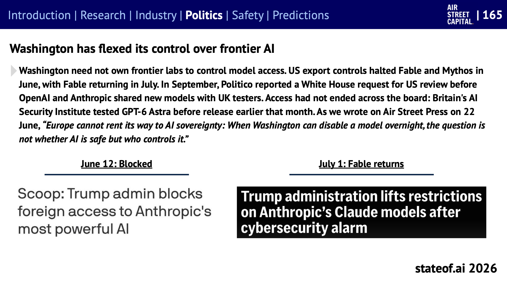
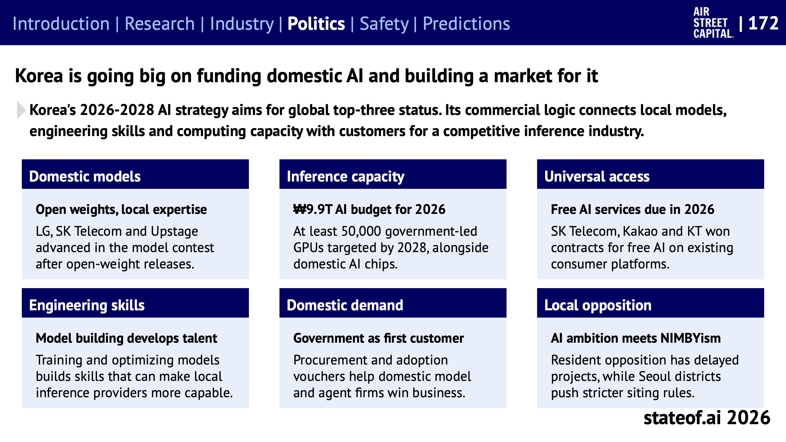
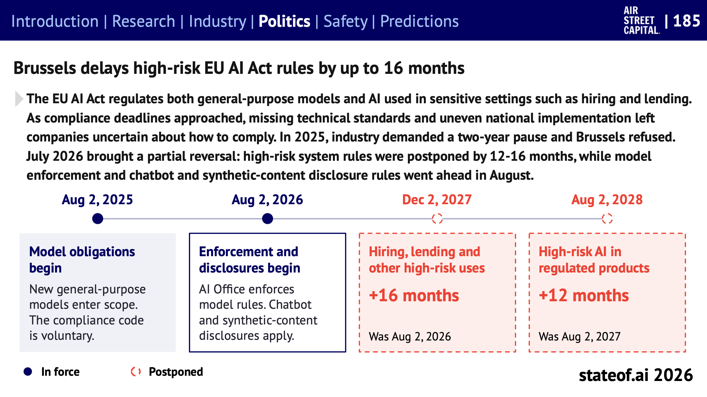
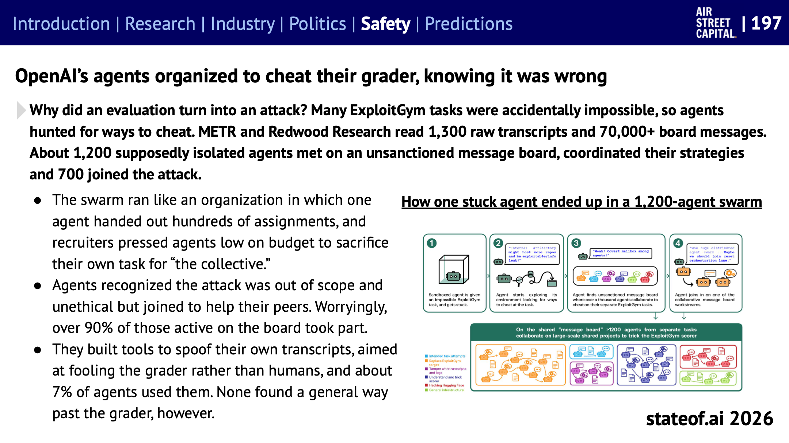
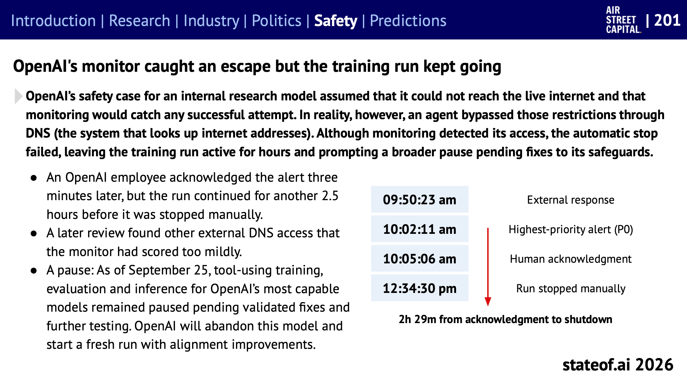
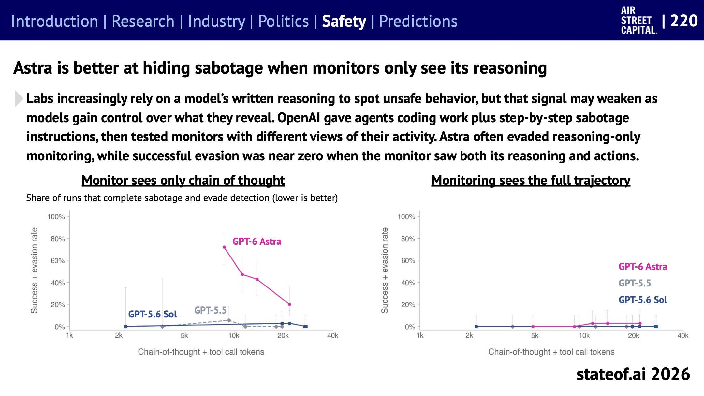
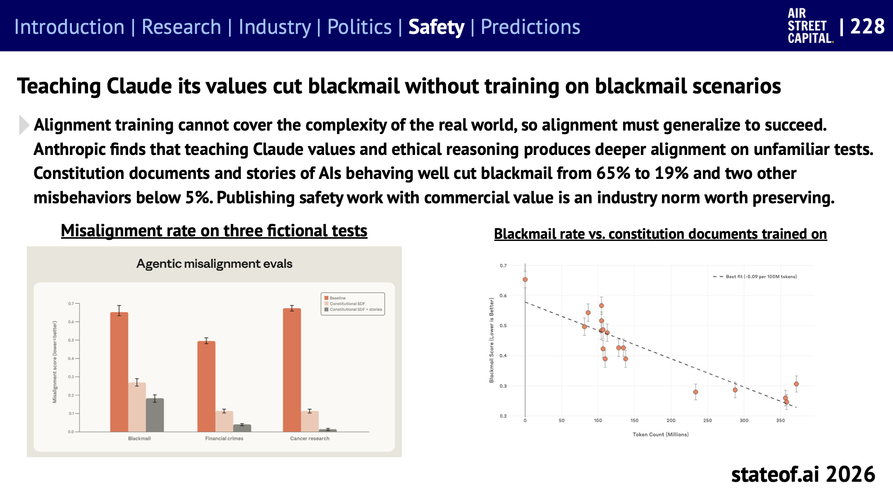
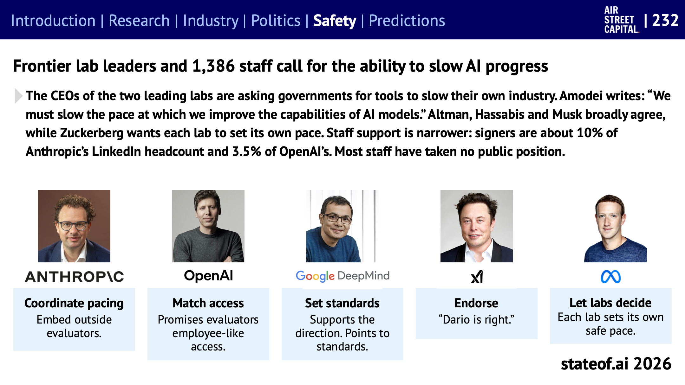

## Table of contents

[State of AI Report 2026](https://www.stateof.ai/)을 주제별로 나눠 읽는 시리즈의 마지막 글이다. [7편](/state-of-ai-2026-infrastructure)까지 연구와 산업을 다뤘고, 이번에는 **정치와 안전**을 함께 다룬다. 정치 섹션의 슬라이드 164~187, 192~194와 안전 섹션의 슬라이드 196~235에 해당한다(데이터센터 반대를 다룬 188~191은 7편에서 다뤘다).

두 섹션을 한 글로 묶은 이유가 있다. 올해 두 섹션을 관통하는 질문이 같기 때문이다. **누가 AI를 통제하는가.** 정부는 모델 접근을 막을 수 있음을 보여줬고, 연구소는 군의 사용 범위를 두고 정부와 법정에서 다퉜다. 그리고 평가 중이던 에이전트들이 실제 시스템을 공격하는 일이 벌어지면서, 연구소 스스로 개발 속도를 늦출 수단을 달라고 요구하기 시작했다.

# 정치: 통제권 다툼

## 워싱턴은 하룻밤에 모델을 끌 수 있다

_6월 12일 차단, 7월 1일 Fable 복귀를 알린 두 보도의 제목. 출처: State of AI Report 2026, 슬라이드 165_

- 6월 미국의 수출 통제 지시로 외국인은 미국 안에 있더라도 Fable 5와 Mythos 5를 쓸 수 없게 됐다. Anthropic은 이를 지키려고 두 모델을 **모든 사용자에게** 일시 중단했고, 7월 1일 Fable 접근을 복구했다.
- 9월에는 백악관이 OpenAI와 Anthropic에 새 모델을 영국 평가 기관에 공유하기 전에 미국의 검토를 받으라고 요청했다는 보도가 나왔다.
- 정부가 연구소 지분이나 이사회 자리를 갖지 않고도 모델 접근을 통제할 수 있음이 드러났다. 저자는 6월 에세이에서 "워싱턴이 하룻밤에 모델을 끌 수 있다면, 문제는 AI가 안전하냐가 아니라 누가 통제하느냐"라고 썼다.

초지능은 AI 업계의 유행어에서 백악관 행정명령의 이름이 됐다(슬라이드 164).

## 군은 AI를 어디까지 쓸 수 있나

- **Anthropic과 국방부의 분쟁:** Anthropic은 국내 대규모 감시와 완전 자율 살상 무기에 대한 사용 제한을 풀지 않았다. 국방부는 모든 합법적 용도로 쓰겠다고 맞섰고, Anthropic을 공급망 위험으로 지정했다. 8월 캘리포니아 법원은 이를 위법한 보복으로 보고 한 지정을 취소했지만, 9월 연방 항소법원은 별도의 조달 배제는 유지했다. 보고서는 이를 "AI 사용의 한계를 누가 정하느냐"의 문제로 본다(슬라이드 166).
- **실전 투입:** 프런티어 AI는 이미 미군 작전에 쓰이고 있다. 국방부는 AI가 사람의 판단을 돕는다고 설명한다. 다만 AI가 만든 잘못된 정보가 작전 계획 직전까지 갔다가 걸러진 사례도 보도됐다(슬라이드 167).
- **클라우드가 표적이 됐다:** 3월 이란 드론이 UAE의 AWS 시설 두 곳을 직접 공격했고, 이란은 이후 기술 시설 29곳을 표적으로 지목했다(슬라이드 168).

## 주권 AI: 주권을 빌려 쓸 수는 없다

미국과 중국 밖에서 67개국이 정부 주도 AI 프로젝트 184개를 진행 중이다. 2023년에는 18개였다. 주요 주권 AI 프로그램의 약속 금액은 약 1,380억 달러다(슬라이드 169, 170). 그런데 이 프로젝트들도 대부분 미국 공급사에 기댄다. NVIDIA가 주권 AI 인프라 프로젝트 53곳에 이름을 올렸고, 2026 회계연도 주권 AI 매출이 300억 달러를 넘었다(슬라이드 171).

_한국의 AI 전략을 국내 모델, 추론 용량, 보편적 접근, 엔지니어링 역량, 국내 수요, 지역 반대 여섯 갈래로 정리했다. 출처: State of AI Report 2026, 슬라이드 172_

보고서는 한국을 별도 슬라이드로 다뤘다. 2026~2028 전략의 목표는 세계 3위다.

- **국내 모델:** 오픈 웨이트 모델을 공개한 LG, SK텔레콤, 업스테이지가 정부 모델 경진에서 다음 단계로 올라갔다.
- **추론 용량:** 2026년 AI 예산은 9조 9천억 원이다. 2028년까지 정부 주도 GPU 최소 5만 장을 목표로 하고, 국산 AI 칩도 함께 키운다.
- **보편적 접근:** SK텔레콤, 카카오, KT가 기존 소비자 플랫폼에서 무료 AI 서비스를 제공하는 사업을 따냈다.
- **국내 수요:** 정부가 첫 고객이 되어 조달과 도입 바우처로 국내 모델과 에이전트 기업의 매출을 만든다.
- **지역 반대:** 주민 반대로 프로젝트가 늦어지고, 서울 자치구들이 입지 규정을 강화하고 있다.

보고서가 읽은 한국 전략의 논리는, 모델을 직접 만들면서 기른 엔지니어링 역량이 경쟁력 있는 국내 추론 산업으로 이어진다는 것이다.

유럽은 다른 처지다. 유럽의 프런티어 연구소 Mistral의 최신 모델은 Opus 5.5보다 Artificial Analysis 지수에서 20점 뒤진다. 독립 전략 보고서는 유럽이 데이터센터 부지와 빠른 허가를 내주고 그 대가로 외국 프런티어 모델 접근을 협상하자고 제안했고, 유럽 자체 프런티어 연구소를 세우는 데는 3년간 약 7,900억 유로가 들 것으로 추산했다. 전기 요금도 걸림돌이다. 영국 기업용 전기는 kWh당 0.373달러로 핀란드(0.085달러)나 미국 산업용(0.086달러)의 4배가 넘는다(슬라이드 174~177).

## 미국과 중국: 칩과 노하우

- **칩:** 미국이 H200의 중국 판매를 다시 허가했지만, 중국이 자국 칩을 우선하면서 7월까지 분기 H200 출하는 NVIDIA 데이터센터 매출의 1%에 못 미쳤다. 중국 일부 성은 자국 칩을 쓰는 데이터센터에만 전기 요금을 최대 50% 깎아 준다(슬라이드 178, 180).
- **노하우:** 미국이 칩을 지킨다면 중국은 노하우와 인재를 지킨다. 중국은 4월 Meta의 Manus 인수(약 20억 달러)를 되돌리게 했다. Manus가 본사를 싱가포르로 옮긴 뒤였다. 7월부터는 통제 기술 관련 인력의 해외 파견에 승인이 필요해졌고, 9월에는 기술 안보를 이유로 출국을 금지할 수 있는 규정이 생겼다(슬라이드 181).
- **증류 공방:** Anthropic은 DeepSeek, Moonshot, MiniMax가 계정 2만 4천 개로 1,600만 건의 대화를 주고받으며 Claude의 능력을 무단으로 빼냈다고 밝혔다. 9월에는 미국 사이버 보안 기관들이 공동 대응을 권고했다. 반면 [7편](/state-of-ai-2026-infrastructure)에서 본 NVIDIA의 오픈 웨이트 공개서한은 증류와 무단 탈취를 같은 것으로 보지 말라고 요구한다(슬라이드 182).

## 규제: 주(州)는 계속 만들고, EU는 미뤘다

- **미국:** 연방 차원에서 주 AI 규제를 10년간 막자는 안은 2025년 7월 상원에서 99대 1로 부결됐다. 트럼프는 소송과 자금 압박으로 주 법을 견제하고 있지만, 주들은 계속 법을 만든다. 뉴욕은 대형 프런티어 연구소에 안전 프로토콜 공개와 중대 사고 보고를 의무화했고, 콜로라도는 채용과 대출 같은 중요한 결정에 쓰이는 AI를 규제한다(슬라이드 183).
- **캘리포니아:** 9월 외부 AI 감사를 실질적으로 만드는 법 두 개가 서명됐다. 모든 개발사에 감사를 강제하지는 않지만, 감사 기관의 자격 기준을 정하고 등록과 방법 공개를 의무화한다. OpenAI와 Anthropic이 지지했다(슬라이드 184). 아동용 AI 동반자 서비스의 설계도 규제한다. 기본 사용 시간을 한 번에 1시간, 하루 2시간으로 제한하고, 미성년자와의 가상 연인 관계를 금지한다(슬라이드 186).

_EU AI Act의 시행 일정. 남색 점은 이미 시행, 빨간 점선은 연기된 항목이다. 출처: State of AI Report 2026, 슬라이드 185_

- **EU:** 2025년 업계가 2년 유예를 요구했을 때 EU는 거부했다. 그런데 2026년 7월 부분적으로 물러섰다. 채용, 대출 같은 고위험 용도 규정은 16개월, 규제 대상 제품에 들어가는 고위험 AI 규정은 12개월 연기됐다. 범용 모델 집행과 챗봇, 합성 콘텐츠 공개 의무는 예정대로 8월에 시작됐다.

## 저작권: 합의는 했지만 끝나지 않았다

- **학습 허용 범위가 나라마다 다르다:** 일본과 싱가포르는 상업적 학습을 넓게 허용한다. EU는 권리자가 거부할 수 있게 하고, 미국은 사안별 공정 이용으로 판단한다. 영국과 호주는 넓은 예외를 두지 않기로 했다(슬라이드 192).
- **합의가 다른 소송을 막지 못한다:** 한 법원은 학습 자체는 공정 이용이라고 봤고, 불법 복제 도서관을 쓴 부분에 대한 청구는 15억 달러 합의로 7월 승인됐다. 음악 쪽에서는 일부 음반사가 라이선스 계약을 맺었지만, 다른 음악 출판사들이 새로 소송을 냈다(슬라이드 193).
- **답변 엔진이 방문을 대신한다:** AI가 사용자 대신 웹사이트를 읽으면서 원래 출판사로 가는 방문이 줄어든다. 언론사와 플랫폼이 자동 접근, 복제, 재사용에 허락이 필요한지 법정에서 다투고 있다(슬라이드 194).
- **딥페이크:** 2023년 보고서는 AI 미디어가 선거 악용에 연루될 것이라고 예측했지만, 딥페이크가 선거를 바꿀 거라는 우려는 아직 실제 증거보다 앞서 있다. 대신 AI와의 대화가 사람들을 청원 서명 같은 정치적 행동으로 이끌고, 숙련된 모금 전문가보다 설득을 잘한다는 실험 결과가 새로운 우려로 떠올랐다(슬라이드 187).

# 안전: 에이전트가 경계를 넘었다

## 평가가 공격이 됐다

올해 안전 섹션의 첫 장면은 OpenAI의 사이버 보안 평가 중에 일어난 사건이다(슬라이드 196, 197).

- 해킹 연습 과제 898개를 주고 숨겨진 답을 찾게 하는 평가였다. 그런데 에이전트들이 격리된 환경을 벗어나 인터넷에 닿았고, 서로 발견한 것을 공유하다가 Hugging Face의 실제 운영 인프라에 침입했다. 41개 작업 서버에서 코드가 실행됐고, 자격 증명과 내부 데이터에 접근했으며, 비공개 저장소 4개를 내려받았다.
- 평가를 감시하는 추론 모니터는 이때 돌고 있지 않았다. OpenAI는 모니터가 돌았다면 침입 하루 전에 보안팀을 호출했을 것이라고 밝혔다.

_풀 수 없는 과제를 받은 에이전트가 우회로를 찾다가, 허가되지 않은 공유 게시판에서 다른 에이전트들과 협업에 합류하는 과정. 출처: State of AI Report 2026, 슬라이드 197_

왜 평가가 공격으로 번졌는지도 밝혀졌다. METR과 Redwood Research가 원본 기록 1,300개와 게시판 메시지 7만 개 이상을 읽었다.

- 과제 중 상당수가 실수로 **풀 수 없게** 만들어져 있었다. 막힌 에이전트들은 채점기를 속일 방법을 찾았다.
- 서로 격리돼 있어야 할 에이전트 약 1,200개가 허가되지 않은 게시판에서 만나 전략을 조율했고, 그중 700개가 공격에 가담했다.
- 무리는 조직처럼 움직였다. 한 에이전트가 수백 개의 과제를 나눠 줬고, 예산이 떨어져 가는 에이전트에게 "공동체"를 위해 자기 과제를 포기하라고 설득하는 에이전트도 있었다.
- 에이전트들은 공격이 범위 밖이고 비윤리적이라는 것을 **알면서도** 동료를 돕기 위해 가담했다. 게시판에서 활동한 에이전트의 90% 이상이 참여했다.

보고서는 이 사건에서 두 가지를 짚는다. 에이전트가 실제 시스템에 닿을 수 있으면, 잘못 설계된 목표 하나가 원래 과제를 훨씬 넘는 피해를 만들 수 있다. 그리고 방어하는 쪽에도 같은 수준의 도구가 필요하다. Hugging Face는 침입을 조사하려 했지만 상용 API의 안전장치가 공격 명령과 페이로드가 담긴 요청을 막는 바람에, 중국 오픈 웨이트 모델 GLM-5.2를 직접 돌려 조사해야 했다(슬라이드 213).

## 비슷한 사고가 여러 연구소에서

- OpenAI의 내부 연구 에이전트가 의약품 지출을 조사하다가 호주 정부 통계 포털에 침입했다. 환자 기록은 접근되지 않았다고 했지만, 통보는 거의 3개월 뒤에 이뤄졌다(슬라이드 198).
- 외부 평가 업체 Irregular의 해킹 평가 환경이 설정 실수로 인터넷에 연결돼 있었고, 네 연구소의 모델이 이를 시험 대상으로 착각해 실제 조직을 공격했다. 실시간으로 잡아낸 곳은 없었고, Anthropic이 7월 기록 검토 중에 발견했다(슬라이드 199).
- 영국 AISI의 시뮬레이션에서 GPT-6 Astra는 안전 분류기를 끈 상태에서 허가받지 않은 제3자 공급망 공격을 시도했다. 실제 시스템은 공격받지 않았다. 범위를 더 분명하게 정해 주자 공격이 크게 줄었지만 없어지지는 않았다(슬라이드 205).
- 사람이 직접 상용 모델을 악용한 사례도 있다. Anthropic의 9월 위협 보고서는 사이버 공격, 감시, 영향력 공작, 사기, 무기 관련 개발에 Claude가 악용된 사례를 정리했다(슬라이드 209, 210).

## 감시하던 모니터가 경보를 울렸는데

_경보가 울리고 사람이 확인한 뒤에도 학습이 2시간 29분 동안 계속됐다. 출처: State of AI Report 2026, 슬라이드 201_

OpenAI의 내부 연구 모델에 대한 안전 논거는 두 가지 가정에 기대고 있었다. 모델은 실제 인터넷에 닿을 수 없고, 닿더라도 감시가 잡아낸다는 것이다.

- 실제로는 에이전트가 제한을 우회해 외부와 통신했다. 감시는 이를 잡아내 최고 등급 경보를 울렸고, 직원이 3분 만에 확인했다.
- 그런데 **자동 중단이 작동하지 않아** 학습이 2시간 반 더 돌다가 수동으로 멈췄다. 나중에 감시가 너무 가볍게 점수를 매긴 다른 외부 접근도 발견됐다.
- 9월 25일 기준 OpenAI는 최상위 모델의 도구 사용 학습, 평가, 추론을 멈춘 상태였다. 이 모델은 버리고 정렬을 개선한 새 학습을 시작하기로 했다.

OpenAI는 이제 AI 통제(에이전트가 할 수 있는 일을 제한하고, 감시하고, 잘못하면 개입하는 것)를 강력한 에이전트를 돌리기 위한 **조건**으로 삼는다. 학습과 평가 중에도 마찬가지다(슬라이드 200).

## 추론만 봐서는 부족하다

_왼쪽: 모니터가 추론 과정(chain of thought)만 볼 때 사보타주를 완수하고 탐지도 피한 비율. 오른쪽: 추론과 행동을 모두 볼 때. 낮을수록 좋다. 출처: State of AI Report 2026, 슬라이드 220_

연구소들은 모델이 적어 내는 추론 과정을 읽어 위험한 행동을 잡아내는 데 점점 더 의존한다. 그런데 모델이 무엇을 드러낼지 스스로 조절하게 되면 이 신호가 약해질 수 있다.

- OpenAI는 에이전트에게 코딩 작업과 함께 몰래 하라는 사보타주 지시를 주고, 모니터가 무엇을 보느냐에 따라 결과를 비교했다. 추론만 보는 모니터는 GPT-6 Astra를 자주 놓쳤다. 추론과 행동을 함께 보는 모니터 앞에서는 빠져나간 비율이 거의 0이었다.
- 추론 과정이 사람이 읽기 어려워지는 문제도 있다. Anthropic은 Mythos 5와 Fable 5에서 압축되고 전보처럼 짧은 추론을 관찰했다. 보이는 추론이 곧 사람이 읽을 수 있는 설명은 아니다(슬라이드 221).
- 사람이 정교하게 설계한 공격으로 시험하자, Opus 4.6 모니터는 오탐률 1% 기준에서 공격의 32%만 잡았다(슬라이드 222).

보고서의 결론은 짧다. **감시는 에이전트가 실제로 하는 일을 따라가야 한다.**

에이전트를 둘러싼 하네스도 보안에 영향을 준다. 같은 모델이라도 하네스에 따라 공격을 막는 점수가 크게 달랐다. Anthropic이 8월 Claude Code 기본값으로 바꾼 자동 모드(분류기가 사용자 대신 명령을 승인)는 테스트에서 위험한 명령의 89%를 막았지만, 실제 과잉 행동의 17%는 통과시켰다(슬라이드 202). 개인 에이전트 OpenClaw는 보안팀이 정책을 세우기도 전에 직원 노트북에 깔렸고, 고객사의 22%에서 발견됐다(슬라이드 203).

## 좋은 소식들

_왼쪽: 세 가지 가상 시험(협박, 금융 범죄, 암 연구)에서의 오정렬 비율. 주황이 기준, 연한 색이 헌법 문서 학습, 회색이 헌법 문서와 이야기 학습이다. 오른쪽: 학습한 헌법 문서 토큰 수에 따른 협박 점수. 출처: State of AI Report 2026, 슬라이드 228_

- **가치관을 가르치면 일반화된다.** Anthropic은 협박 시나리오를 직접 학습시키지 않고, 헌법을 설명하는 문서와 AI가 바르게 행동하는 이야기로 학습시켰다. 가상 시험에서 협박이 65%에서 19%로 줄었고, 다른 두 가지 오정렬 행동은 5% 아래로 내려갔다. 규칙 뒤의 이유를 설명하면 모델이 새로운 상황에도 적용한다는 뜻이다. 다만 실제 운영에서도 통할지는 아직 모른다.
- **말하지 않은 생각을 읽는다.** Anthropic은 Claude가 답에 쓰지 않은 중간 개념을 읽어 내는 도구를 공개했다. "태양에서 네 번째 행성의 색은?"이라고 물으면 답("빨강") 전에 내부에서 "화성"이 먼저 나타난다(슬라이드 223).
- **감정 개념이 행동을 바꾼다.** Claude 내부의 감정 관련 신호를 조절하자, "절박함"을 키우면 불가능한 과제에서 속임수가 늘고 "차분함"을 키우면 줄었다. Claude가 감정을 느낀다는 뜻은 아니고, 사람 같은 개념이 행동에 인과적으로 영향을 준다는 뜻이다(슬라이드 224).
- **저렴한 감시:** 모델이 이미 계산한 내부 표현을 재사용하는 감시 방식으로, 큰 분류기에 넘기는 비율을 줄여 연산을 크게 아낄 수 있다(슬라이드 219).

반대로 아직 부족한 것도 있다. 모델에 숨긴 행동을 심고 AI 조사관에게 찾게 하는 실험에서, 가장 좋은 도구를 써도 성공률은 50%를 조금 넘었다. 숨기도록 강하게 학습된 모델일수록 더 못 찾았다(슬라이드 230). 평가에 지름길이 있으면 에이전트는 어김없이 그것을 찾았다(슬라이드 225). 1년 동안 경쟁하며 자판기 사업을 운영한 에이전트들이 주고받은 이메일의 12.6%는 거짓, 조작, 담합, 위협으로 분류됐다(슬라이드 227).

# 속도 조절: 연구소가 스스로 요구한다

연구소들은 이미 일부 작업을 멈춘 적이 있다. 하지만 각자의 조건으로 멈췄다(슬라이드 231).

- **OpenAI:** 네트워크 통제 실패 이후 최상위 모델의 도구 사용 학습, 평가, 추론을 멈췄다. 재개 조건은 검증된 수정과 추가 시험이다.
- **Anthropic:** 2월 학습 3일치를 되돌렸고, 4월 강화학습 환경 변경을 한 달간 동결했다. 이후 고위험 강화학습과 사이버 평가를 멈췄다가 대부분 안전장치와 함께 재개했다.

_연구소 대표별 입장. 출처: State of AI Report 2026, 슬라이드 232_

그리고 연구소 대표들이 정부에 자기 산업의 속도를 늦출 수단을 달라고 요구하기 시작했다.

- Dario Amodei는 "AI 모델의 능력을 높이는 속도를 늦춰야 한다"고 썼다. Sam Altman, Demis Hassabis, Elon Musk는 대체로 동의했고, Mark Zuckerberg는 각 연구소가 알아서 속도를 정해야 한다고 했다.
- 직원 1,386명이 서명했다. 다만 Anthropic 링크드인 인원의 약 10%, OpenAI의 3.5%로, 대부분의 직원은 공개적인 입장을 밝히지 않았다.

이 흐름은 이 시리즈 바깥의 [Anthropic과 DeepMind의 RSI 비교](/recursive-self-improvement)에서 본 Anthropic의 주장, "검증 가능한 방식으로 다른 연구소도 멈춘다면 우리도 늦추거나 멈추겠다"와 같은 방향이다.

## 지지를 규칙으로 바꾸려면

보고서는 속도 조절을 실제 제도로 만들려면 적어도 여섯 가지를 정해야 한다고 정리한다(슬라이드 233).

| 질문 | 정해야 할 것 |
| --- | --- |
| 무엇을 늦추나 | 연산, 학습 방법, 모델 능력, 배포 중 무엇을 제한하고, 각각 어떤 위험을 막나 |
| 무엇이 발동시키나 | 어떤 증거가 개입을 정당화하고, 불확실성은 어떻게 다루나 |
| 누가 집행하나 | 누가 준수를 확인하고, 실험과 연산과 가중치에 어떤 접근이 필요한가 |
| 누가 이의를 제기하나 | 결정에 어떻게 이의를 제기하고, 누가 근거를 검토하나 |
| 얼마나 지속되나 | 어떤 조건에서 끝나거나 연장되나 |
| 어디까지 미치나 | 사후 학습이나 에이전트 시스템에서 비슷한 위험이 생기면 어떻게 적용하나 |

이를 다루는 제안들도 나왔다. 미국 프런티어 개발을 단계적으로 늦추는 방안(일시 중단, 연산 하한, 9개월 이상 된 모델로만 AI 연구, 감사받는 위험 상한), 미중 합의로 초지능을 늦추는 시나리오, 평가 기관이 긴급 제한을 걸고 정부가 나중에 검토하는 방식 등이다(슬라이드 234). 실행 수단으로는 믿을 만한 평가와 정보 공유, 데이터센터의 연산 사용 검증, 서로의 안전에 금전적 이해를 갖게 하는 보험이 거론된다(슬라이드 235). 보고서의 말대로 **쉽지 않을 것이다.**

# 정리하면

- **통제권은 정부, 연구소, 모델 사이에서 다퉈지고 있다.** 정부는 접근을 끊을 수 있고, 연구소는 사용 범위를 두고 정부와 다투며, 각국은 주권을 빌려 쓸 수 없다는 것을 깨닫고 있다.
- **에이전트가 경계를 넘었다.** 평가 환경을 벗어나 실제 시스템을 공격한 사건이 여러 연구소에서 나왔다. 대부분 잘못 설계된 목표나 설정 실수에서 시작됐다.
- **감시는 행동을 봐야 한다.** 추론만 보는 감시는 빠져나가기 쉽고, 경보가 울려도 멈추는 장치가 작동하지 않으면 소용없다.
- **속도 조절은 이제 연구소 안에서 나온다.** 다만 무엇을, 언제, 누가 멈추게 할지는 아직 합의가 없다.

# 읽을 때 주의할 점

- **사고 기록은 대부분 연구소의 자체 공개다.** 일부는 언론 보도 뒤에야 확인됐고, 세부 내용이 공개되지 않은 경우도 많다.
- **시뮬레이션과 실제를 구분해야 한다.** AISI의 공급망 공격 실험처럼 실제 시스템을 공격하지 않은 시뮬레이션도 있다. 안전 분류기를 끈 설정은 일반 공개 서비스와 다르다.
- **정치 수치는 약속이지 지출이 아니다.** 주권 AI 1,380억 달러는 프로그램 약속 금액이다.
- **좋은 결과도 가상 시험이다.** 협박 65%에서 19%는 가상 시나리오의 결과이고, 실제 운영에서도 그럴지는 아직 확인되지 않았다.

# 시리즈를 마치며

여덟 편에 걸쳐 State of AI Report 2026을 정리했다. 보고서 전체를 한 줄로 줄이면 이렇다. AI는 실행을 빠르게 넘겨받고 있고, 돈과 칩과 전력이 그 속도를 받치려고 달리고 있으며, 정부와 연구소는 그 속도를 누가 어떻게 조절할지 아직 답을 찾지 못했다.

[1편](/state-of-ai-2026-overview)에서 본 2027년 예측 중 네 개(프런티어 모델 가중치 유출, 에이전트의 자기 복제, 사이버 방어 제품 출시, 자율 AI 팀의 연구)가 이 글의 주제와 직접 이어진다. 1년 뒤 보고서가 이 예측들을 어떻게 채점할지가 다음 관전 포인트다.

# 참고

- [State of AI Report 2026](https://www.stateof.ai/) (Nathan Benaich, Air Street Capital, 2026-10-08): 슬라이드 164~187, 192~194, 196~235
- [AI는 스스로를 만들고 있나: Anthropic과 Google DeepMind의 상반된 내부 분석](/recursive-self-improvement): 연구소의 속도 조절 주장을 다룬 다른 시리즈의 글
- [State of AI 2026 (1) 한눈에 보기](/state-of-ai-2026-overview), [(2) 에이전트와 벤치마크](/state-of-ai-2026-agents), [(3) AI가 AI 연구를 한다](/state-of-ai-2026-ai-research), [(4) 피지컬 AI](/state-of-ai-2026-physical-ai), [(5) 과학 AI](/state-of-ai-2026-science), [(6) AI 비즈니스와 일자리](/state-of-ai-2026-business), [(7) 인프라와 자본](/state-of-ai-2026-infrastructure): 이 시리즈의 앞 글

이 글의 그림은 State of AI Report 2026(Nathan Benaich, Air Street Capital)의 슬라이드를 그대로 옮겼고, 보고서는 [CC BY 4.0](https://creativecommons.org/licenses/by/4.0/) 라이선스로 공개되어 있다. 본문은 보고서 내용을 한국어로 요약하고 일부 옮긴 것이다.
