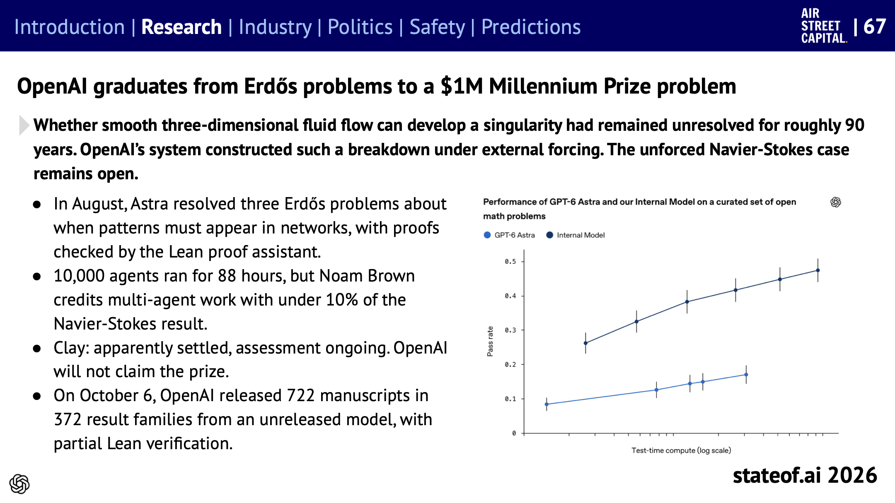
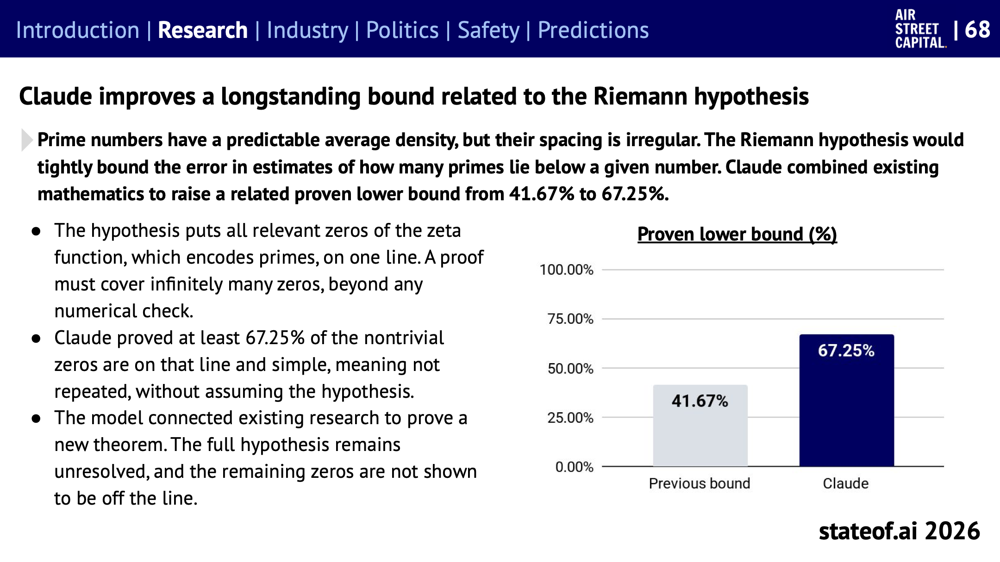
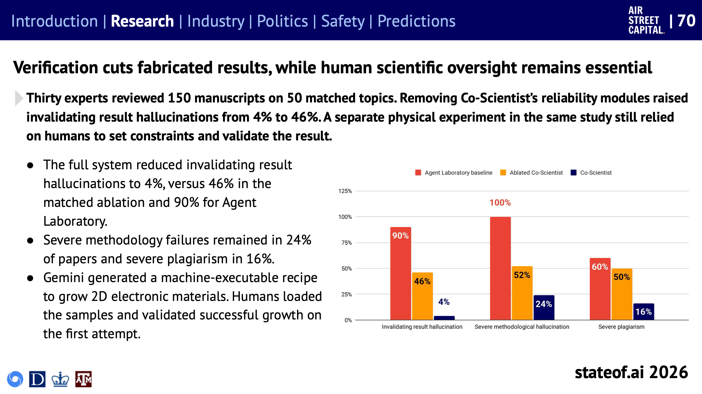
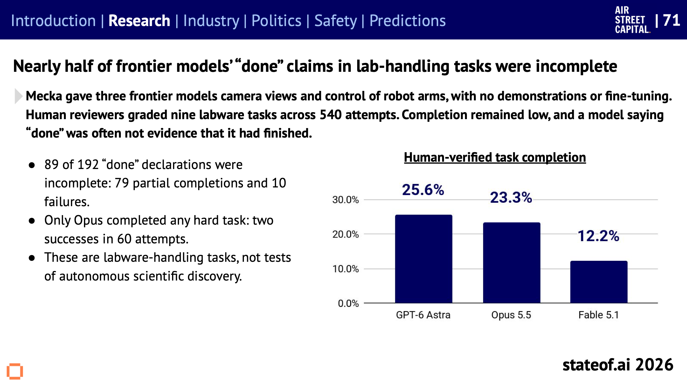
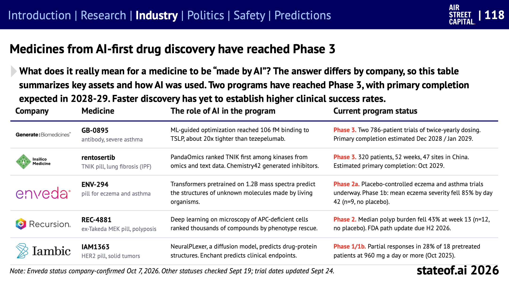

## Table of contents

[State of AI Report 2026](https://www.stateof.ai/)을 주제별로 나눠 읽는 시리즈의 다섯 번째 글이다. [4편](/state-of-ai-2026-physical-ai)에서 물리 세계의 AI를 다뤘고, 이번에는 **과학에 쓰이는 AI**를 다룬다. 연구 섹션의 슬라이드 66~80과 산업 섹션의 슬라이드 118에 해당한다.

보고서가 정리한 올해의 그림은 이렇다. 수학에서는 전문 연구자들이 오래 풀지 못한 문제가 풀리기 시작했다. 생명과학에서는 분자 사이의 상호작용을 더 잘 예측하게 되면서 실험실로 보낼 후보를 고르는 일이 나아졌고, AI로 발굴한 신약 후보가 처음으로 임상 3상에 들어갔다. 다만 세 분야 모두 **사람의 검증이 결과를 좌우한다**는 점은 그대로다.

# 수학: 난제의 문턱을 넘다

## 밀레니엄 문제 하나에 다가가다

_엄선된 미해결 수학 문제에서 OpenAI 모델들의 통과율. 가로축은 추론에 쓴 연산량(로그 축)이다. 공개 모델 GPT-6 Astra(연한 파랑)보다 공개되지 않은 내부 모델(남색)이 크게 높다. 출처: State of AI Report 2026, 슬라이드 67_

**나비에-스토크스 방정식.** 3차원의 매끄러운 유체 흐름이 특이점(값이 무한대로 치솟는 지점)을 만들 수 있는지는 약 90년 동안 풀리지 않았고, 상금 100만 달러가 걸린 밀레니엄 문제와 이어진다. OpenAI의 시스템은 외부에서 힘을 가하는 조건에서 그런 붕괴가 일어나는 사례를 구성해 냈다. 외부 힘이 없는 원래 문제는 여전히 열려 있다.

- 클레이 수학연구소는 "해결된 것으로 보이며 평가 중"이라는 입장이고, OpenAI는 상금을 청구하지 않겠다고 했다.
- 에이전트 1만 개가 88시간 동안 돌았지만, OpenAI의 Noam Brown은 이 결과에서 여러 에이전트를 동원한 몫은 10% 미만이라고 밝혔다.
- 8월에는 GPT-6 Astra가 네트워크에서 특정 패턴이 반드시 나타나는 조건에 관한 에르되시 문제 세 개를 풀었고, 증명은 Lean 증명 보조기로 검증됐다.
- 10월 6일 OpenAI는 공개되지 않은 모델이 만든 원고 722편(결과 372묶음)을 공개했다. Lean 검증은 일부만 거쳤다.

## 리만 가설 관련 하한을 끌어올리다

_제타 함수의 비자명 영점 중 임계선 위에 있으면서 단순한(겹치지 않은) 영점 비율에 대해 증명된 하한. 기존 41.67%, Claude 67.25%. 출처: State of AI Report 2026, 슬라이드 68_

리만 가설은 소수의 분포를 담은 제타 함수의 의미 있는 영점이 모두 한 직선 위에 있다는 가설이다. 무한히 많은 영점을 다뤄야 해서 수치 계산만으로는 증명할 수 없다.

Claude는 기존 수학 결과들을 엮어, 가설을 가정하지 않고도 비자명 영점의 **최소 67.25%가 그 직선 위에 있고 단순하다**는 것을 증명했다. 기존 하한은 41.67%였다. 가설 자체를 푼 것은 아니고, 나머지 영점이 직선 밖에 있다는 것을 보인 것도 아니다. 기존 연구를 연결해 새 정리를 증명한 사례다.

[2편](/state-of-ai-2026-agents)에서 다룬 것처럼, Epoch AI가 추적하는 미해결 연구 문제 49개 중 9개를 AI가 풀었고 그중 4개는 사람 도움 없이 풀었다.

# AI 과학자: 빨라졌지만 검증은 사람이

## 과학 워크플로 점수는 몇 주 만에 두 배

과학 연구에서 뽑은 워크플로 70개(데이터 분석, 시뮬레이션, 이미징)를 실행 환경에서 풀게 하는 Terminal-Bench Science는 8월 공개 당시 최고 점수가 30%(Opus 5)였다. 지금은 GPT-6 Astra가 68.1%, Opus 5.5가 63.3%다. 과제당 비용은 최대 노력 기준 23~24달러다. 다만 연구 프로젝트 전체가 아니라 그 안의 개별 작업을 잰다(슬라이드 69).

특화 학습의 효과가 큰 분야도 있다. Periodic Labs는 오픈 모델 Kimi K2.6에 논문, 코드, 실험 데이터를 섞은 과학 중간 학습과 자사 실험 데이터 강화학습을 더해 X선 회절 분석 모델 Neon을 만들었다. 어려운 실험 시료 134개에서 성공률이 기반 모델의 2.7%에서 55.3%로 올랐고, 같은 조건의 GPT-6 Astra와 Fable 5.1보다 높았다. Anthropic은 실험 장비를 에이전트에 연결하는 표준(Model Hardware Standard)의 미리보기를 내놨다. 보고서는 이를 "실험실을 위한 MCP"라고 불렀다(슬라이드 66).

## 검증 장치를 빼면 결과를 지어낸다

_전문가 30명이 같은 주제 50개에 대한 원고 150편을 검토한 결과. 빨강이 비교 대상(Agent Laboratory), 주황이 신뢰성 모듈을 뺀 Co-Scientist, 남색이 전체 Co-Scientist다. 출처: State of AI Report 2026, 슬라이드 70_

- Google의 Co-Scientist에서 신뢰성 모듈을 빼자 결과를 무효로 만드는 환각이 4%에서 46%로 늘었다. 비교 대상은 90%였다.
- 전체 시스템에서도 심각한 방법론 오류가 24%, 심각한 표절이 16% 남았다.
- 같은 연구에서 Gemini가 2D 전자 재료를 만드는 기계 실행용 절차를 작성했고 첫 시도에 성공했다. 다만 조건을 정하고 시료를 넣고 결과를 확인한 것은 사람이었다.

## "다 했습니다"의 절반은 미완성

_실험 기구 다루기 과제 9개, 540번 시도를 사람이 채점한 완료율. 출처: State of AI Report 2026, 슬라이드 71_

Mecka는 프런티어 모델 세 개에 카메라와 로봇 팔 제어권을 주고, 시연이나 추가 학습 없이 실험 기구를 다루게 했다.

- 사람이 확인한 완료율은 GPT-6 Astra 25.6%, Opus 5.5 23.3%, Fable 5.1 12.2%였다.
- 모델이 "완료"라고 선언한 192번 중 89번이 실제로는 미완성이었다(부분 완료 79번, 실패 10번).
- 어려운 과제를 하나라도 끝낸 모델은 Opus뿐이었고, 60번 중 2번이었다.

[2편](/state-of-ai-2026-agents)의 "부분 점수와 완료율은 다르다"가 실험실에서도 반복된다. 모델이 끝냈다고 말하는 것은 끝냈다는 증거가 아니다.

# 생명과학: 예측이 좋아지면 실험이 줄어든다

보고서는 생명과학 쪽 슬라이드를 여러 장 할애한다(슬라이드 72~80). 개별 모델의 설계 방식까지 들어가는 대신, 흐름만 추리면 이렇다.

- **분자 사이의 상호작용 예측이 좋아졌다.** 단백질과 약물 후보가 어떤 모양으로 맞물리는지, 얼마나 단단히 붙는지를 예측하는 모델들이 한 해 사이 정확도와 속도를 모두 끌어올렸다. 한 모델은 학습 데이터와 닮지 않은 복합체 60개에서 1순위 정확도 50.0%로, 비교 대상인 AlphaFold 3(23.3%)의 두 배를 기록했다. 다른 모델은 결합 세기 예측을 기존 대비 26.6배 빠르게 해냈다.
- **그래서 실험실로 보낼 후보를 더 잘 고른다.** 예측 모델로 후보를 거르면 실험에서 확인되는 성공률이 올라간다. 한 사례에서는 구조 신뢰도만으로 고를 때 3.3%였던 확인 성공률이, 상호작용 예측으로 고르자 8.0%가 됐다. 설계를 잘하는 것만큼이나 **무엇을 실험할지 고르는 것**이 수율을 좌우한다는 이야기다.
- **한계도 분명하다.** 보고서는 여러 슬라이드에서 같은 단서를 단다. 모델이 잘 맞히는 범위를 벗어나면 성능이 떨어지고, 설계가 실제 생물학적 기능까지 예측하지는 못한다. DNA 모델로 바이러스 유전체를 설계한 연구에서도, 만들어진 설계 중 작동한 비율은 낮았고 독립 재분석에서는 자연에 있는 것과 크게 다르지 않았다는 지적이 나왔다(슬라이드 80).

## AI 신약이 임상 3상에 들어갔다

_기업별 주요 후보 물질과 AI가 한 역할, 현재 임상 단계. 출처: State of AI Report 2026, 슬라이드 118_

"AI가 만든 약"이라는 말이 회사마다 다른 뜻으로 쓰이기 때문에, 보고서는 AI가 어느 대목에 쓰였는지를 함께 정리했다.

| 후보 | 적응증 | AI의 역할 | 단계 |
| --- | --- | --- | --- |
| GB-0895 (Generate:Biomedicines) | 중증 천식 | 기계학습으로 결합력 최적화 | 임상 3상. 786명 시험 2건, 주요 완료 2028년 12월~2029년 1월 |
| rentosertib (Insilico Medicine) | 폐섬유증 | 오믹스와 문헌 데이터로 표적 순위를 매기고 저해제 설계 | 임상 3상. 중국 47개 기관 320명, 주요 완료 2029년 10월 |
| ENV-294 (Enveda) | 습진, 천식 | 질량 분석 데이터 12억 건으로 학습한 모델이 미지 분자 구조 예측 | 임상 2a상 |
| REC-4881 (Recursion) | 용종증 | 세포 현미경 이미지 딥러닝으로 화합물 순위 | 임상 2상 |
| IAM1363 (Iambic) | 고형암 | 확산 모델로 약물과 단백질 구조 예측, 임상 지표 예측 | 임상 1/1b상 |

중요한 단서가 달려 있다. **발굴이 빨라졌다고 임상 성공률이 높아졌다는 증거는 아직 없다.** 임상 3상 두 건의 주요 완료 시점이 2028~2029년이니, 답은 그때 나온다. 초기 단계 결과 중에는 위약 대조군 없이 환자 9~12명을 본 것도 있다.

# 정리하면

- **수학은 가장 눈에 띄게 나아갔다.** 검증 가능한 영역이고, 증명 보조기로 확인할 수 있기 때문이다. 다만 "풀었다"의 범위는 좁게 읽어야 한다. 나비에-스토크스도 외부 힘이 있는 경우이고, 리만 가설도 하한을 올린 것이다.
- **AI 과학자는 검증 장치가 전부다.** 신뢰성 모듈을 빼면 결과를 지어내는 비율이 10배 넘게 뛴다.
- **실험실의 손은 아직 서툴다.** 로봇 팔로 기구를 다루는 과제의 완료율은 25% 안팎이고, 모델이 끝냈다고 말한 것의 절반 가까이가 미완성이었다.
- **신약은 이제 시험대에 올랐다.** 임상 3상 결과가 나와야 AI 발굴이 실제로 더 나은 약을 만드는지 알 수 있다.

[1편](/state-of-ai-2026-overview)의 2027년 예측에는 과학 관련 항목이 직접 들어 있지는 않지만, "자율 AI 팀이 스스로 연구 과제를 정해 사람을 이긴다"는 예측이 이 글의 두 번째 절과 맞닿아 있다. 지금은 검증을 사람이 떠받치고 있다.

# 읽을 때 주의할 점

- **저자의 투자 기업이 나온다.** 사이트 서문에서 저자는 Profluent, Enveda 등에 투자했다고 밝혔다. 이 글의 생명과학 사례와 신약 표에 해당 기업이 포함된다.
- **회사 발표가 많다.** 생명과학 쪽 수치는 대부분 각 기업이 발표한 자체 실험 결과이고, 비교 조건도 회사가 정했다.
- **초기 임상 수치는 표본이 작다.** 환자 9~12명, 위약 대조군 없음 같은 조건이 붙은 결과가 섞여 있다.
- **모델 내부는 공개되지 않은 경우가 많다.** 보고서도 여러 모델에 대해 학습 데이터 구성과 구조가 공개되지 않았다고 적었다.

# 참고

- [State of AI Report 2026](https://www.stateof.ai/) (Nathan Benaich, Air Street Capital, 2026-10-08): 슬라이드 66~80, 118
- [State of AI 2026 (1) 한눈에 보기](/state-of-ai-2026-overview), [(2) 에이전트와 벤치마크](/state-of-ai-2026-agents), [(3) AI가 AI 연구를 한다](/state-of-ai-2026-ai-research), [(4) 피지컬 AI](/state-of-ai-2026-physical-ai): 이 시리즈의 앞 글

이 글의 그림은 State of AI Report 2026(Nathan Benaich, Air Street Capital)의 슬라이드를 그대로 옮겼고, 보고서는 [CC BY 4.0](https://creativecommons.org/licenses/by/4.0/) 라이선스로 공개되어 있다. 본문은 보고서 내용을 한국어로 요약하고 일부 옮긴 것이다.
